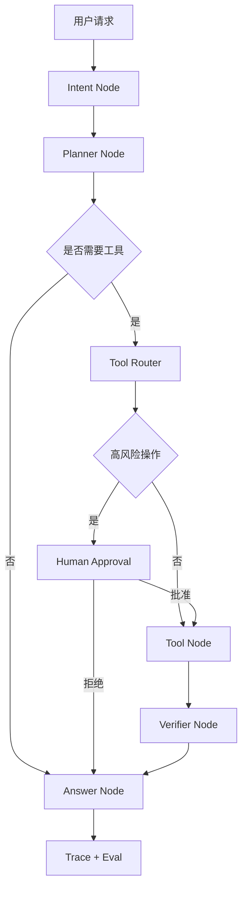

# LangGraph 生产级 Agent 编排

> [!abstract] 一句话总结
> LangGraph 使用图组织 Agent 的状态和步骤，可以结合检查点实现恢复，并在需要时暂停等待人工处理。

> [!info] 本节定位
> 本章第 7 课。[[03-ReAct-Spring-AI实现]]、[[04-Plan-and-Execute-实现]]、[[06-Multi-Agent-Supervisor实现]] 讲的是单 Agent 与多 Agent 的**模式**；本篇补生产级**编排**：状态、检查点、人工介入与可观测。延伸见 [[08-OpenAI-Agents-SDK与Handoffs-Guardrails]] 与 [[18-Agent可观测]]。

## 🎯 为什么要学

当 Agent 执行多步业务流程时，可以考虑用图组织状态，在合适的节点保存检查点并等待审批。能否恢复、保留多久以及观察到哪些信息取决于存储、配置和业务实现；trace 有助于排查，但不保证外部服务结果可以完全重放。

## 🧩 核心概念

| 能力 | 解决的问题 | 怎么理解 |
| ---- | ---------- | -------- |
| StateGraph | Agent 每一步读写统一状态 | 把对话、计划、工具结果、审批状态都放进状态对象 |
| Node | 一个可执行步骤 | LLM 调用、工具调用、检索、校验、人工审批都可以是节点 |
| Edge / Conditional Edge | 决定下一步走向 | 用结构化路由代替模型自由发挥 |
| Checkpoint | 记录执行状态 | 配置合适的存储后，可按流程标识恢复 |
| Human-in-the-loop | 人工介入 | 高风险写操作先暂停，审批后继续 |
| Streaming | 输出过程信息 | 按配置向调用方提供节点、消息或其他事件 |

## 🗣️ 从暂停到恢复

例如生成退款建议后，系统保存订单、金额和审批状态并暂停；审批通过后恢复后续执行，拒绝则结束。恢复前仍需再次校验订单状态和权限，退款接口也要设计幂等，避免检查点恢复或请求重试造成重复退款。
以任务 `T001` 为例，一次暂停和恢复可以这样理解：
1. 图运行到审批节点，将待确认的订单和金额写入状态并暂停；调用方将任务标识与审批请求关联。
2. 人工批准后，调用方使用同一个 `thread_id` 找回检查点，并把审批结果交给图继续执行。
3. 恢复后重新校验订单与权限，再调用退款服务；退款服务使用幂等键避免重复处理。

这要求配置可用的 checkpointer；需要跨进程重启恢复时，还需要选择能持久化的存储。内存检查点适合演示，不能保证进程退出后仍能找回状态。`thread_id` 是流程标识，不等于用户授权，应用应限制谁能读取和恢复该任务。

> [!warning] 恢复不等于从暂停行的下一行继续
> LangGraph 的 `interrupt` 恢复时会从该节点开头重新执行，暂停前的代码也会再运行。写数据库、发请求等副作用应放到合适的独立节点，并设计幂等；检查点不会自动回滚外部服务。

## ☕ Java 后端怎么理解

从状态机与工作流编排引擎的视角理解 LangGraph 的核心概念：
- `State` 类似流程实例上下文。
- `Node` 类似流程节点或 Spring Service 方法。
- `Edge` 类似状态机流转条件。
- `Checkpoint` 类似流程实例持久化。
- `Human-in-the-loop` 类似审批节点。

Java 项目可以先理解它的状态与恢复机制。你可以用 Spring Boot 自己实现状态机，也可以让 Python/TS Agent 服务承担编排，Java 保持业务权限和工具执行。

## 🏗️ 典型架构

## ✅ 适用场景

- 多步骤业务流程：报销审核、客服工单、数据分析、代码修复。
- 需要人工审批：退款、发券、改订单、发外部通知。
- 需要断点恢复：任务跑几分钟甚至几十分钟，不能失败就重来。
- 多 Agent 协作：研究、规划、执行、审核分角色。
- 需要长期状态：用户目标、任务进度、工具执行历史。

## ⚠️ 需要谨慎的场景

- 简单问答：普通 ChatClient + RAG 足够。
- 固定流程且规则明确：普通后端工作流更稳定。
- 强事务核心链路：不要让 LLM 决定账务、库存、权限。

## 🔗 与现有笔记的关系

- [[03-ReAct-Spring-AI实现]] 讲单 Agent 如何思考和行动。
- [[04-Plan-and-Execute-实现]] 讲先计划再执行。
- [[06-Multi-Agent-Supervisor实现]] 讲多 Agent 角色分工。
- 本文补的是生产级编排：状态、恢复、人工介入、可观测。
- 本章索引：[[_index]]
- 上级：[[../00-总览/学习仪表盘]]

## ❓ 面试问题

> [!question]- LangGraph 如何帮助管理多步骤 Agent？
> 它可以把每一步建模为节点，用状态和边组织流转，并借助检查点记录执行进度。需要人工确认时可以暂停和恢复；权限校验、外部操作的幂等与补偿仍需应用自己实现。

## ✅ 学习检查

- [ ] 能解释什么情况下图编排比简单链式调用更合适。
- [ ] 能画出一个包含 Planner、Tool、Verifier、Human Approval 的流程图。
- [ ] 能说清哪些节点应该由 LLM 决策，哪些必须由代码判断。
- [ ] 能设计 checkpoint 和失败恢复策略。

## 📚 参考资料

- [LangGraph 官方文档：Overview](https://docs.langchain.com/oss/python/langgraph/overview)
- [LangGraph 官方文档：Durable execution](https://docs.langchain.com/oss/python/langgraph/durable-execution)
- [LangGraph 官方文档：Human-in-the-loop](https://docs.langchain.com/oss/python/langgraph/human-in-the-loop)
- [LangGraph 官方文档：Interrupts](https://docs.langchain.com/oss/python/langgraph/interrupts)
