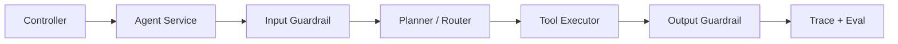

# OpenAI Agents SDK 与 Handoffs Guardrails

> [!abstract] 一句话总结
> OpenAI Agents SDK 提供工具调用、多 Agent 交接、护栏和追踪等能力，可用于组织和检查 Agent 的执行流程。

> [!info] 本节定位
> 本章第 8 课，与 [[06-Multi-Agent-Supervisor实现]]、[[07-LangGraph生产级Agent编排]] 互补：前两篇讲多 Agent 分工与状态编排，本篇以 OpenAI Agents SDK 为例看 **Handoff 交接 + Guardrail 护栏 + Tracing** 的产品化设计，并给出 Java 侧的落地对照。

## 🎯 为什么要学

Agents SDK 用几个组件组织多步骤任务，先分清它们的作用：
- **Agent**：带 instructions、tools、handoffs 的执行单元。
- **Tool**：模型可调用的函数或外部能力。
- **Handoff**：当前 Agent 把任务交给另一个专业 Agent。
- **Guardrail**：输入或输出护栏，用来阻断风险请求或不合规结果。
- **Tracing**：按配置记录模型、工具、交接、异常和耗时，具体可见内容取决于实现和脱敏策略。

## 🔀 Handoffs 的工程意义

Handoff 表示把后续处理交给另一个 Agent；Agent-as-Tool 则是把子 Agent 当作工具调用，子 Agent 返回结果后由主 Agent 继续处理。两者的主要区别是后续由谁继续负责对话。

| 场景 | 主 Agent | 被交接 Agent |
| ---- | -------- | ------------ |
| 智能客服 | 意图分流 | 售后、发票、技术支持 |
| 数据分析 | 需求澄清 | SQL Agent、图表 Agent |
| 代码助手 | 总控规划 | 测试修复 Agent、文档 Agent |
| 企业知识库 | 问题理解 | 检索 Agent、合规审核 Agent |

## 🗣️ 交接和子调用有什么区别？

用户问“发票抬头怎么修改？”分流 Agent 可以把后续对话交给发票 Agent，让它继续处理；如果只是需要发票 Agent 查一次资料，也可以把它当工具调用，返回结果后由分流 Agent 继续回答。
交接时目标 Agent 可能看到之前的对话，应按实际运行模式选择可用的历史过滤方式，并检查摘要、普通消息中是否也包含敏感信息。两种方式都要控制子 Agent 的工具权限；会话交接不等于授权发票修改，实际写操作仍由业务服务验证。

## 🛡️ Guardrails 的工程意义

护栏可以在不同位置检查输入、输出和工具调用：
- **输入护栏（Input Guardrails）**：按规则检查用户输入，例如识别敏感信息或不允许的请求。
- **输出护栏（Output Guardrails）**：检查最终回答是否符合结构和内容要求。
- **工具护栏（Tool Guardrails）**：在受支持的函数工具执行前后检查参数或结果。

在 Python 版 Agents SDK 中，输入护栏作用于任务链路的入口 Agent，输出护栏作用于生成最终响应的 Agent。输入护栏默认与 Agent 并行运行，检查失败时工具可能已经开始执行；如果必须等检查通过后再开始，应配置阻塞模式 `run_in_parallel=False`。

> [!warning] 工具护栏有适用范围
> 当前 Python SDK 的工具护栏针对受支持的函数工具执行，并不拦截 Handoff 本身，也不覆盖所有托管工具。具体能力随版本变化，使用前查阅[官方工具护栏说明](https://openai.github.io/openai-agents-python/guardrails/#tool-guardrails)。业务服务仍需独立鉴权，高风险操作按业务策略审批。

## ☕ Java 后端怎么落地

即使项目不用 OpenAI Python SDK，也可以吸收这个架构：

Java 里建议这样分层：
- `AgentOrchestrator`：负责路由和步骤控制。
- `GuardrailService`：输入输出校验、敏感词、注入检测。
- `ToolExecutor`：统一工具执行入口，做权限、限流、审计。
- `TraceService`：按需记录模型、工具、耗时和错误，控制敏感信息及保留期限。

## 🧩 与 Spring AI 的关系

Spring AI 可以在 Java 应用中提供模型和工具调用，再由应用实现相应的路由、检查与追踪；下面是职责上的类比，不代表两个框架的组件能直接互换：
- `ToolCallback` 对应 Tool。
- Advisor / 拦截器对应 Guardrail 和 Trace。
- 自定义状态机对应 Handoff / Workflow。

## ❓ 面试问题

> [!question]- Handoff、Guardrail 和 Tracing 分别解决什么问题？
> Handoff 将任务交给另一个 Agent，Guardrail 在输入、输出或工具调用处执行检查，Tracing 记录执行过程以便排查和评估。具体权限仍由应用和业务服务校验。

## ✅ 学习检查

- [ ] 能解释 Handoff 与普通函数调用的区别。
- [ ] 能说出输入护栏、输出护栏、工具护栏各自拦什么。
- [ ] 能画出 Java 版 Agent SDK 分层。
- [ ] 能说明 trace 如何帮助排查 Agent 的执行问题，以及记录哪些内容需要脱敏。

## 🔗 关联笔记

- [[06-Multi-Agent-Supervisor实现]] —— 多 Agent 分工的另一种实现
- [[07-LangGraph生产级Agent编排]] —— 生产级状态编排与检查点
- [[20-Agent安全与防注入]] —— Guardrail 思想的工程化落地
- [[_index]]
- [[../00-总览/学习仪表盘]]

## 📚 参考资料

- [OpenAI Agents SDK：Quickstart](https://openai.github.io/openai-agents-python/quickstart/)
- [OpenAI Agents SDK：Handoffs](https://openai.github.io/openai-agents-python/handoffs/)
- [OpenAI Agents SDK：Guardrails](https://openai.github.io/openai-agents-python/guardrails/)
- [OpenAI Agents SDK：Tracing](https://openai.github.io/openai-agents-python/tracing/)
- [OpenAI：Guardrails 与人工审批](https://developers.openai.com/api/docs/guides/agents/guardrails-approvals)
