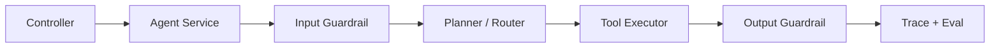

# OpenAI Agents SDK 与 Handoffs Guardrails

> [!abstract] 一句话总结
> OpenAI Agents SDK 把 Agent 的工具调用、多 Agent 交接、护栏和 trace 做成一套轻量工程框架，代表了 2026 年主流 Agent SDK 的设计方向。

## 为什么要学

应用开发岗位越来越少问“怎么调一次模型”，更多问“怎么让 Agent 稳定执行任务”。Agents SDK 里的四个词要背熟：

- **Agent**：带 instructions、tools、handoffs 的执行单元。
- **Tool**：模型可调用的函数或外部能力。
- **Handoff**：当前 Agent 把任务交给另一个专业 Agent。
- **Guardrail**：输入或输出护栏，用来阻断风险请求或不合规结果。
- **Tracing**：完整记录模型、工具、交接、异常和耗时。

## Handoffs 的工程意义

Handoff 不是“多叫几个模型聊天”，而是任务所有权转移。

| 场景 | 主 Agent | 被交接 Agent |
| ---- | -------- | ------------ |
| 智能客服 | 意图分流 | 售后、发票、技术支持 |
| 数据分析 | 需求澄清 | SQL Agent、图表 Agent |
| 代码助手 | 总控规划 | 测试修复 Agent、文档 Agent |
| 企业知识库 | 问题理解 | 检索 Agent、合规审核 Agent |

## Guardrails 的工程意义

Prompt 不是安全边界。护栏要在代码层做：

- 输入护栏：识别越权、注入、敏感数据、违法内容。
- 输出护栏：检查泄露、幻觉、格式错误、危险建议。
- 工具护栏：执行前做权限、额度、幂等和审批。

## Java 后端怎么落地

即使项目不用 OpenAI Python SDK，也可以吸收这个架构：

Java 里建议这样分层：

- `AgentOrchestrator`：负责路由和步骤控制。
- `GuardrailService`：输入输出校验、敏感词、注入检测。
- `ToolExecutor`：统一工具执行入口，做权限、限流、审计。
- `TraceService`：记录 prompt、模型、工具、耗时、错误和用户反馈。

## 与 Spring AI 的关系

Spring AI 更适合作为 Java 侧模型调用和工具调用基础设施；Agents SDK 更适合学习 Agent 产品形态。真正生产系统可以用 Spring AI 实现同样的模式：

- `ToolCallback` 对应 Tool。
- Advisor / 拦截器对应 Guardrail 和 Trace。
- 自定义状态机对应 Handoff / Workflow。

## 面试讲法

> 我会把 Agent 系统拆成执行单元、工具、交接、护栏和追踪五层。Handoff 解决专业 Agent 分工，Guardrail 解决输入输出风险，Tracing 解决线上定位和评估。即使用 Java/Spring AI 落地，也会复用这套设计，而不是只写一个大 prompt。

## 学习检查

- [ ] 能解释 Handoff 与普通函数调用的区别。
- [ ] 能说出输入护栏、输出护栏、工具护栏各自拦什么。
- [ ] 能画出 Java 版 Agent SDK 分层。
- [ ] 能说明为什么 trace 是 Agent 上生产的必要条件。

## 📚 参考资料

- [OpenAI Agents SDK：Quickstart](https://openai.github.io/openai-agents-python/quickstart/)
- [OpenAI Agents SDK：Handoffs](https://openai.github.io/openai-agents-python/handoffs/)
- [OpenAI Agents SDK：Guardrails](https://openai.github.io/openai-agents-python/guardrails/)
- [OpenAI Agents SDK：Tracing](https://openai.github.io/openai-agents-python/tracing/)

