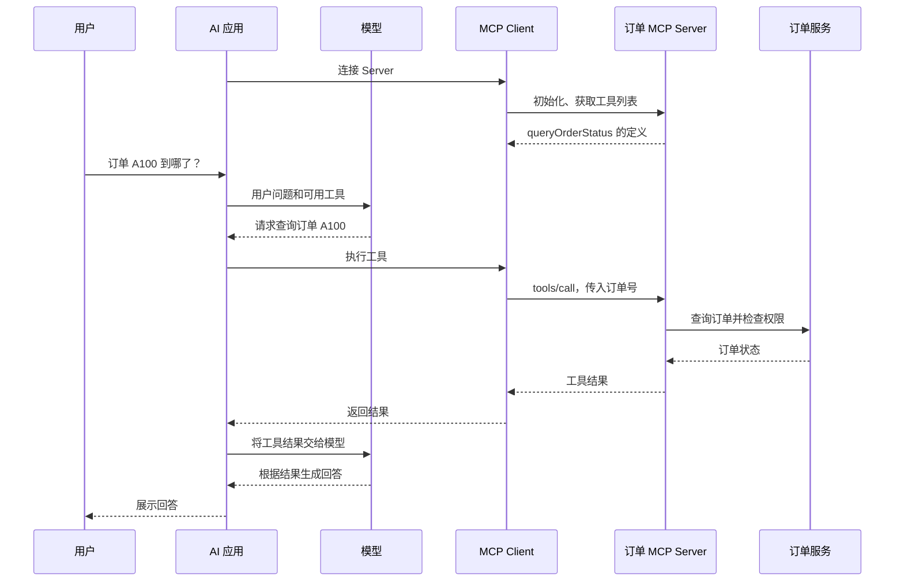

# MCP 协议详解

> [!abstract] 一句话总结
> MCP（Model Context Protocol）是一套让应用发现和使用外部工具、资源与提示模板的协议。它统一连接方式，业务身份、权限和执行结果仍需要应用处理。

## 🎯 先看一个订单查询

用户问“订单 A100 到哪了？”，模型本身不知道实时状态。假设订单系统提供了 MCP Server，并暴露 `queryOrderStatus` 工具，应用就可以先取得工具定义，再让模型决定是否使用。模型提出订单号后，应用通过 MCP Client 调用 Server，Server 查询并返回结果，模型再据此回答。
如果订单系统原本只有内部 API，不同 AI 应用通常需要分别适配调用方式；将它封装成 MCP Server 后，兼容的客户端可以复用同一套能力描述和协议。业务系统仍需要自己完成认证和权限检查。



这是常见的模型工具调用流程，并非 MCP 强制要求必须接入模型：Inspector 也可以作为客户端直接调用工具。图中的订单查询是示意，具体实现见 [[10-MCP-Server开发-Java实战]]。

## 🧩 Host、Client、Server 怎么分工？

| 角色 | 做什么 | 订单例子 |
| ---- | ------ | -------- |
| Host | 承载用户交互，管理模型和 MCP 连接 | 订单客服 AI 应用 |
| Client | 在 Host 中按 MCP 协议连接 Server | 应用中连接订单 Server 的客户端 |
| Server | 按 MCP 协议提供工具、资源或模板 | 暴露订单查询工具的服务 |

Host 可以管理多个 Client，分别连接订单、物流等不同 Server。Server 内部仍然可以调用现有 Java 服务、数据库或 REST API，不需要把原有业务全部重写。

## 🧰 Tools、Resources、Prompts 的区别

Server 可以提供不同类型的能力，具体是否支持要看它的声明和实现：

| 能力 | 用途 | 订单场景 |
| ---- | ---- | -------- |
| Tools | 执行动作，可只读，也可能有副作用 | 调用 `queryOrderStatus` 查询订单 |
| Resources | 按 URI 读取数据，作为上下文 | 读取退货规则或订单说明文档 |
| Prompts | 获取带参数的提示模板 | 获取“根据订单状态组织回复”的模板 |

例如，查询实时状态适合作为 Tool；读取一份退货规则可以用 Resource；统一客服回复格式可以提供 Prompt。它们分别解决“做什么、看什么、怎么开始”，并不是把三种内容都自动当成工具调用。上一节的订单示例只实现 Tool，Resource 和 Prompt 只是帮助理解的例子。
工具通常提供名称、描述和输入 schema，告诉调用方应该传什么；是否提供输出 schema 取决于 Server。工具描述也会影响模型选择，但不能代替服务端参数校验和授权。

## 🔄 从连接到调用

一个常见的 MCP 连接过程如下：
1. 选择 stdio 或 HTTP 等传输方式；远程服务可能先要求认证。
2. Client 发送 `initialize`，与 Server 协商协议版本和能力，再发送初始化完成通知。
3. Client 根据需要调用 `tools/list` 等方法发现能力，获取工具名称与参数 schema。
4. 应用决定向模型提供哪些工具；模型提出调用后，Client 通过 `tools/call` 发起请求。
5. Server 处理业务并返回结果；应用按需要记录日志，连接可以继续复用或关闭。

协议能力声明表示双方支持什么，不代表当前用户已经获得业务权限。工具列表发生变化时，客户端需要按实现刷新；如果双方支持变更通知，也可以结合通知处理。

## 📡 请求和响应长什么样？

MCP 消息使用 JSON-RPC 2.0。下面是一次订单工具调用的示意：`method` 表示协议操作，`name` 是工具名，`arguments` 是工具参数；请求与响应的 `id` 用来对应同一次调用。

```json
{
  "jsonrpc": "2.0",
  "id": 1,
  "method": "tools/call",
  "params": {
    "name": "queryOrderStatus",
    "arguments": { "orderId": "A100" }
  }
}
```

Server 返回的结果可能包含文本或其他协议支持的内容；下面只展示一种文本结果，实际序列化内容以 Server 为准。

```json
{
  "jsonrpc": "2.0",
  "id": 1,
  "result": {
    "content": [{ "type": "text", "text": "订单 A100：配送中" }],
    "isError": false
  }
}
```

别把模型工具调用和 MCP 混为同一层：模型调用中的工具定义和参数，用于让模型提出行动；MCP 负责 Client 与 Server 之间发现能力和交换请求、结果。应用也可以调用本地工具而不使用 MCP。

## 🔌 stdio 和 Streamable HTTP 怎么选？

| 传输方式 | 适合场景 | 需要注意 |
| -------- | -------- | -------- |
| stdio | IDE、本机命令行工具，由客户端启动子进程 | stdout 承载协议消息，日志写 stderr 或文件 |
| Streamable HTTP | 跨进程、跨机器的服务 | 配置地址、认证、超时和网络访问控制 |

Streamable HTTP 可以返回 JSON 响应，也可以在需要时使用 SSE 流；`Mcp-Session-Id` 可用于有状态会话，但断线恢复和横向扩展还取决于实现。早期的 HTTP+SSE 双端点方案与 Streamable HTTP 不是同一套连接配置，接入时要确认客户端和服务端支持的协议版本及传输方式。

## 🔐 认证、授权与错误处理

认证解决“调用方是谁”，授权解决“是否能查这笔订单”。远程 Server 可以结合 OAuth、API Key 或企业网关等方式认证，但仍要在业务层检查用户、租户与资源归属；模型生成的 `userId` 不能作为身份凭据。只暴露必要的工具和返回字段，写操作按业务需要增加幂等、审批和审计。
排错时要区分几类结果：

| 类型 | 例子 | 处理方向 |
| ---- | ---- | -------- |
| 协议错误 | 未知工具、请求格式不符合协议 | 检查工具名和请求，可能返回顶层 `error` |
| 工具执行错误 | 参数校验失败、下游业务失败 | 检查工具结果，可能标记 `isError: true` |
| 认证或权限错误 | 未登录、无权查看订单 | 检查可信身份、scope 和业务授权 |
| 传输错误 | 连接中断、超时、限流 | 检查网络与服务状态，再按幂等性决定重试 |

日志和链路记录可以包含调用方、工具名、耗时、权限判断和错误码，但参数、结果及凭据需要按敏感程度脱敏。外部资源和工具结果也可能包含不可信指令，不能直接让其覆盖系统规则。
共享 Server 时，还需要按租户、用户或高成本工具设置频率、并发和配额，避免某一调用方占用全部资源。出现限流或超时，应返回可理解的错误，并根据操作是否幂等决定能否重试；工具失败不应把内部堆栈或凭据直接返回给模型。

## 🧭 它和 Agent、Skill 有什么关系？

Agent 决定下一步做什么，MCP 提供连接外部能力的协议，Skill 组织可复用的任务指引；固定 Workflow 则按预设步骤执行。三者可以组合，也可以分别使用，并不是接入 MCP 后就自动拥有安全治理或自主决策能力。

## ❓ 自测

> [!question]- MCP 和普通工具调用有什么区别？
> 模型的工具调用让模型提出工具名和参数；MCP 规范客户端如何发现和调用外部能力。工具可以通过 MCP 执行，也可以直接由应用本地执行。

> [!question]- Resources 和 Tools 有什么区别？
> Resource 偏向读取上下文，Tool 偏向执行操作。只读查询也可以设计成 Tool，具体看能力的使用方式。

> [!question]- 连接上 Server 后，为什么还要检查订单权限？
> 连接和认证只说明双方能通信以及调用方身份；能否访问某笔订单，还需要服务端按用户和资源授权。

> [!question]- 为什么建议先用 Inspector 测试？
> Inspector 可以直接检查连接、工具定义和调用结果，不依赖模型，便于先判断问题是否出在 MCP Server。

## 🔗 关联笔记

- [[10-MCP-Server开发-Java实战]] · [[11-MCP-Client开发实战]] · [[12-MCP调试-Inspector]]
- [[01-Agent设计模式详解]] · [[13-Skills详解]] · [[17-Agent-MCP-Skills组合实战]] · [[_index]]

## 📚 参考资料

- [MCP 官方规范](https://modelcontextprotocol.io/specification/)
- [MCP 初始化与生命周期](https://modelcontextprotocol.io/specification/2025-11-25/basic/lifecycle)
- [MCP Tools：输入、输出和错误](https://modelcontextprotocol.io/specification/2025-11-25/server/tools)
- [MCP 传输方式](https://modelcontextprotocol.io/specification/2025-11-25/basic/transports)
- [MCP 授权规范](https://modelcontextprotocol.io/specification/2025-11-25/basic/authorization)
- [Spring AI MCP 文档](https://docs.spring.io/spring-ai/reference/api/mcp/mcp-server-boot-starter-docs.html)
