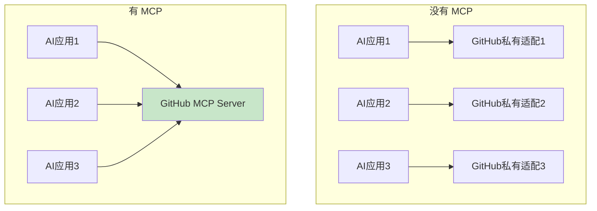
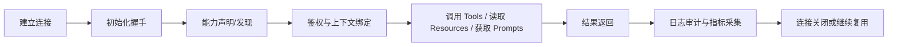
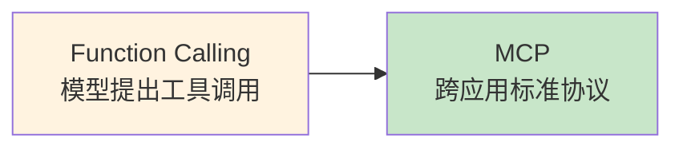

# MCP 协议详解

> [!abstract] 一句话总结
> MCP（Model Context Protocol）是一个让 LLM 以标准方式连接外部工具、资源与提示模板的开放协议。它的重点不只是“能调工具”，而是把 **能力发现、权限、传输、审计、错误处理、可观测** 统一起来。

## 这是什么

MCP 可以理解为 LLM 与外部系统之间的标准化接口层。以前每个 AI 应用要接 GitHub、数据库、工单系统，都得自己写一套工具定义、鉴权、错误处理和交互协议；有了 MCP，Server 只要按协议暴露能力，支持 MCP 的 Host/Client 就能复用。

## MCP 解决的核心问题

### 1. 连接方式不统一

没有 MCP 时：

- 每个 AI 客户端都要重新写工具适配。
- 每个外部系统都要为不同 Agent 框架单独接入。
- Tools、Resources、Prompts 没有统一发现和调用模型。

### 2. 工具治理困难

没有统一协议时，很难标准化地处理：

- 工具发现与能力声明。
- 鉴权与租户隔离。
- 调用审计。
- 错误返回与重试。
- 多客户端复用。

### 3. Agent 边界模糊

很多团队容易把“函数调用”“插件”“远程 API”“MCP”混成一件事。MCP 的价值之一，就是把能力边界讲清楚。



## 架构角色

| 角色 | 说明 | 例子 |
| ---- | ---- | ---- |
| Host | 宿主应用，承载用户交互与模型体验 | Claude Desktop、Cursor、你的 Java Agent 平台 |
| Client | Host 内部的 MCP 协议客户端 | 一个 Host 里连接某个 MCP Server 的连接器 |
| Server | 暴露能力的服务端 | GitHub MCP Server、内部工单 MCP Server |

> [!tip] 一个常见误区
> 很多人说“Claude 是 MCP Client”。更准确地说，**Claude Desktop / IDE 这类 Host 内部包含 MCP Client**，它们再去连 MCP Server。

## 三大原语：Tools / Resources / Prompts

### Tools：让模型“做事”

Tools 是可被模型调用的动作，通常对应函数、API、工作流步骤。

- 可以有副作用，也可以没有。
- 输入输出有明确 schema。
- 适合“执行型能力”。

例子：

- `create_issue`
- `query_order`
- `restart_service`

### Resources：让模型“看数据”

Resources 是可读取的数据对象，更像标准化只读上下文。

- 强调读取，不强调执行。
- 适合文档、配置、数据库快照、日志片段。
- 更像“数据挂载”或“只读 GET 视图”。

例子：

- `file://README.md`
- `db://orders/123`
- `kb://runbooks/payment-retry`

### Prompts：让模型“按模板思考”

Prompts 是可复用提示模板，用来约束任务入口和交互结构。

- 不是外部副作用。
- 不是数据资源本身。
- 更像标准化提示片段或工作模板。

例子：

- “生成代码评审意见”模板
- “根据告警生成故障分析”模板
- “把需求整理成工单”模板

### 边界记忆法

| 原语 | 你可以怎么理解 |
| ---- | ---- |
| Tools | 我能做什么 |
| Resources | 我能看什么 |
| Prompts | 我该怎么开始做 |

> [!note] 面试高频点
> Tools / Resources / Prompts 不是“都能给模型用”这么简单，它们的本质区别在于：**动作、数据、模板** 三种职责分离。

## 协议生命周期

MCP 不只是“发一次请求调个工具”，而是一条完整生命周期。



### 1. 建立连接

根据部署方式选择 stdio 或远程 HTTP 传输。

### 2. 初始化握手

双方确认：

- 协议版本。
- 能力清单。
- 是否支持特定扩展。

### 3. 能力发现

Client 发现 Server 暴露的：

- Tools
- Resources
- Prompts

### 4. 鉴权与上下文绑定

把用户身份、租户上下文、作用域权限绑定到这次会话，而不是依赖模型自己带权限。

### 5. 调用阶段

模型基于当前任务决定：

- 调 Tool。
- 读 Resource。
- 取 Prompt 模板。

### 6. 结果返回

结果可能是：

- 成功返回结构化数据。
- 业务失败。
- 鉴权失败。
- 限流或超时。

### 7. 审计与可观测

平台记录本次调用的 trace、日志、指标与安全事件。

## 传输方式：stdio vs Streamable HTTP

> [!note] 传输协议演进说明
> MCP 规范（如 2025-11-25 版）定义了 **stdio** 与 **Streamable HTTP** 两种标准传输机制。其中 Streamable HTTP 演进自早期（2024-11-05 版）的 `HTTP+SSE` 双端点方案，将客户端通信统一收拢至单一 HTTP 端点，并支持在需要流式通知或分块返回时动态升级为 SSE 流。

### stdio

stdio 是本地进程通信。

适合：

- Claude Desktop 本地插件。
- IDE 内本地工具。
- 单机开发调试。

优点：

- 简单。
- 延迟低。
- 本地开发体验好。

缺点：

- 不适合跨网络。
- 权限边界依赖宿主机环境。
- 部署、升级、隔离能力较弱。

### Streamable HTTP / HTTP

Streamable HTTP 面向远程服务化部署设计，支持通过单一 HTTP 端点承载标准 JSON-RPC 响应或 SSE 流式推送，既可结合 `Mcp-Session-Id` 实现有状态会话管理与断线续传，也可按无状态微服务模式横向扩展。

适合：

- 企业统一工具平台。
- 跨 VPC / 跨网络调用。
- 需要标准鉴权、审计、限流、服务治理的场景。

优点：

- 更适合云上服务化。
- 容易接入 API Gateway、鉴权、中间件、日志系统。
- 更利于多租户与可观测治理。

缺点：

- 需要更完整的网络与安全设计。
- 部署复杂度高于 stdio。

### 怎么选

| 场景 | 推荐 |
| ---- | ---- |
| 本地个人工具、IDE 调试 | stdio |
| 企业内统一远程工具平台 | Streamable HTTP |
| 需要 OAuth、审计、限流、网关治理 | Streamable HTTP |
| 需要离线、本地文件或本地命令直连 | stdio |

> [!tip] 一句话记忆
> **stdio 偏本地集成，Streamable HTTP 偏平台化治理。**

## 通信与协议层

### JSON-RPC 2.0

MCP 的消息层建立在 JSON-RPC 2.0 之上，这意味着它天然具备：

- request / response 对应关系。
- 标准错误对象。
- 方法调用语义。
- 可扩展通知机制。

这使得 MCP 不只是“传一段 JSON”，而是具备标准 RPC 语义，便于调试、追踪和跨语言实现。

一个最小的请求/响应示例（`tools/call`）：

请求（Client → Server）：

```json
{
  "jsonrpc": "2.0",
  "id": 1,
  "method": "tools/call",
  "params": {
    "name": "get_weather",
    "arguments": { "city": "杭州" }
  }
}

```

响应（Server → Client）：

```json
{
  "jsonrpc": "2.0",
  "id": 1,
  "result": {
    "content": [{ "type": "text", "text": "杭州：晴，28℃" }],
    "isError": false
  }
}
```

> [!note] 看懂这三行
> - `id` 用于把请求与响应配对（请求是 1，响应也要回 1）。
> - `method` 是协议方法名（`tools/list`、`tools/call`、`resources/read`、`prompts/get` 等）。
> - **两层错误语义分离**：连接异常、未知方法或非法 JSON 等协议层错误通过顶层 JSON-RPC `error` 字段返回；而工具内部业务逻辑异常、参数校验不通过或下游接口超时等执行期失败，则在 `result` 中返回结构化说明并标记 `isError: true`，以便模型读取错误上下文并决定修正参数或终止调用。

## 鉴权与授权

### 认证解决“你是谁”

远程 MCP Server 通常要做认证，常见方式包括：

- OAuth 2.1 / Bearer Token
- API Key
- mTLS
- 企业 SSO 透传

### 授权解决“你能做什么”

即使连上了 MCP Server，也不代表可以任意调用所有工具。

服务端仍应判断：

- 当前用户可见哪些 Tools / Resources / Prompts。
- 当前租户能访问哪些资源。
- 当前 scope 是否允许高风险动作。
- 是否需要审批或二次确认。

### 关键原则

- 不信任模型传来的 `userId`、`tenantId`、`scope`。
- 权限上下文应由 Host / Gateway 注入。
- Tool 可见性本身就是一种授权结果。

## 限流、配额与多租户

### 限流不只是防刷

MCP Server 要考虑三层限流：

- **租户级**：防止一个大租户抢占资源。
- **用户级**：防止单用户滥用。
- **工具级**：高成本工具单独设额。

### 多租户治理建议

- 按 `tenantId` 绑定鉴权上下文。
- Resource 查询先做租户过滤，再返回给模型。
- Tool 内部不要信任模型生成的租户参数。
- 审计日志必须带租户维度。
- 对共享 Server 做配额隔离与并发隔离。

## 错误处理

### 错误要让三方都能消费

一个好的 MCP 错误返回，至少要同时考虑：

- **模型能理解**：知道该重试、换参数还是放弃。
- **客户端能处理**：能展示友好错误。
- **运维能排障**：能定位是鉴权、业务、网络还是系统问题。

### 可分层的错误类型

| 类型 | 例子 | 建议处理 |
| ---- | ---- | ---- |
| 参数错误 | 缺字段、类型错、枚举非法 | 直接返回可理解的校验信息 |
| 权限错误 | 无权访问订单、无权调用高危工具 | 返回拒绝原因，不暴露敏感细节 |
| 业务错误 | 工单不存在、订单已退款 | 返回业务可理解信息 |
| 资源限制 | 限流、超时、并发超限 | 给出重试建议或退避策略 |
| 系统错误 | 下游挂了、DB 连接失败 | 返回通用错误码，细节进日志 |

### 设计建议

- 对模型展示的是“可操作信息”，不是 Java 堆栈。
- 对日志保留完整错误链。
- 高风险错误单独打安全标签。

## 审计与可观测

### 需要观测什么

MCP 落地后，至少观测这四类信息：

#### 1. Trace

串起完整链路：

- 用户请求
- Host 推理
- MCP Tool 调用
- 下游系统调用
- 最终结果

#### 2. 日志

至少记录：

- `traceId`
- `sessionId`
- `tenantId`
- `toolName`
- 参数摘要
- 权限判断结果
- 错误码

#### 3. 指标

核心指标示例：

- Tool 调用次数
- 调用成功率
- P95 / P99 延迟
- 限流命中率
- 权限拒绝率
- 各租户资源占用

#### 4. 安全事件

例如：

- 非法租户访问尝试。
- 高频失败调用。
- 高风险工具审批拒绝。
- 敏感资源读取峰值异常。

> [!tip] 面试可这样说
> 我会把 MCP Server 当成“带 AI 流量特征的 API 网关后端”来治理，而不是把它当成普通插件。

## 代码实践（Spring AI）

### MCP Server：暴露 Tool

```java
@Service
public class OrderTools {

    @Tool(description = "根据订单号查询订单详情")
    public Order queryOrder(@ToolParam(description = "订单号") String orderId) {
        return orderService.findById(orderId);
    }
}
```

### MCP Client：消费 Tool

```java
ChatClient chatClient = ChatClient.builder(chatModel)
    .defaultTools(mcpToolCallbackProvider.getToolCallbacks())
    .build();
```

> [!note] 落地时别只停留在“能跑通”
> 真正上线还要补鉴权、日志、限流、超时、重试、租户隔离，而不是只写一个 `@Tool` 就结束。

## Function Calling 与 MCP 的关系



| 维度 | Function Calling | MCP |
| ---- | ---------------- | --- |
| 范围 | 单应用内 | 跨应用通用 |
| 形式 | 框架或 SDK 内工具定义 | 标准协议 |
| 复用 | 不易跨客户端复用 | 多 Host / Client 可复用 |
| 治理 | 更偏业务内实现 | 更偏平台化能力暴露 |

> [!tip] 本质关系
> MCP 不是取代 Function Calling，而是把“工具暴露与消费”标准化。很多 MCP Server 内部仍然是普通函数或 HTTP API。

## 与 Agent / Skill / Workflow 的边界

| 概念 | 关注点 | 解决的问题 |
| ---- | ---- | ---- |
| Workflow | 流程编排 | 固定步骤怎么走 |
| Agent | 动态决策 | 何时做、做什么、调用什么 |
| Skill | 任务经验/模板 | 这类事情通常怎么做 |
| MCP | 能力连接协议 | 外部工具和资源怎么标准化接入 |

一句话区分：

- Workflow 管流程。
- Agent 管决策。
- Skill 管经验。
- MCP 管连接。

## 企业落地常见模式

### 模式一：本地开发助手

- Host：IDE / Claude Desktop
- 传输：stdio
- 适合：本地代码、文件、命令工具

### 模式二：企业统一工具平台

- Host：内部 Agent 平台
- 传输：Streamable HTTP
- 适合：工单、CRM、订单、审批、报表等系统统一接入

### 模式三：治理型 Agent 平台

- Host 上层有 Workflow / Policy / Audit
- MCP Server 只负责标准暴露能力
- 适合：多租户、合规、审计要求强的场景

## 常见踩坑

- [ ] 把 MCP 当成“万能插件框架”，忽略鉴权和审计。
- [ ] Resources 没做租户过滤，直接暴露全量数据。
- [ ] Tool 描述过于模糊，导致模型不会调或调错。
- [ ] stdio 方案直接用于企业远程生产环境，缺少统一治理。
- [ ] 只做 happy path，不做限流、超时、降级和错误分层。
- [ ] 在文档里堆很多无来源生态数字，结果过时且不可信。

## 面试问题

> [!question] 高频问题
> - **Q: MCP 解决了什么问题？**
>   - A: 它统一了 LLM 连接外部工具、资源和提示模板的协议，降低多客户端重复集成成本。
> - **Q: MCP 三大原语是什么？**
>   - A: Tools、Resources、Prompts，分别对应动作、数据、模板。
> - **Q: stdio 和 Streamable HTTP 怎么选？**
>   - A: 本地开发和 IDE 集成用 stdio；企业远程平台化治理更适合 Streamable HTTP。
> - **Q: MCP 和 Function Calling 的区别？**
>   - A: Function Calling 定义模型如何提出工具名和参数，执行器可以调用本地或远程能力；MCP 规范 Host/Client 与能力服务的发现和通信，两者可组合。
> - **Q: MCP Server 上线重点看什么？**
>   - A: 鉴权、租户隔离、限流、错误处理、审计和可观测。
>
> [!question] 进阶追问
> - **Q: Resources 和 Tools 最大区别是什么？**
>   - A: Resources 更偏只读上下文，Tools 更偏可执行动作。
> - **Q: MCP 里权限应该放哪一层？**
>   - A: 放 Server / Gateway，不放模型提示词。
> - **Q: 企业为什么不直接让 Agent 调内部 API？**
>   - A: 可以，但 MCP 提供了标准化发现、复用和治理接口，更适合多客户端生态。

## 关联笔记

- [[01-Agent设计模式详解]] —— MCP 是 Agent 连接外部能力的协议层
- [[13-Skills详解]] —— Skill 偏经验模板，MCP 偏能力连接
- [[17-Agent-MCP-Skills组合实战]] —— 三者如何协同
- [[_index]]

## 📚 参考资料

- [MCP 官方规范](https://modelcontextprotocol.io/)
- [MCP 官方 Authorization 规范](https://modelcontextprotocol.io/specification/2025-11-25/basic/authorization)
- [MCP 官方 Transport 文档](https://modelcontextprotocol.io/specification/2025-11-25/basic/transports)
- [Spring AI MCP 文档](https://docs.spring.io/spring-ai/reference/)
