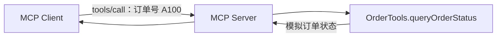

# MCP Server 开发：Java 实战

> [!abstract] 一句话总结
> MCP Server 把已有业务能力注册成客户端可以发现和调用的工具。本篇先用模拟订单数据跑通服务，再说明接入真实业务时要补哪些检查。

## 🎯 先看要做什么

假设用户问“订单 A100 到哪了？”，我们希望 Server 暴露一个 `queryOrderStatus` 工具，接收订单号并返回状态。客户端可以先读取工具名、描述和参数格式，再发送调用请求；Server 收到请求后执行 Java 方法并返回结果。
这里先只做一个本地只读示例，不接数据库、不接模型，也不包含用户认证。下文的“配送中”是模拟结果，只用于说明调用链。



## 🧩 准备项目

下面按 Spring AI 2.x 的 WebMVC 接口说明。准备一个兼容版本的 Spring Boot 项目，并使用 Spring AI BOM 管理版本；项目搭建和 BOM 配置见 [[../02-框架-SpringAI与LangChain4j/SpringAI/01-Spring-AI项目搭建|Spring AI 项目搭建]]。添加 MCP Server Starter：

```xml
<dependency>
    <groupId>org.springframework.ai</groupId>
    <artifactId>spring-ai-starter-mcp-server-webmvc</artifactId>
</dependency>
```

Starter 负责 MCP 协议和 HTTP 传输；`@Tool` 描述 Java 方法，还需要把方法注册为工具。以下代码省略 imports，假设类都在 Spring Boot 的组件扫描范围内；示例尚未在本机运行。
使用自定义 Java 编译配置时，要保留方法参数名，例如启用 `-parameters`，以便生成包含 `orderId` 的工具 schema。

## 💻 定义并注册订单工具

先定义一个返回模拟状态的 Spring Bean。`name` 是客户端看到的工具名，`description` 和 `@ToolParam` 帮助客户端理解用途及参数。

```java
@Service
class OrderTools {

    @Tool(name = "queryOrderStatus", description = "根据业务订单号查询订单状态")
    public String queryOrderStatus(
            @ToolParam(description = "业务订单号，例如 A100") String orderId) {
        if (orderId == null || orderId.isBlank()) {
            return "订单号不能为空";
        }
        return "A100".equals(orderId) ? "订单 A100：配送中" : "订单不存在";
    }
}
```

再把 Bean 转换为 `ToolCallbackProvider`，由 Starter 注册到 MCP Server：

```java
@Configuration
class McpToolConfig {

    @Bean
    ToolCallbackProvider orderTools(OrderTools tools) {
        return MethodToolCallbackProvider.builder().toolObjects(tools).build();
    }
}
```

`@Tool` 本身只是工具定义，`ToolCallbackProvider` 负责提供这些工具，MCP Starter 再把它们发布给客户端。只有方法而没有对应注册时，不能假设 `tools/list` 一定能看到它。

## 🔌 配置传输并启动

在 `application.yml` 中选择 Streamable HTTP，并把示例限制在本机访问：

```yaml
server:
  address: 127.0.0.1
  port: 8080
spring:
  ai:
    mcp:
      server:
        name: order-mcp-server
        protocol: STREAMABLE
        streamable-http:
          mcp-endpoint: /mcp
```

在 Maven 项目根目录启动 Spring Boot：

```bash
mvn spring-boot:run
```

启动后 MCP 地址是 `http://127.0.0.1:8080/mcp`。这是 MCP 协议端点，不是普通的订单 REST 接口；使用 MCP Client 或 [[12-MCP调试-Inspector|Inspector]] 测试，不要以浏览器直接打开后是否显示页面判断服务是否正常。配置项和 Starter 名称可能随 Spring AI 版本变化，使用时对照[官方文档](https://docs.spring.io/spring-ai/reference/api/mcp/mcp-streamable-http-server-boot-starter-docs.html)。

## 🧪 怎么验证？

用 Inspector 连接上述地址，在 Tools 中找到 `queryOrderStatus`，检查参数 `orderId`，再提交：

```json
{ "orderId": "A100" }
```

预期返回内容包含“配送中”；换成其他订单号应看到“订单不存在”。再试空值和缺失参数，观察客户端 schema 校验以及服务端实际返回；具体操作见 [[12-MCP调试-Inspector]]。验证通过后，再用 [[11-MCP-Client开发实战|Spring AI Client]] 接入模型。

## 🔐 接入真实订单服务时

模拟示例没有认证，不能直接对外开放。真实服务需要先验证调用方身份，再由订单服务检查用户、租户和订单归属；不要相信模型传入的 `userId`。工具尽量只返回查询需要的字段，记录脱敏后的调用、耗时与错误。
网络访问还要配置 TLS、认证、超时与限流。本机绑定地址只限制监听范围，不等于完成鉴权；写操作还要按业务需要处理幂等、审批和状态变化。

## ❓ 自测

> [!question]- 为什么写了 `@Tool`，Inspector 里还是看不到工具？
> 检查 Bean 是否被扫描、是否通过 `ToolCallbackProvider` 注册，以及 MCP Server 的 Starter 和传输配置是否生效。只写注解不等于已经发布 MCP 服务。

> [!question]- MCP Server 和普通 REST API 有什么区别？
> MCP 规定客户端发现和调用工具、资源、提示模板的协议；REST API 通常按业务接口自行约定。MCP Server 内部仍然可以调用现有 REST 服务或领域服务。

> [!question]- 为什么订单工具不直接接收模型给出的 userId？
> 模型生成的参数不能证明身份。身份应来自服务端验证的凭据，订单归属由业务服务再检查。

## 🔗 关联笔记

- [[_index]] · [[09-MCP协议详解]] · [[11-MCP-Client开发实战]]
- [[12-MCP调试-Inspector]] · [[../00-总览/学习仪表盘]]

## 📚 参考资料

- [Spring AI MCP Server Starter](https://docs.spring.io/spring-ai/reference/api/mcp/mcp-server-boot-starter-docs.html)
- [Spring AI Streamable HTTP Server 配置](https://docs.spring.io/spring-ai/reference/api/mcp/mcp-streamable-http-server-boot-starter-docs.html)
- [MCP 官方文档](https://modelcontextprotocol.io/)
