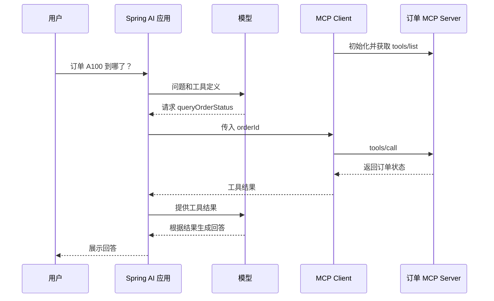

# MCP Client 开发实战

> [!abstract] 一句话总结
> MCP Client 连接 Server、发现工具并转发调用。Spring AI 可以把远端工具接入 `ChatClient`，模型提出调用请求后，由应用通过 MCP 执行。

## 🎯 从订单问题看 Client 做什么

接着 [[10-MCP-Server开发-Java实战|上一节的订单 Server]]：用户问“订单 A100 到哪了？”，Server 已暴露 `queryOrderStatus` 工具。Client 要先连接这个 Server、获取工具定义，再让应用把工具提供给模型；模型选择查询时，Client 才把订单号发给 Server。
Client 不负责凭空知道订单状态，模型也不会直接调用远程 Java 方法。业务校验仍由 Server 执行，模型拿到工具结果后再组织回答。



## 🧩 准备客户端项目

本篇按 Spring AI 2.x 同步客户端说明。先准备一个能调用模型的 Spring Boot 项目，按 [[../02-框架-SpringAI与LangChain4j/SpringAI/01-Spring-AI项目搭建|Spring AI 项目搭建]] 配好 BOM、模型 Starter 和凭据，再添加 MCP Client Starter：

```xml
<dependency>
    <groupId>org.springframework.ai</groupId>
    <artifactId>spring-ai-starter-mcp-client</artifactId>
</dependency>
```

本例假设上一节的订单 Server 已在本机启动。MCP Client 项目和 Server 项目是两个应用；只想检查 Server 时，可以先用 Inspector，不需要模型密钥。

## 🔌 连接订单 Server

在客户端的 `application.yml` 中填写服务基地址和 MCP 端点：

```yaml
spring:
  ai:
    mcp:
      client:
        request-timeout: 10s
        streamable-http:
          connections:
            order:
              url: http://127.0.0.1:8080
              endpoint: /mcp
```

`order` 是客户端配置中的连接名称；`url` 加 `endpoint` 对应 Server 的 `http://127.0.0.1:8080/mcp`。如果两个应用都启动了 Web 服务，客户端还要使用不同端口。远程服务应按实际地址和认证方式配置；请求超时不等于下游工作一定停止。

## 💻 把远程工具交给 ChatClient

在默认自动配置启用且 MCP 连接成功的情况下，Spring AI 可提供 `ToolCallbackProvider`。下面将该 Provider 注册到 `ChatClient`；假设模型配置、MCP 连接和 Spring Bean 扫描均已就绪，省略 imports，示例尚未连接模型运行。

```java
@Configuration
class OrderChatConfig {

    @Bean
    ChatClient orderChatClient(ChatClient.Builder builder, ToolCallbackProvider mcpTools) {
        return builder.defaultTools(mcpTools).build();
    }
}
```

业务代码注入这个 `orderChatClient` 后，即可发起请求：

```java
String answer = orderChatClient.prompt()
        .user("查询订单 A100 的状态，请先调用订单查询工具。")
        .call()
        .content();
```

应用把工具定义与问题交给模型；如果模型选择 `queryOrderStatus`，Spring AI 调用对应的 `ToolCallback`，再通过 MCP Client 请求 Server。模型不一定每次都选对工具，排查时应同时看模型请求、工具调用和服务端返回。
这里用 `defaultTools(mcpTools)` 是 Spring AI 2.x 写法；1.x 注册 Provider 或 Callback 使用 `defaultToolCallbacks(...)`，以项目对应版本文档为准。Provider 暴露的是工具；Resources 和 Prompts 需要通过相应 MCP 操作读取，并不会都变成 `ToolCallback`。

## 🛡️ 工具选择与身份

上面的演示只连接一个模拟 Server，直接注册其工具。真实应用不应默认把所有工具交给所有用户：可以按 Agent 场景筛选工具，并在 Server 端再次验证调用者是否有权执行具体操作；工具可见不代表已授权。
MCP 连接可能由多个请求复用，连接身份、当前用户和会话不是同一个概念。用户凭据应通过可信的认证机制按实际请求传递并由 Server 验证，不能把模型提供的用户 ID 或普通元数据当成身份凭证。

## 🔍 出错时怎么查

- 连接失败：检查 Server 是否启动、地址、端点和传输方式是否一致。
- 工具列表为空：检查 Server 注册、客户端配置以及是否关闭了 ToolCallback 自动配置。
- 模型没有调用：检查应用实际提供的工具、描述、问题和模型对工具调用的支持。
- 调用失败：区分协议、鉴权、业务和网络错误，结合两端日志定位。

Server 更新工具定义后，客户端需要按自身实现刷新列表；支持变更通知时也要检查通知是否启用。可以为只读查询设置有限重试和退避；写操作必须先考虑幂等，不能对所有失败一律重试。

## ❓ 自测

> [!question]- MCP Client 和模型分别做什么？
> 模型根据提供的工具定义提出调用意图；Client 与 Server 通信、发送工具参数并接收结果。应用负责把两者接起来。

> [!question]- 为什么连接成功不代表当前用户有权限？
> 连接只说明双方可以通信。用户身份和对具体订单的访问权限仍需认证与服务端授权。

> [!question]- Inspector 能调用工具，为什么模型还是没有调用？
> 先检查 `ChatClient` 是否拿到工具、模型是否支持工具调用，再查看描述、问题和模型产生的调用记录。

## 🔗 关联笔记

- [[_index]] · [[09-MCP协议详解]] · [[10-MCP-Server开发-Java实战]]
- [[12-MCP调试-Inspector]] · [[../00-总览/学习仪表盘]]

## 📚 参考资料

- [Spring AI MCP Client Starter](https://docs.spring.io/spring-ai/reference/api/mcp/mcp-client-boot-starter-docs.html)
- [Spring AI MCP 安全配置](https://docs.spring.io/spring-ai/reference/api/mcp/mcp-security.html)
- [Spring AI 1.x ChatClient API](https://docs.spring.io/spring-ai/docs/1.0.x/api/org/springframework/ai/chat/client/ChatClient.Builder.html)
