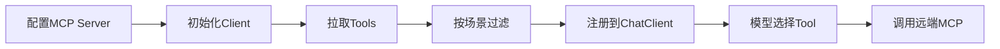

# MCP-Client开发实战

> [!abstract] 一句话总结
> MCP Client 负责发现 MCP Server 暴露的 tools/resources/prompts，把它们转换成 Agent 可调用的 ToolCallback，并处理连接、鉴权、超时和降级。

## 📌 这是什么

在 Spring AI 应用里，MCP Client 通常做三件事：

1. 连接一个或多个 MCP Server。
2. 拉取并缓存 tools 列表和 JSON schema。
3. 把 MCP tool 包装进 `ChatClient` 的工具调用流程，让模型按 schema 发起调用。

MCP Client 不应该只是“能连上”。它还要决定哪些工具给当前 Agent、当前用户、当前场景使用。

## 🤔 解决什么问题 / 为什么需要

- **跨进程复用工具**：Agent 服务不必把所有业务 SDK 都打进同一个进程。
- **动态发现能力**：新增 MCP server 后，客户端可拉取 tools 列表。
- **隔离故障**：某个 MCP server 超时，不应拖垮整个 Agent。
- **统一治理**：对远端工具调用统一加 trace、权限、限流和重试。

## 🧩 客户端职责

| 职责 | 做法 | 风险 |
| ---- | ---- | ---- |
| 连接管理 | stdio/Streamable HTTP client 配置（SSE 已废弃） | 本地和生产 transport 不一致。 |
| 工具筛选 | 按场景和权限选择 tools | 全量暴露导致模型乱调。 |
| Schema 缓存 | 缓存 `tools/list` | 版本更新后要刷新。 |
| 调用治理 | 超时、重试、熔断 | 重试写操作可能造成重复执行。 |
| 可观测 | trace MCP round-trip | 无法定位是模型错还是 server 错。 |

## ⚙️ 实现步骤



1. 为每个 MCP server 配置名称、传输方式、地址、认证和超时。
2. 启动时或首次请求时获取 tools 列表，记录 server version 和 tool schema hash。
3. 在业务层做工具白名单：订单 Agent 只拿订单、物流、客服工单工具。
4. 通过 Spring AI MCP ToolCallbackProvider 注入 `ChatClient`。
5. 对 MCP 调用结果做结构化校验和异常映射，失败时允许 Agent 走降级回答。

## 💻 Java / Spring AI 示例

```yaml
spring:
  ai:
    mcp:
      client:
        enabled: true
        request-timeout: 5s
        sse:
          connections:
            order:
              url: https://mcp.example.com/order
```

```java
@Configuration
class AgentClientConfig {
    @Bean
    ChatClient orderAgent(ChatClient.Builder builder, ToolCallbackProvider mcpTools) {
        return builder
                .defaultSystem("""
                        你是订单客服 Agent。优先使用订单和物流 MCP 工具。
                        工具失败时说明无法自动查询，并创建人工工单。
                        """)
                .defaultToolCallbacks(mcpTools)
                .build();
    }
}
```

```java
String answer = orderAgent.prompt()
        .user("订单 A100 到哪里了？")
        .call()
        .content();
```

## ⚠️ 工程坑

- 把所有 MCP tools 一次性注册给所有 Agent，导致工具选择混乱和 token 浪费。
- 客户端没有设置 request timeout，远端 MCP 卡住后用户请求一直等待。
- 对写工具做自动重试，但没有幂等键。
- 忽略 server schema 变化，线上出现“模型传旧参数、server 要新参数”。
- 只记录最终回答，不记录 MCP server、tool name、arguments、latency。

## 🎯 面试问题

> [!question] 高频问题
> - Q: MCP Client 在 Agent 架构中放在哪里？
>   - A: 放在 Agent Runtime 与外部能力之间，把远端 MCP tools 转换成模型可调用的工具，并负责连接、过滤和治理。
> - Q: 为什么不能把所有 tools 都交给模型？
>   - A: 工具太多会增加 token、降低选择准确率，还会扩大权限面；应按场景和用户权限过滤。
> - Q: MCP 调用失败怎么处理？
>   - A: 记录 trace，区分连接失败、schema 错误、业务异常；只读查询可重试，写操作要幂等或转人工。

## ✅ 精通检查清单

- 能配置 Spring AI MCP Client 连接远端 server。
- 能解释 ToolCallbackProvider 如何接入 ChatClient。
- 能设计工具白名单和超时策略。
- 能处理 MCP schema 版本变化。

## 🔗 关联笔记

- [[_index]]
- [[09-MCP协议详解]]
- [[10-MCP-Server开发-Java实战]]
- [[10-AI应用开发/00-总览/学习仪表盘]]

## 📚 参考资料

- [Spring AI MCP Client Boot Starter](https://docs.spring.io/spring-ai/reference/api/mcp/mcp-client-boot-starter-docs.html)
- [Model Context Protocol Docs](https://modelcontextprotocol.io/)
