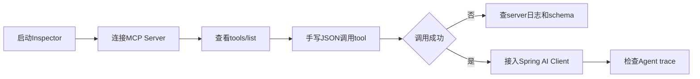

# MCP调试-Inspector

> [!abstract] 一句话总结
> MCP Inspector 是调试 MCP Server 的第一站：先验证连接、tools/list、schema、tools/call，再接入 Agent，能少掉大量“模型为什么不调用工具”的误判。

## 📌 这是什么

Inspector 是 MCP 官方调试工具，用来模拟 MCP Client：

1. 启动或连接 MCP Server。
2. 查看 server 暴露的 tools、resources、prompts。
3. 直接传 JSON 参数调用 tool。
4. 观察返回值、错误、日志和传输问题。

它验证的是 MCP server 本身，不依赖模型。如果 Inspector 都调不通，先不要排查 prompt。

## 🤔 解决什么问题 / 为什么需要

- **确认 server 是否能被发现**：连接参数、命令、环境变量、HTTP 地址是否正确。
- **确认 schema 是否清楚**：参数描述是否让 Agent 能正确填值。
- **确认 handler 是否可执行**：业务异常、鉴权、超时能否按预期返回。
- **确认传输问题**：stdio、Streamable HTTP 的启动方式和日志位置不同（SSE 为已废弃的旧传输）。

## 🧩 调试顺序

| 步骤 | 要看什么 | 常见结论 |
| ---- | -------- | -------- |
| Connect | server 是否启动 | 命令、端口、env 配错。 |
| List tools | 工具名、描述、schema | 工具没注册或描述过泛。 |
| Call tool | 参数和返回 | handler 抛异常或鉴权失败。 |
| Check logs | server stderr / app log | JSON-RPC 错误、业务异常。 |
| Agent 接入 | 模型是否选择工具 | prompt 或工具筛选问题。 |

## ⚙️ 调试流程



1. 本地先用 stdio 或本机 HTTP 连接，减少网络和网关干扰。
2. `tools/list` 中检查 description 是否包含使用时机、参数格式和权限限制。
3. `tools/call` 先传最小合法参数，再传边界参数和错误参数。
4. 对 Java MCP Server 同时看 Inspector 返回和 Spring Boot 日志。
5. Inspector 成功后再接入 Agent；若 Agent 不调用工具，再看 prompt、工具白名单和工具描述。

## 💻 示例配置与调用

```bash
npx @modelcontextprotocol/inspector
```

```json
{
  "orderId": "A20260704001"
}
```

```java
@Tool(description = "查询当前登录用户订单状态。orderId 是业务订单号，例如 A20260704001。")
OrderStatusView queryOrderStatus(String orderId) {
    return orderService.queryOwnedOrder(orderId);
}
```

## ⚠️ 工程坑

- Inspector 能连上但 tools 为空，通常是 Spring Bean 没注册成 ToolCallbackProvider。
- 工具名用缩写，如 `qos`，模型很难判断用途。
- description 没写参数格式，模型传自然语言导致 schema 校验失败。
- stdio server 把业务日志写到 stdout，破坏 JSON-RPC 通道；日志应写 stderr 或文件。
- Inspector 成功后直接上线，没验证生产鉴权、超时、跨域和网关配置。

## 🎯 面试问题

> [!question] 高频问题
> - Q: Agent 不调用 MCP 工具时，如何排查？
>   - A: 先用 Inspector 验证 server、tools/list 和 tools/call；如果工具本身正常，再看 Agent 是否拿到了工具、工具描述是否清晰、prompt 是否要求使用工具。
> - Q: stdio MCP Server 调试时最容易踩什么坑？
>   - A: stdout 被业务日志污染，导致 JSON-RPC 解析失败；应把日志输出到 stderr 或文件。
> - Q: 为什么要手写错误参数调用工具？
>   - A: 验证 schema、业务校验和错误返回是否可被 Agent 理解，避免线上异常变成无意义的 500。

## ✅ 精通检查清单

- 能用 Inspector 验证连接、tools/list、tools/call。
- 能根据 Inspector 结果判断问题在 server、client 还是 prompt。
- 能解释 stdio 与 Streamable HTTP 调试差异。
- 能用边界参数验证工具 schema 和异常返回。

## 🔗 关联笔记

- [[_index]]
- [[09-MCP协议详解]]
- [[10-MCP-Server开发-Java实战]]
- [[../00-总览/学习仪表盘]]

## 📚 参考资料

- [MCP Inspector](https://modelcontextprotocol.io/docs/tools/inspector)
- [Spring AI MCP Server Boot Starter](https://docs.spring.io/spring-ai/reference/api/mcp/mcp-server-boot-starter-docs.html)
