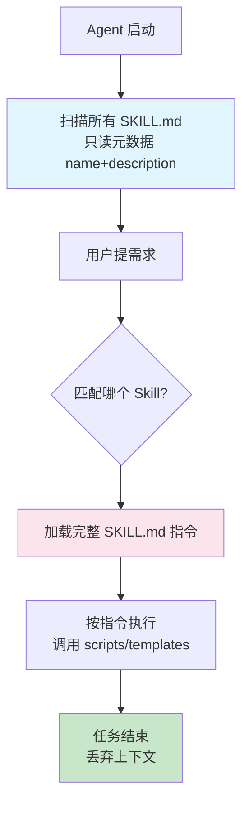

# 📦 Skills（SKILL.md）详解

> [!abstract] 一句话总结
> Agent Skills 是 Anthropic 在 2025 年下半年推出的新原语：用一个 **Markdown 文件夹（含 SKILL.md）打包"怎么做某件事"的程序化知识**，Agent 按需渐进式加载。2026 年快速普及，Microsoft Agent Framework 等已支持。

## 📌 这是什么

一个 Skill 就是一个 **文件夹**，告诉 Agent「做某类任务时，应该按什么流程、用什么工具、套什么模板」。

```text
my-skill/
├── SKILL.md          # 必需：YAML frontmatter + Markdown 指令
├── scripts/          # 可选：脚本文件
├── templates/        # 可选：模板文件
└── references/       # 可选：参考资料
```

## 🤔 解决什么问题

> [!quote] 核心痛点
> 把所有指令塞进一个巨大的 System Prompt → LLM 会迷失在中间、忽略关键约束、上下文爆炸。
> Skills 把"做事方法"模块化，**用到哪个加载哪个**。

| 没有 Skills | 有 Skills |
| ----------- | --------- |
| 巨型 System Prompt | 模块化的能力包 |
| 所有指令一直占上下文 | 按需加载，省上下文 |
| 难复用、难维护 | 文件夹可复制、可版本管理 |
| 团队各写各的 | 团队共享标准流程 |

---

## 🧩 核心概念

### SKILL.md 结构

```markdown
---
name: invoice-processor
description: 当用户上传发票时，提取信息并填入财务系统
---

# 处理流程

1. 读取发票图片，调用 OCR 工具提取字段
2. 校验金额、税号、日期
3. 调用财务系统 MCP Server 写入
4. 失败时记录到 errors.log 并通知用户
```

- **YAML frontmatter**：最小只需 `name` + `description`
- **Markdown body**：详细的步骤指令

### 最关键设计：渐进式上下文披露（Progressive Disclosure）

> [!important] 这是 Skills 的灵魂
> Agent 启动时**只读所有 SKILL.md 的元数据**（name + description），任务匹配时**才加载完整指令**，任务结束后**丢弃上下文**。



这样即使有 100 个 Skill，启动时也只占很少上下文（每个就一行描述）。

---

## ⚙️ Skills 与其他概念的关系

### Skills vs MCP

| 维度 | Skills | MCP |
| ---- | ------ | --- |
| **本质** | 程序化知识 / 工作流剧本 | 连接外部系统的协议 |
| **回答** | "**怎么做**这件事" | "**用什么**做这件事" |
| **形式** | Markdown 文件夹 | JSON-RPC 协议 |
| **加载** | 渐进式按需加载 | 实时调用 |
| **典型场景** | 周报生成、合同审查模板 | 查 DB、调 API |
| **类比** | 员工手册 | 工具箱 |

> 详细对比和组合用法见 [[17-Agent-MCP-Skills组合实战]]

### Skills vs LLM Wiki

> [!note] 都用 Markdown 组织 AI 上下文，思路一脉相承
> - **LLM Wiki**：知识"是什么"（陈述性知识）
> - **Skills**：知识"怎么做"（程序化知识）
> - 你的 Obsidian 仓库可以同时有 Wiki 和 Skills

---

## 💻 实践：设计一个 Skill

### 示例：周报生成 Skill

```markdown
---
name: weekly-report
description: 当用户要写周报时，从 Jira 和 Git 收集本周工作，按公司模板生成
---

# 周报生成流程

## 第一步：收集数据
1. 调用 Jira MCP Server，查询本周状态变更的 issue
2. 调用 Git MCP Server，查询本周 commit

## 第二步：归类
按「已完成 / 进行中 / 下周计划」三类整理

## 第三步：套模板
使用 templates/weekly-template.md 的格式

## 第四步：输出
- 突出本周关键成果
- 风险项单独标红
- 控制在 500 字以内
```

### 测试方式

```text
☑ 放到 Claude.ai 的 Skills 目录
☑ 或 Claude Code 的 .claude/skills/ 目录
☑ 提"帮我写周报"，观察是否自动加载该 Skill
```

> 完整实战见：[[10-AI应用开发/08-项目实战/07-项目-业务Agent系统]]

---

## 🆚 三个 Markdown 标准别搞混

| 文件 | 给谁看 | 干什么 |
| ---- | ------ | ------ |
| **SKILL.md** | Agent | 教 Agent 怎么做某类任务 |
| **AGENTS.md** | 编程 Agent | 告诉 Agent 项目怎么 build/test/规范 |
| **README.md** | 人类 | 项目说明 |

> AGENTS.md 详见 [[16-AGENTS规范详解]]

---

## ⚠️ 踩坑与注意事项

- [ ] **description 是关键**：写不好 Agent 不会触发这个 Skill
- [ ] **别写太长**：SKILL.md 正文要精简，详细资料放 references/
- [ ] **一个 Skill 一件事**：别把多个任务塞一个 Skill
- [ ] **Skill 调 MCP 要确保 Server 在线**：组合使用时的依赖

---

## 🎯 面试问题

> [!question] 高频问题
> - **Q: Skills 是什么？解决什么问题？**
>   - A: 用 Markdown 文件夹打包"怎么做事"的程序化知识，Agent 按需加载，避免巨型 System Prompt 和上下文爆炸。
> - **Q: 什么是渐进式上下文披露？**
>   - A: 启动只读 SKILL.md 元数据，任务匹配才加载完整指令，结束后丢弃。让大量 Skill 也不占上下文。
> - **Q: Skills 和 MCP 的区别？**
>   - A: Skills 是"怎么做"（程序化知识），MCP 是"用什么"（外部连接）。常组合用：Skill 描述流程，流程里调用 MCP 工具。
> - **Q: SKILL.md 最小结构？**
>   - A: YAML frontmatter 的 name + description，加 Markdown 正文指令。

---

## 🔗 关联笔记

- [[01-Agent设计模式详解]] —— Skills 是 Agent 的程序化知识
- [[09-MCP协议详解]] —— Skills 可调用 MCP 工具
- [[16-AGENTS规范详解]] —— 另一个 Markdown 标准
- [[17-Agent-MCP-Skills组合实战]] —— 三者如何协同
- [[10-AI应用开发/03-知识库技术-RAG/_index]] —— LLM Wiki 与 Skills 的关系
- [[_index]]

## 📚 参考资料

- [Anthropic Skills 官方仓库](https://github.com/anthropics/skills)
- [Microsoft Agent Framework - Skills](https://learn.microsoft.com/en-us/agent-framework/agents/skills)
