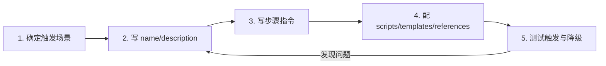

# 🛠️ 设计自己的 Skill 实战

> [!abstract] 一句话总结
> Skill 设计的核心不是写代码,而是把"一个会做事的人会怎么完成这类任务"翻译成 Agent 能**稳定触发、不会误读**的 `SKILL.md`:先定触发场景,再写 name/description,再写步骤指令,最后配 scripts/templates/references,并用正负样例反复测试触发与降级。

> [!info] 本节定位
> 前置:[[13-Skills详解]](Skills 概念、SKILL.md 结构与渐进式上下文披露)。本篇在"是什么"之上讲"**怎么设计一个合格 Skill**"。延伸:[[16-AGENTS规范详解]](另一个 Markdown 规范,不要混淆)、[[17-Agent-MCP-Skills组合实战]](Skill 里如何编排 MCP 调用)。

## 📌 这是什么

[[13-Skills详解]] 已经讲清了 Skills 的原理,但"原理懂了"和"写出来的 Skill 好用"之间还隔着一段路:description 写宽了会误触发,写窄了不触发;步骤指令模糊,模型就会自由发挥,每次都输出不一样的结果。

设计 Skill 的本质是**知识工程**:把散落在某位同事脑子里、或某篇文档里的"做事方法",固化成 Agent 能按需加载、稳定复现的指令包。好的 Skill 应该让任务结果**不依赖模型心情**——换个模型、换个人用,产出基本一致。

## ⚙️ 设计流程(五步)



### 第一步:确定触发场景

先回答三个问题,决定这个 Skill **值不值得做**:

| 问题 | 判断标准 |
| ---- | -------- |
| 频率 | 团队每周至少出现几次?一次性任务不值得固化成 Skill |
| 流程 | 有固定步骤、固定输出格式吗?纯开放性的创意任务不适合 |
| 边界 | 能说清"哪些算这个任务、哪些不算"吗?说不清就别做 |

> [!note] 一个 Skill 一件事
> 把"写周报"和"写会议纪要"塞进同一个 Skill,description 就会写得含糊,触发必然混乱。宁可拆成两个,靠 description 各管各的触发。

### 第二步:写 name 和 description(决定"会不会被触发")

Agent 启动时只读所有 SKILL.md 的元数据,靠 `name + description` 决定命中哪个 Skill——所以 **description 是 Skill 的门面**。写法要点:

- **name**:小写英文 + 连字符,`动作-对象` 结构,如 `meeting-notes`、`code-review`。
- **description** 要回答三件事:
  1. **何时触发**:用户说了什么样的话、提供了什么材料,才该用这个 Skill(给 2~3 个触发信号词或例句);
  2. **何时不触发**:哪些相似场景反而不能触发(负例,防止误判);
  3. **参数格式**:任务里有哪些变量(输入文本、可选配置),分别是什么格式。

示例(下文完整版会继续用):

```markdown
---
name: meeting-notes
description: >
  当用户提供会议记录文本(速记、转写稿或聊天记录)并要求整理成正式会议纪要时使用。
  触发信号:包含"会议纪要""整理会议""会议记录"等词,并且附带了会议内容原文。
  不触发:用户只是询问"会议纪要怎么写"这类概念问题,或没有提供任何会议内容原文。
  参数:会议记录原文(必填);参会人、日期、主题(选填,缺失时从原文推断)。
---
```

### 第三步:写步骤指令(决定"执行得好不好")

步骤指令是 Agent 在任务执行期才加载的正文。要点:

1. **用祈使句 + 编号步骤**,每步只做一个动作,像操作手册,不像散文;
2. **明确每步的输入输出**,如"输出格式:`负责人 | 截止日期 | 任务描述`",固定格式直接给死;
3. **写清判定条件**,把"看情况"翻译成可判断的规则;
4. **写边界与降级**:什么情况停止、什么情况询问用户、依赖不可用时的后备方案;
5. **控制正文长度**:细节放 references/,正文只留流程骨架。

> [!warning] 反面示例(会误导模型)
> ```markdown
> # 整理会议纪要
> 1. 先大致看看内容,把重要的东西记下来
> 2. 合适的部分放进纪要
> 3. 最后整理一下格式
> ```
> "大致看看""合适的""整理一下"都是模型无法稳定执行的主观词,十个模型能给你十种结果。

### 第四步:配 scripts / templates / references

| 目录 | 什么时候用 | 怎么组织 |
| ---- | ---------- | -------- |
| `scripts/` | 步骤里有**确定性逻辑**(解析日期、规范化格式、调 API 算结果)——凡是代码能可靠完成、模型容易做错的,都交给脚本 | 用独立脚本文件,SKILL.md 里写明"何时调用、传什么参数、预期输出",不要把所有代码塞进正文 |
| `templates/` | 输出格式固定(报告、邮件、文档骨架) | 模板里留 `{{变量}}` 占位,SKILL.md 说明每个变量怎么填 |
| `references/` | 背景知识、规范全文、示例输出 | 按需阅读,避免 SKILL.md 正文过长占用上下文 |

> 核心原则:**SKILL.md 正文做"导演",scripts/templates/references 做"道具"**。模型只负责决策和编排,重复劳动交给确定性的文件。

### 第五步:测试触发与降级

Skill 上线前必须过三关(详见下节"测试与迭代"):正例能命中、负例不误触发、依赖失效有降级。

---

## 💻 完整示例:会议纪要 Skill

```text
meeting-notes/
├── SKILL.md
├── scripts/
│   └── extract-actions.py     # 提取并归一化行动项日期
├── templates/
│   └── minutes-template.md    # 纪要输出模板
└── references/
    └── minutes-guide.md       # 团队纪要规范全文
```

**SKILL.md**(frontmatter + 指令):

```markdown
---
name: meeting-notes
description: >
  当用户提供会议记录文本(速记、转写稿或聊天记录)并要求整理成正式会议纪要时使用。
  触发信号:包含"会议纪要""整理会议""会议记录"等词,并且附带了会议内容原文。
  不触发:用户只是询问"会议纪要怎么写"这类概念问题,或没有提供任何会议内容原文。
  参数:会议记录原文(必填);参会人、日期、主题(选填,缺失时从原文推断)。
---

# 会议纪要整理流程

## 输入
- 会议记录原文(必填)
- 参会人、日期、主题(选填,缺失时从原文推断)

## 步骤
1. 把原文按「讨论主题 / 决策结论 / 行动项」三类分段,重复内容合并。
2. 逐条提取行动项,统一为一行格式:`负责人 | 截止日期 | 任务描述`。
   负责人无法从原文确定时写「待指派」,禁止猜测人名。
3. 调用 `scripts/extract-actions.py`(参数:行动项清单),把日期归一化为 YYYY-MM-DD。
4. 按 `templates/minutes-template.md` 填充输出,正文控制在 1 页以内。
5. 输出后询问用户是否保存到待办系统;若待办 MCP Server 不可用,直接返回 Markdown 结果并说明原因,不阻塞交付。

## 边界
- 输入不是会议内容(如普通闲聊、技术文档)时,不执行本流程,先向用户确认。
- 原文严重残缺(无法识别任何行动项)时,输出"信息不足"清单,不要编造内容。
- 涉及敏感决策时,在纪要中标注「待确认」,由用户决定是否传达。
```

**scripts/extract-actions.py**(节选,示意职责边界):

```python
#!/usr/bin/env python3
"""从行动项行中解析并归一化日期。输入:每行一个行动项;输出:替换为标准化格式。"""
import re, sys
from datetime import date

for line in sys.stdin:
    m = re.search(r"(\d{1,2})月(\d{1,2})日", line)
    if m:
        d = date(date.today().year, int(m.group(1)), int(m.group(2)))
        line = line.replace(m.group(0), d.isoformat())
    print(line, end="")
```

**templates/minutes-template.md**:

```markdown
# 会议纪要:{{主题}}
- 时间:{{日期}} | 参会人:{{参会人}}
## 讨论主题
{{主题列表}}
## 决策
{{决策结论}}
## 行动项
| 负责人 | 截止日期 | 任务描述 |
| ------ | -------- | -------- |
{{行动项表格}}
```

> 把"日期解析"交给 Python 而不是交给模型——这是 scripts/ 存在的意义:确定性逻辑用代码,决策性工作留给模型。

---

## 🧪 测试与迭代

Skill 是"给模型的软件",所以也要像软件一样测:

### 1. 触发测试(正例 / 负例 / 边界例)

建一张三列表格,每改一次 description 就全跑一遍:

| 类型 | 测试输入 | 期望结果 |
| ---- | -------- | -------- |
| 正例 | "帮我整理今天的会议纪要" + 粘贴速记 | 触发 |
| 负例 | "会议纪要和邮件通知有什么区别?" | 不触发(概念问答) |
| 负例 | 粘贴一段技术文档说"总结一下" | 不触发(应走总结类 Skill) |
| 边界例 | 只发了一句话"有会议纪要吗" | 不触发或追问补材料 |

> [!important] 触发误判是头号问题
> description 写太宽 → 该任务命中了错误的 Skill,输出完全跑偏;写太窄 → Skill 成了摆设。**负例和正例同样重要**,写 description 时一定要列出"看起来像、但别触发"的场景。

### 2. 指令失效回归

- **换模型回归**:同一套样例在新模型上重跑——模型能力变化会让原来"懂"的指令失效;
- **引用文件改名回归**:scripts/templates/references 文件改过名后,检查 SKILL.md 里的引用是否同步;
- **依赖变更回归**:Skill 调用的 MCP Server 工具改了参数,流程步骤要跟着改。

### 3. 沉淀样例集

触发测试的表格保留下来,就是以后做回归和评测的种子集(见 [[19-Agent评估]]"固定 Skill 版本再评估")。改 description 或指令后重跑,不通过就退回上一版。

---

## ⚠️ 踩坑与注意事项

- [ ] **description 写宽不写窄**:常见的坑是只写"当用户提到 X 时",漏了"什么时候不用";误触发比不触发更难排查,因为输出是错的但看起来合理
- [ ] **让模型做它不擅长的事**:日期解析、格式规范化这类确定性逻辑不写脚本,结果每次都不一样
- [ ] **正文写太长**:SKILL.md 正文恨不得写成论文,正确做法是骨架进正文、细节进 references/
- [ ] **指令里留主观词**:"合适的""合理的""适当处理"——模型无法稳定执行
- [ ] **一个 Skill 塞多类任务**:触发必然混乱,拆开反而简单
- [ ] **不声明依赖与降级**:Skill 依赖 MCP 但不写"Server 不可用时怎么办",线上直接卡死(见 [[17-Agent-MCP-Skills组合实战]] 的降级策略)

---

## 🎯 面试问题

> [!question] 高频问题
> - **Q: 设计一个 Skill 的第一步是什么?为什么?**
>   - A: 确定触发场景——判断任务是否高频、有固定流程、边界清晰。边界说不清的任务做不成 Skill,这决定了整个设计的可行性。
> - **Q: SKILL.md 的 description 怎么写才不容易误触发?**
>   - A: 三要素:何时触发(触发信号词/例句)、何时不触发(负例)、参数格式。负例是防止误判的关键,和正例同等重要。
> - **Q: scripts/ 和让模型直接干,边界怎么划?**
>   - A: 确定性逻辑(解析、规范化、计算)一律进 scripts/;模型只做需要理解和决策的部分。这样输出稳定、可测试、上下文也省。
> - **Q: 上线后用户说 Skill 经常不触发,怎么排查?**
>   - A: 先跑正负样例集确认是描述问题还是指令问题;再看可观测里的 skill 命中记录(见 [[18-Agent可观测]]);然后改 description 并回归样例集。

---

## ✅ 精通检查清单

- 能说出五步设计流程,并解释每步在防止什么问题
- 能手写一份 description 完整版:触发信号、负例、参数格式三要素齐全
- 能判断一段步骤指令哪些该写进正文、哪些该挪到 scripts/ 或 references/
- 能设计一张正例/负例/边界例测试表,并解释误触发的危害
- 知道换模型、改引用文件后必须做指令回归

## 🔗 关联笔记

- [[13-Skills详解]] —— 前置:Skill 原理与 SKILL.md 结构
- [[15-Skills在企业落地的模式]] —— 单点设计之上的企业治理
- [[16-AGENTS规范详解]] —— AGENTS.md 是项目级约束,不要与 Skill 混淆
- [[17-Agent-MCP-Skills组合实战]] —— Skill 流程中如何编排 MCP 工具与降级
- [[18-Agent可观测]] —— skill.name 命中记录是排查触发问题的第一手数据
- [[19-Agent评估]] —— 样例集沉淀与 Skill 版本固定
- [[20-Agent安全与防注入]] —— Skill 文本作为"可信指令"需要版本与评审
- [[_index]]

## 📚 参考资料

- [Anthropic Skills 官方仓库](https://github.com/anthropics/skills)
- [Building Effective Agents - Anthropic](https://www.anthropic.com/research/building-effective-agents)
