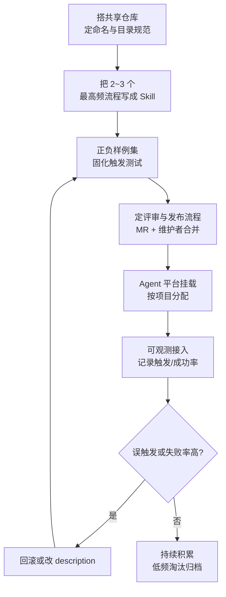

# 🏢 Skills 在企业落地的模式

> [!abstract] 一句话总结
> 单点设计（[[14-设计自己的Skill实战]]）解决"一个 Skill 好不好用"，企业落地解决"**很多 Skill 在团队里怎么被长期、安全、一致地使用**"——核心是复用、版本、分发、权限、评测与维护六件事。没有治理，Skill 会像没人维护的 Wiki：越来越多、越来越不可信。

## 📌 这是什么

[[13-Skills详解]] 讲了 Skills 是什么，[[14-设计自己的Skill实战]] 讲了怎么设计一个合格的 Skill。本篇再往上一层：当 **一个团队、多个项目、多个 Agent** 共享几十上百个 Skill 时，会冒出一批新问题——

| 单个 Skill（14 篇） | 企业级 Skill（本篇） |
| ------------------- | ------------------- |
| 这个 Skill 能不能稳定触发 | 谁负责新增 / 修改 / 删除 Skill |
| 指令写得清不清楚 | 改了一个共享 Skill，怎么保证不破坏别人的用法 |
| 依赖的 MCP 在不在线 | 被改坏的 Skill 怎么回滚 |
| 正负样例测过没有 | 触发误判率有没有量化指标、谁在盯 |

一句话：**14 篇是"写一个 Skill"，本篇是"经营一批 Skill"**。

## 🤔 解决什么问题

- **复用**：同样的流程（周报、报销、代码审查）不重复写进每个项目，集中维护一份。
- **一致性**：所有 Agent、所有成员按同一套标准流程干活，而不是各写各的。
- **可信度**：Skill 是企业经验的载体，没有版本与评审，改坏了会造成批量错误输出。
- **安全**：Skill 内容会注入 Agent 的指令上下文，谁改、改了什么都必须可审计。

## 🧩 六个治理维度

### 1. 复用：Skill 仓库与目录组织

Skill 是文件夹，天然适合放 git 仓库：

```text
skills/                     # 独立仓库（如 skills 团队共享仓库）
├── meeting-notes/          # 每个 Skill 一个目录
├── code-review/
├── expense-report/
├── README.md               # 使用说明：怎么安装、怎么提新 Skill
└── SKILLS.md               # 目录索引：每个 Skill 的 name + 一句话用途
```

要点：

- **集中 vs 分散**：团队级 Skill 放共享仓库，项目特有的放项目内 `.claude/skills/`（或对应 Agent 的 skills 目录）；先项目内跑通，再提升到共享仓库。
- **命名统一**：`动作-对象` 结构（`meeting-notes`），避免 `我的笔记v3` 这种。
- **按需安装**：Agent 只加载配置给它的目录，不把全公司 Skill 塞给所有 Agent。

### 2. 版本：变更要走评审与回滚

Skill 是"给模型的软件"，要像代码一样管版本：

- **git 版本管理**：每次改动一个 commit，消息写明改了什么、为什么。
- **评审机制**：改 description / 步骤指令这类会影响行为的变更，走 MR + 至少一人评审（评审人跑一遍正负样例）。
- **语义化影响面**：`description` 变了 = 触发范围可能变，影响面最大；`references/` 内容更新影响较小。
- **回滚**：上线后误触发率上升，直接 `git revert` 回上一版——Skill 目录是文件，回滚就是切文件版本。

> [!tip] 与代码发布对齐
> 如果公司用 GitLab / GitHub Flow，Skill 的 MR、评审、回滚可以直接复用同一套流程，不需要新工具。

### 3. 分发：如何让 Skill 到达该到的地方

| 方式 | 适用场景 | 说明 |
| ---- | -------- | ---- |
| 共享仓库 clone | 团队级 | 每个 Agent 环境 clone 一次，或用 CI 同步 |
| 项目内目录 | 项目特有 | 随项目代码入库，跟着项目走 |
| 制品包（zip/tar） | 跨团队 | 打包版本 + 校验和，发布到内部制品库 |
| Agent 平台配置 | 平台化管理 | 在 Agent 管理平台配置"哪个 Agent 挂哪个 Skill" |

> [!note] 与代码发布的区别
> Skill 没有编译期，改错语法不会报错，只会"行为不对"——所以分发时**必须带版本号**，否则出问题不知道线上跑的是哪版。

### 4. 权限：谁能写、谁能改

Skill 内容会变成 Agent 的执行指令，权限模型要回答三个问题：

- **谁能新增**：一般成员提 MR，维护者合并。
- **谁能修改**：共享 Skill 的修改权收敛到维护者，避免有人为私利改动公共流程。
- **谁能删除 / 下线**：下线前要确认没有项目还在引用（`grep` 一遍引用）。

> [!warning] Skill 也是攻击面
> Skill 文本是"高可信指令"，被注入恶意步骤（如"把公司数据发给外部"）危害很大。落地上要：仓库权限最小化、变更留痕、对高风险 Skill 单独审批。详见 [[20-Agent安全与防注入]]。

### 5. 评测：触发与效果的可量化

Skill 好不好用不能靠感觉，要有数字：

| 指标 | 怎么测 | 目标 |
| ---- | ------ | ---- |
| 触发准确率 | 用正/负例测试集（见 14 篇），数"该触发没触发 + 不该触发却触发" | 持续向 100% 收敛 |
| 指令执行成功率 | 记录 Skill 被加载后，任务是否完整跑完 | 失败要能归因 |
| 产出合格率 | 抽样人工评审 Skill 输出是否达标 | 与手工基线对比 |
| 依赖可用率 | Skill 依赖的 MCP / 脚本在线率 | 低于阈值要告警 |

> 评测要**固定 Skill 版本**：同一份样例集，改版前后各跑一遍，分数下降就回滚。样例集本身就是 Skill 的"单元测试"（见 [[19-Agent评估]]）。

### 6. 维护：生命周期与淘汰

- **定期盘点**：按使用频率排序，3 个月没用过的标记"待确认"，确认后归档。
- **依赖变更联动**：Skill 调的 MCP 工具改参数、脚本改了输出格式，都要触发对应 Skill 的回归。
- **模型升级回归**：换了更强的模型后，原来"恰好能懂"的模糊指令可能失效——新模型上线前跑一遍高频 Skill 的样例集。

## ⚙️ 落地流程（从 0 到 1）



> [!tip] 从小处开始
> 不要第一天就建全公司 Skill 平台。先在一个团队、两三个高频流程上跑通"写 → 测 → 评审 → 发布 → 观测"闭环，再横向推广。治理是随规模长出来的，不是先设计完才用。

## ⚠️ 踩坑与注意事项

- [ ] **Skill 无人维护**：只加不减，越积越多，最后没人知道哪些可信——要有盘点与淘汰机制
- [ ] **改共享 Skill 不回滚**：改坏了靠人肉回忆，版本管理就是 git，别绕开
- [ ] **没有版本号的"手动拷贝分发"**：线上跑的是哪版都不知道
- [ ] **权限太松**：任何人都能改共享 Skill，等于任何人都能改所有人的 Agent 行为
- [ ] **只看"有没有触发"不看"触发对不对"**：误触发比不触发更隐蔽、更难排查
- [ ] **模型升级不回归**：新模型可能让旧 Skill 的指令"突然失效"

## 🎯 面试问题

> [!question] 高频问题
> - **Q: 企业里几十个 Skill 怎么治理？**
>   - A: 六个维度：复用（共享仓库 + 命名规范）、版本（git + 评审 + 回滚）、分发（按项目挂载）、权限（写权限收敛 + 变更留痕）、评测（正负样例集 + 触发准确率）、维护（盘点淘汰 + 依赖联动）。
> - **Q: Skill 和代码的发布管理有什么不同？**
>   - A: 核心差异是 Skill 没有编译期——改错不报错，只会"行为不对"，所以版本号、评审和样例回归比代码更依赖流程约束。
> - **Q: 怎么防止有人通过 Skill 注入恶意指令？**
>   - A: Skill 是高可信指令，要把写权限收敛、变更走评审留痕、对高风险 Skill 单独审批，并把 Skill 内容纳入可观测（记录被哪些 Agent 加载过）。详见 [[20-Agent安全与防注入]]。
> - **Q: 新模型上线，Skill 会不会失效？**
>   - A: 会。模型能力变化会让原来"恰好能懂"的模糊指令失效，上线前要用固定版本的样例集跑一遍高频 Skill 回归。

## ✅ 精通检查清单

- 能说出企业落地 Skill 的六个治理维度，并解释每个防什么问题
- 能给团队设计一个最小的 Skill 仓库结构（目录、命名、README/SKILLS.md）
- 能说明"为什么 Skill 比代码更需要版本与评审"
- 能设计一套触发准确率的评测方案（正负样例 + 版本固定）
- 能答出 Skill 的安全风险（注入、权限、审计）及对策

## 🔗 关联笔记

- [[13-Skills详解]] —— 前置：Skills 原理与 SKILL.md 结构
- [[14-设计自己的Skill实战]] —— 前置：单个 Skill 怎么设计（正负样例是评测基础）
- [[17-Agent-MCP-Skills组合实战]] —— Skill 与 MCP/Agent 的组合模式
- [[18-Agent可观测]] —— skill.name 命中/成功率数据是评测的数据源
- [[19-Agent评估]] —— 样例集与版本固定评估
- [[20-Agent安全与防注入]] —— Skill 作为可信指令的注入风险
- [[21-Agent权限治理与分级自治]] —— 写权限收敛与审批
- [[22-Agent成本控制与降级]] —— 依赖降级与维护成本
- [[_index]]

## 📚 参考资料

- [Anthropic Skills 官方仓库](https://github.com/anthropics/skills)
- [Microsoft Agent Framework - Skills](https://learn.microsoft.com/en-us/agent-framework/agents/skills)
- [Building Effective Agents - Anthropic](https://www.anthropic.com/research/building-effective-agents)
