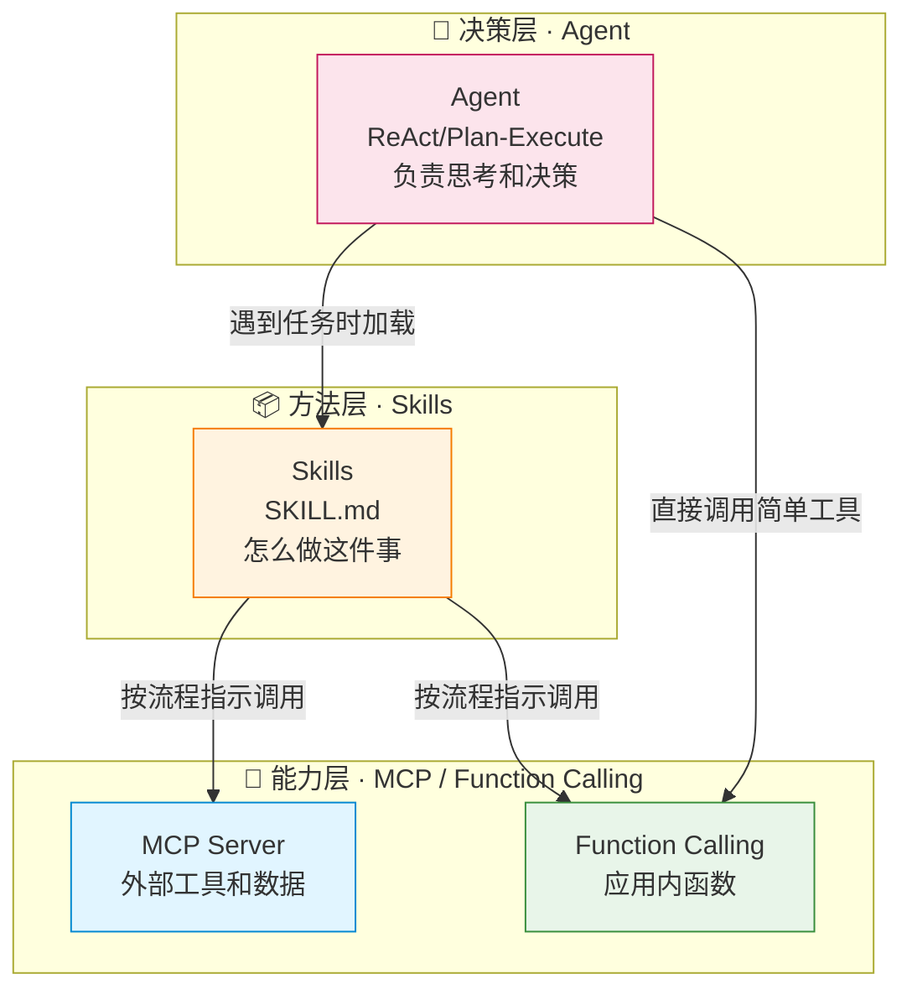
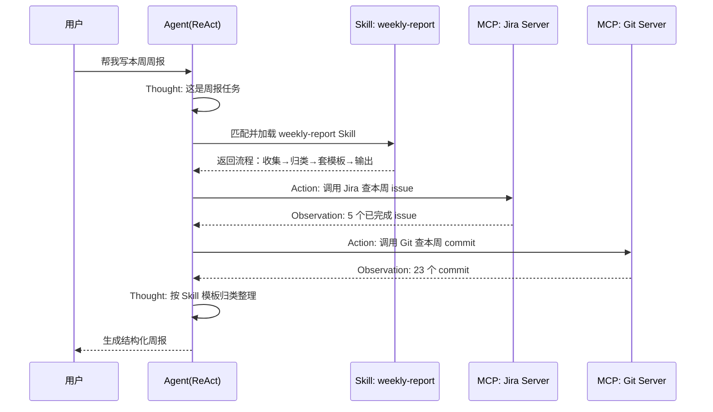
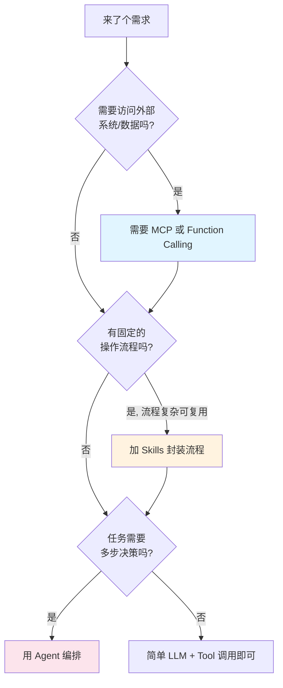

# 🧩 Agent × MCP × Skills 组合实战

> [!abstract] 一句话总结
> Agent、MCP、Skills 不是三选一，而是 **三层协同**：Agent 是大脑（决策），Skills 是方法论（怎么做），MCP 是工具箱（用什么做）。三者组合是 2026 年企业级 AI 应用的主流架构。

> [!info] 前置阅读
> 建议先读完单项详解，再读本文：
> [[01-Agent设计模式详解]]、[[09-MCP协议详解]]、[[13-Skills详解]]、[[16-AGENTS规范详解]]

---

## 📌 为什么要组合

单独用任何一个都有短板：

| 只用它 | 短板 |
| ------ | ---- |
| 只用 Agent | 没工具调用就是空想，没流程指引容易跑偏 |
| 只用 MCP | 有工具但 Agent 不知道按什么流程用 |
| 只用 Skills | 有流程指引但没工具就执行不了实际动作 |

**合起来才是完整的生产级 AI 应用。**

---

## 🏗️ 三层架构心智



### 各层职责

| 层 | 组件 | 职责 | 类比公司 |
| -- | ---- | ---- | -------- |
| 决策层 | **Agent** | 理解目标、规划步骤、决定下一步 | 员工（大脑） |
| 方法层 | **Skills** | 提供标准作业流程（SOP） | 员工手册 |
| 能力层 | **MCP / Function Calling** | 实际访问系统、执行动作 | 工具箱 |

---

## ⚙️ 一个完整例子：智能周报助手

> 需求：用户说"帮我写本周周报"，系统自动生成。

### 完整执行流程



### 三层各做了什么

```text
🧠 Agent（ReAct 模式）
   - 识别"写周报"意图
   - 决定先加载 Skill，再按步骤调工具
   - 每步观察结果，决定下一步

📦 Skill（weekly-report/SKILL.md）
   - 告诉 Agent：先查 Jira、再查 Git、按三类归整、套模板、限 500 字
   - 提供 templates/weekly-template.md

🔌 MCP（两个 Server）
   - Jira MCP Server：提供 query_issues 工具
   - Git MCP Server：提供 query_commits 工具
```

---

## 🎯 什么时候用哪个 / 组合



### 决策速查表

| 场景 | Agent | Skills | MCP | 说明 |
| ---- | :---: | :----: | :-: | ---- |
| 简单问答 | ❌ | ❌ | ❌ | 直接调 LLM |
| 查实时数据回答 | 轻量 | ❌ | ✅ | LLM + MCP 工具 |
| 固定流程任务（周报） | ✅ | ✅ | ✅ | 三层全用 |
| 探索性复杂任务 | ✅ | 可选 | ✅ | Agent 主导 |
| 团队标准化作业 | ✅ | ✅ | ✅ | Skills 保证一致性 |

---

## 💻 在 Java（Spring AI）里怎么落地

```text
🔌 能力层
   - 用 @Tool 定义 Function Calling 工具
   - 用 Spring AI MCP Server Starter 暴露成 MCP
   - 用 MCP Client 消费外部 Server

📦 方法层
   - Skills 目前以 Claude.ai / Claude Code / Agent SDK 为主
   - Java 侧可把 SKILL.md 内容作为「流程 Prompt 模板」注入
   - 或用 Spring AI Advisor 实现"加载对应流程"的逻辑

🧠 决策层
   - ChatClient + Tools = ReAct
   - 多 ChatClient + 状态机 = Multi-Agent
```

> [!note] Java 生态现状
> Skills 标准目前在 Anthropic 生态（Claude.ai / Claude Code）最成熟。在 Java 项目里，你可以：
> 1. **借鉴 Skills 思想**：把可复用的流程写成 Markdown 模板，按需注入 Prompt
> 2. **MCP 完全可用**：Spring AI 已原生支持 MCP Server/Client
> 3. **混合架构**：Java 后端做 MCP Server，Claude/Cursor 做 Agent + Skills 消费

> 完整项目见：[[../08-项目实战/07-项目-业务Agent系统]]

---

## ⚠️ 踩坑与注意事项

- [ ] **不要过度组合**：简单任务别硬上三层，徒增复杂度和成本
- [ ] **Skill 依赖 MCP 时要处理 Server 不可用**：降级策略
- [ ] **Token 成本**：三层都带上下文，注意预算（见 [[../04-多轮对话与上下文工程/_index]]）
- [ ] **可观测**：用 Langfuse 追踪 Agent→Skill→MCP 的完整链路（见 [[../06-平台与工程化/06-Langfuse接入]]）

---

## 🎯 面试问题

> [!question] 高频问题
> - **Q: Agent、MCP、Skills 是替代关系吗？**
>   - A: 不是，是三层协同。Agent 决策、Skills 提供方法论、MCP 提供工具。组合用是 2026 年企业主流架构。
> - **Q: 举例说明三者怎么配合？**
>   - A: 以周报助手为例：Agent 识别意图并编排，加载 weekly-report Skill 拿到流程，按流程调用 Jira/Git 的 MCP 工具收集数据，最后套模板输出。
> - **Q: 什么场景需要全用三层？**
>   - A: 有固定可复用流程、需要访问外部系统、需要多步决策的任务（如周报、合同审查、自动化运维）。

---

## 🔗 关联笔记

- [[01-Agent设计模式详解]]
- [[09-MCP协议详解]]
- [[13-Skills详解]]
- [[16-AGENTS规范详解]]
- [[../08-项目实战/07-项目-业务Agent系统]]
- [[_index]]

## 📚 参考资料

- [Building Effective Agents - Anthropic](https://www.anthropic.com/research/building-effective-agents)
- [Claude Skills vs MCP 对比](https://modelcontextprotocol.io/)
