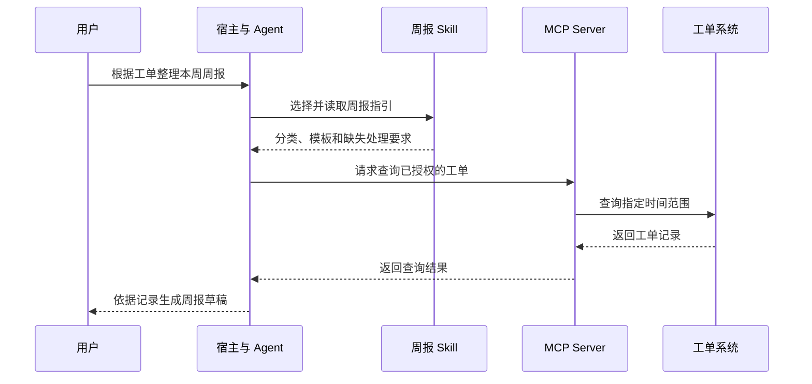

# 🧩 Agent × MCP × Skills 组合实战

> [!abstract] 一句话总结
> Agent 根据任务组织步骤，Skill 提供可复用的做事指引，MCP 连接工具与其他上下文。它们可以组合，也可以根据需要只使用其中一部分。

> [!info] 前置阅读
> [[01-Agent设计模式详解]]、[[09-MCP协议详解]]、[[13-Skills详解]]、[[16-AGENTS规范详解]]

## 📌 先用周报例子理解分工

用户说“帮我整理本周周报，工作记录在工单系统里”。假设当前宿主支持 Skills，也已经接入有权限查询工单的 MCP Server：

| 组件 | 在这件事中做什么 |
| ---- | ---------------- |
| Agent | 理解任务，选择是否查询，以及根据结果继续处理 |
| `weekly-report` Skill | 提供分类、模板和缺失信息的处理要求 |
| MCP Client / Server | 按协议连接，提供查询工单等能力 |
| 工单系统 | 保存并返回用户有权限查看的实际记录 |

Skill 文件不会自己读取工单，MCP Server 也不会因为连接成功就自动生成周报。模型通常提出工具调用请求，再由宿主或应用负责执行、检查权限并把结果返回给模型。`AGENTS.md` 则用于支持它的编程宿主了解项目约定，和周报 Skill 不是同一个文件。

## ⚙️ 一次请求是怎么走完的

下面是**一种可能的执行过程**；Skill 如何选择、工具何时调用以及界面如何展示，都取决于宿主和配置。



把流程展开看：
1. 确认“本周”的起止日期和人员范围；有歧义时向用户确认。
2. 宿主发现 `weekly-report`，需要时加载 `SKILL.md` 和模板。
3. Agent 请求查询，宿主通过 MCP Client 调用工具；Server 按业务权限访问工单系统。
4. 根据返回记录归类为已完成、进行中、风险；无法确认的内容标待确认，并说明数据来源。

例如工单返回“完成订单查询接口、登录失败问题处理中”，周报就可以分别列入已完成和进行中；如果没有风险信息，就写“待确认”，不能编造风险已经消除。上面的数据和流程是示意，并未实际连接 Jira、Git 或其他服务。

### 如果工具不可用

查询失败、超时或权限不足时，应说明哪部分记录没有获取到；如果用户已经提供了部分工作记录，可以先根据现有材料生成草稿并标明缺口。用户没有要求发送时只返回草稿；需要写入或发送时，再按实际授权及系统规则处理。

## 🔌 MCP 和 Function Calling 怎么配合

Function Calling 是模型提出工具名称和参数、由应用执行并返回结果的机制；这个工具背后可以是 Java 方法、普通 HTTP API，也可以是通过 MCP Client 接入的远程工具。MCP 是宿主与 Server 交换工具、资源和提示等信息的协议，二者不处于同一个比较层面。
例如模型请求 `query_issues` 后，Spring AI 可以把请求交给 MCP Client，Client 再调用工单 MCP Server；模型本身并没有直接登录工单系统。具体工具名称、参数和返回结构由实际 Server 决定。详见 [[09-MCP协议详解]]。

## 💻 在 Spring AI 里怎样接起来

先准备支持工具调用的模型、MCP Client 和一个已授权的工单 MCP Server。以 Spring AI 2.x 的官方接口为例，引入 MCP Client Starter 并配置连接后，可以把发现的 MCP 工具提供给本次请求：

```java
// chatClient 和 mcpTools 由应用配置或注入；工单 Server 已连接
String report = chatClient.prompt()
        .system("按已完成、进行中、风险整理；不确定的内容标待确认。")
        .user("请根据工单记录整理本周周报")
        .tools(mcpTools)
        .call()
        .content();
```

这里的 `mcpTools` 可由同步 MCP 客户端的 `SyncMcpToolCallbackProvider` 提供；具体依赖、连接地址、认证和接口应按所用版本的 [Spring AI MCP Client 文档](https://docs.spring.io/spring-ai/reference/api/mcp/mcp-client-boot-starter-docs.html) 配置。示例展示工具怎样进入一次请求，省略了类、依赖注入和连接配置，也没有实际运行。
上面的 `.system(...)` 只是直接给模型一条简化指引，**并没有实现对 `SKILL.md` 的发现、选择与按需加载**。要真正复用第 14 篇的 Skill，需要选择支持该能力的宿主或框架，或者在应用中自行实现发现、读取及资源加载；只把一段字符串传给模型不等于完整接入 Skills。

### 怎么验证组合是否接通

先确认模型、服务端连接和认证可用，检查当前用户能否查询指定范围的工单，再做下面几项检查：
- 用固定测试工单发起请求，核对工具调用参数、返回记录和生成的周报是否一致。
- 查看应用或宿主可用的调用记录，确认实际调用了哪个工具；不要只凭回答判断。
- 用无权限或不可用的服务测试，确认结果说明数据缺失，没有编造查询成功。
- 如果接入了 Skill 宿主，再分别验证 Skill 的发现、自动选择、模板读取和显式调用。

工具描述不是权限控制；只向当前请求开放需要的工具，并在业务系统校验用户权限。注意日志中的工单内容和个人信息，相关实践见 [[18-Agent可观测]]、[[20-Agent安全与防注入]]。

## 🎯 什么时候需要组合

| 场景 | 可以先怎么做 |
| ---- | ------------ |
| 用户直接贴出记录，只需整理一次 | 模型加清楚的提示词即可 |
| 经常按同一套规则整理 | 考虑用 Skill 或模板复用指引 |
| 需要读取工单等外部数据 | 通过应用 API、工具或 MCP 接入 |
| 需要多步选择、查询并根据结果调整 | 考虑让 Agent 编排，关注验证与成本 |

同一个任务也可以用固定程序调用 API 后套模板，不一定需要 Agent；也可以使用 Java 后端提供工具，由支持 Skills 的其他宿主负责加载指引。选择取决于任务复杂度、接入方式和维护成本。

## 🎯 自测

> [!question]- Agent、Skill 和 MCP 是替代关系吗？
> 不是。Agent 组织任务，Skill 提供指引，MCP 提供通信协议；是否需要组合，要看任务和宿主能力。

> [!question]- 为什么有了 MCP Server，还要配置工具权限？
> MCP 规定通信方式，不自动授予工单系统访问权限。宿主、Server 和业务系统仍要执行各自的授权检查。

> [!question]- Spring AI 的 `ChatClient` 加上几句 system 提示，就自动支持完整 Skills 吗？
> 不能这样认为。示例只把文本传给模型；Skill 的发现、选择、文件和资源加载需要宿主或应用实现。

## 🔗 关联笔记

- [[01-Agent设计模式详解]] —— 多步决策和编排
- [[09-MCP协议详解]] —— 协议和连接方式
- [[13-Skills详解]] —— Skill 的结构和加载
- [[14-设计自己的Skill实战]] —— 周报 Skill 的完整文件与测试
- [[16-AGENTS规范详解]] —— 项目约定
- [[18-Agent可观测]] —— 检查实际调用过程
- [[20-Agent安全与防注入]] —— 工具和外部内容的风险
- [[../04-多轮对话与上下文工程/_index]] —— 上下文组织
- [[../06-平台与工程化/06-Langfuse接入]] —— 调用链观测
- [[../08-项目实战/07-项目-业务Agent系统]] —— 完整项目
- [[_index]]

## 📚 参考资料

- [MCP 架构说明](https://modelcontextprotocol.io/docs/learn/architecture)
- [Spring AI Tool Calling](https://docs.spring.io/spring-ai/reference/api/tools.html)
- [Spring AI MCP Client Starter](https://docs.spring.io/spring-ai/reference/api/mcp/mcp-client-boot-starter-docs.html)
- [Building Effective Agents - Anthropic](https://www.anthropic.com/research/building-effective-agents)
