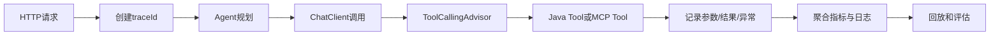

# Agent可观测

> [!abstract] 一句话总结
> Agent 可观测不是普通日志，而是把一次任务中的 prompt、规划、工具调用、MCP 往返、Skill 命中、token、成本、失败原因串成可复盘的执行轨迹。

## 📌 这是什么

Agent 可观测要回答四个生产问题：

1. 用户输入进入系统后，Agent 选择了哪个策略、哪个 Skill、哪些工具。
2. 每一步模型调用的输入、输出、token、耗时、finish reason 是什么。
3. 每次 Java Tool 或 MCP Tool 调用的参数、返回、异常、权限判定是什么。
4. 最终答案为什么这样生成，失败时能否用同一份 trace 复现。

普通应用日志通常只记录接口请求；Agent 链路还要记录推理步骤和外部工具状态，否则线上问题会变成“模型刚才可能想错了”。

## 🤔 解决什么问题 / 为什么需要

- **定位幻觉来源**：区分是 prompt 漏约束、RAG 召回错、工具返回错，还是模型没有调用工具。
- **复盘工具链路**：把 `tool.name`、`tool.arguments`、`tool.result`、`mcp.server`、`mcp.transport` 写进同一个 trace。
- **控制成本和延迟**：按会话、步骤、工具维度统计 token、模型耗时和外部 API 耗时。
- **支撑安全审计**：记录越权请求被哪个 guard 拦截，敏感参数是否脱敏。

## 🧩 关键数据模型

| 字段 | 例子 | 用途 |
| ---- | ---- | ---- |
| `traceId` / `spanId` | `a8f...` | 串联一次用户任务的全部步骤。 |
| `agent.step` | `plan`、`tool_call`、`reflect` | 判断 Agent 停在哪个阶段。 |
| `skill.name` | `refund-policy-skill` | 观察 Skill 是否被正确触发。 |
| `tool.name` | `order_status` | 分析工具调用命中率和失败率。 |
| `mcp.server` | `order-mcp` | 区分本地函数和远端 MCP 服务。 |
| `token.input/output` | `1680/420` | 做成本预算和上下文裁剪。 |
| `safety.decision` | `allow`、`deny`、`redact` | 供审计和回放使用。 |

## ⚙️ 落地步骤



1. 在 Controller 入口生成 `traceId`，放入 MDC、Reactor Context 或请求上下文。
2. 给每次 `ChatClient` 调用加 observation tag：模型名、业务场景、会话 ID、是否流式。
3. 包装 Java `@Tool` 和 MCP `ToolCallback`，记录工具名、耗时、参数摘要、异常类型。
4. prompt、工具参数、工具返回要做脱敏；生产环境不要明文保存身份证、手机号、token。
5. 建立失败样本库：把低分回答、工具异常、超过步数、人工改写过的答案沉淀成回归用例。

## 💻 Java / Spring AI 示例

```java
@Component
class AgentTraceAdvisor implements CallAdvisor {
    @Override
    public ChatClientResponse adviseCall(ChatClientRequest request, CallAdvisorChain chain) {
        String traceId = MDC.get("traceId");
        long start = System.nanoTime();
        try {
            ChatClientResponse response = chain.nextCall(request);
            log.info("agent_call traceId={} model={} tokens={}",
                    traceId,
                    request.prompt().getOptions().getModel(),
                    response.chatResponse().getMetadata().getUsage());
            return response;
        } catch (RuntimeException ex) {
            log.warn("agent_call_failed traceId={} error={}", traceId, ex.getClass().getSimpleName());
            throw ex;
        } finally {
            log.info("agent_call_latency traceId={} ms={}", traceId,
                    TimeUnit.NANOSECONDS.toMillis(System.nanoTime() - start));
        }
    }
}
```

```java
@Service
class OrderTools {
    @Tool(description = "根据订单号查询订单状态。只返回当前登录用户自己的订单。")
    String queryOrderStatus(@ToolParam(description = "订单号") String orderId) {
        log.info("tool_call tool=queryOrderStatus orderIdHash={}", DigestUtils.sha256Hex(orderId));
        return orderService.queryOwnedOrder(orderId).status();
    }
}
```

## ⚠️ 工程坑

- 只记录最终回答，不记录工具参数；线上无法判断模型是没查数据还是查错数据。
- trace 里保存原始 prompt 和完整业务数据，排障方便但合规风险很高。
- 忽略流式响应的中间事件，用户看到卡顿但服务端只有一次总耗时。
- 多 Agent 并行时共用一个 span，导致 supervisor 和 worker 的失败点混在一起。
- 只看平均 token，没看 P95 / P99；少量复杂任务可能吃掉大部分预算。

## 🎯 面试问题

> [!question] 高频问题
> - Q: Agent 可观测和普通接口日志有什么区别？
>   - A: 普通日志关注请求和返回，Agent 可观测还要记录模型输入输出、规划步骤、工具调用、MCP 往返、Skill 命中和 token 成本。
> - Q: 线上回答错误，你会按什么顺序排查？
>   - A: 先看 trace 中的用户输入和 system prompt，再看是否调用正确工具、工具返回是否可信、RAG 上下文是否相关，最后用失败样本回放验证修复。
> - Q: prompt 和工具返回是否都能落日志？
>   - A: 可以落摘要和脱敏字段；敏感原文要有权限、保留周期和加密策略，不能为了排障把隐私数据长期明文保存。

## ✅ 精通检查清单

- 能为一次 Agent 执行画出 trace/span 结构。
- 能解释 Java Tool 和 MCP Tool 分别记录哪些字段。
- 能用指标区分模型慢、工具慢、RAG 慢和网络慢。
- 能设计脱敏、采样、保留周期和失败回放策略。

## 🔗 关联笔记

- [[_index]]
- [[17-Agent-MCP-Skills组合实战]]
- [[../00-总览/学习仪表盘]]

## 📚 参考资料

- [Spring AI Tool Calling](https://docs.spring.io/spring-ai/reference/api/tools.html)
- [OpenAI Platform Docs](https://platform.openai.com/docs/)
