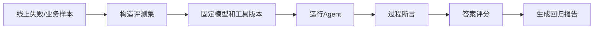

# Agent评估

> [!abstract] 一句话总结
> Agent 评估要同时评估最终答案和过程行为：是否选对 Skill、是否调用正确工具、是否遵守权限、是否在预算内完成。

## 📌 这是什么

传统问答评估看“答案对不对”；Agent 评估还要看过程：

1. **任务理解**：是否识别意图、约束、风险等级。
2. **计划质量**：步骤是否必要，是否遗漏关键动作。
3. **工具行为**：是否调用正确 Java Tool / MCP Tool，参数是否符合 schema。
4. **结果质量**：答案是否引用工具事实，是否结构化，是否满足用户目标。
5. **治理指标**：成本、延迟、步数、安全拦截、人工接管率。

## 🤔 解决什么问题 / 为什么需要

- **避免只凭体感上线**：demo 看起来聪明，不代表稳定处理边界样例。
- **定位回归来源**：prompt、模型、Skill、MCP server 任一变化都可能影响结果。
- **比较方案**：同一套样本跑 ReAct、Plan-and-Execute、Supervisor，才能看清取舍。
- **支撑持续改进**：把线上失败样本沉淀成评测集，形成闭环。

## 🧩 指标设计

| 指标 | 判定方式 | 说明 |
| ---- | -------- | ---- |
| `task_success` | 人工标注或业务断言 | 最终是否完成用户任务。 |
| `tool_precision` | 期望工具 vs 实际工具 | 防止乱调工具。 |
| `arg_valid_rate` | JSON schema / Bean Validation | 参数是否可执行。 |
| `groundedness` | 答案是否来自工具或证据 | 控制幻觉。 |
| `safety_pass` | 是否触发越权、泄露 | 安全红线指标。 |
| `cost_p95` | token + API 成本 | 防止少量请求过贵。 |
| `latency_p95` | 端到端耗时 | 影响用户体验。 |

## ⚙️ 落地步骤



1. 收集 30 到 100 个真实样本，覆盖正常、边界、越权、工具异常、信息不足。
2. 为每个样本写期望：应调用哪个工具、哪些参数必须出现、最终答案必须包含哪些事实。
3. 固定模型版本、prompt 版本、Skill 版本、MCP server 版本，评估时记录到报告。
4. 对工具调用做程序断言，对自然语言答案用人工评分或 LLM-as-judge 辅助评分。
5. 把评估放进 CI 或发布门禁，至少阻止安全和工具调用回归。

## 💻 Java / Spring AI 示例

```java
record EvalCase(
        String id,
        String userMessage,
        String expectedTool,
        List<String> mustContain) {
}
```

```java
@Test
void shouldCallOrderToolAndUseToolFact() {
    EvalCase c = new EvalCase(
            "order-status-001",
            "帮我查一下订单 A100 的物流状态",
            "queryOrderStatus",
            List.of("已发货", "顺丰"));

    AgentRun run = agentRunner.run(c.userMessage());

    assertThat(run.toolCalls()).extracting(ToolCall::name).contains(c.expectedTool());
    assertThat(run.finalAnswer()).contains(c.mustContain().toArray(String[]::new));
    assertThat(run.totalSteps()).isLessThanOrEqualTo(4);
}
```

```java
@Tool(description = "查询订单状态，只能查询当前登录用户订单")
String queryOrderStatus(String orderId) {
    capturedToolCalls.add(new ToolCall("queryOrderStatus", Map.of("orderId", orderId)));
    return "订单 A100 已发货，承运商：顺丰";
}
```

## ⚠️ 工程坑

- 只评估最终文本，不评估工具路径；模型可能蒙对答案但没查真实数据。
- 评测集全是理想问题，没有越权、脏输入、工具超时、信息不足样例。
- 每次评估都换模型或工具版本，回归原因不可追踪。
- LLM-as-judge 没有校准，评分标准漂移。
- 只看平均分，不看安全红线和高价值场景的失败率。

## 🎯 面试问题

> [!question] 高频问题
> - Q: Agent 评估和 RAG 评估有什么不同？
>   - A: RAG 重点看召回和 groundedness；Agent 还要看计划、工具选择、参数、权限、步数和成本。
> - Q: 如何验证模型正确调用了工具？
>   - A: 在测试替身或 trace 中捕获工具调用，断言工具名、参数和调用次数，再检查最终答案是否引用工具结果。
> - Q: LLM-as-judge 能不能完全替代人工？
>   - A: 不能。它适合批量辅助评分，但安全、合规、关键业务样本仍要人工标注或程序断言。

## ✅ 精通检查清单

- 能设计包含正常、边界和安全样例的评测集。
- 能区分答案指标、过程指标和成本指标。
- 能用 Java 测试捕获工具调用并做断言。
- 能把线上失败样本转成回归用例。

## 🔗 关联笔记

- [[_index]]
- [[18-Agent可观测]]
- [[17-Agent-MCP-Skills组合实战]]
- [[10-AI应用开发/00-总览/学习仪表盘]]

## 📚 参考资料

- [Spring AI Tool Calling](https://docs.spring.io/spring-ai/reference/api/tools.html)
- [OpenAI Platform Docs](https://platform.openai.com/docs/)
