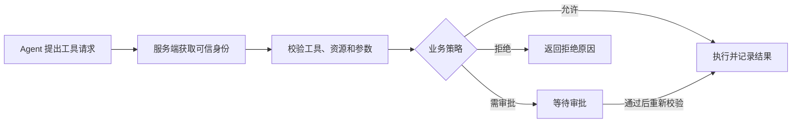
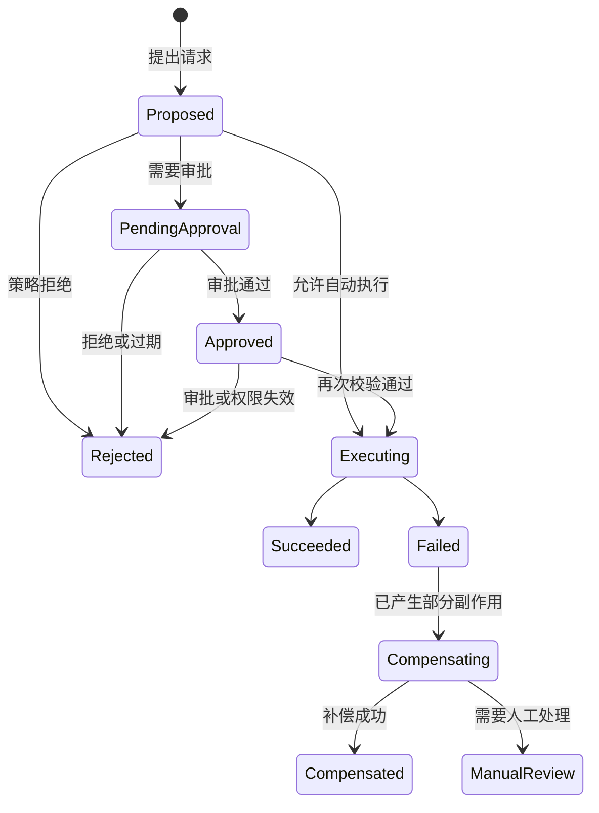

# 🔐 Agent 权限治理与分级自治

> [!abstract] 本文要解决什么
> Agent 可以提出“调用哪个工具、传什么参数”，但能否读取数据或执行操作，必须由服务端根据真实身份、目标资源和业务规则决定。

## 🎯 先看一个退款请求

用户说：“帮我给订单 A1001 退款。”Agent 可能生成 `refund(orderId="A1001", amount=500)`，但这只是一个执行请求。服务端还需要确认：发起人是谁、订单是否属于他、订单当前能否退款、金额是否符合规则，以及该操作是否需要审批。任何一项不满足，都不能因为模型认为“可以退款”就执行。

同样，`queryOrder("A1001")` 虽然只是读取，也可能暴露别人的订单信息；读操作也要校验资源归属。

## 🧭 什么是分级自治？

不是所有操作都要由 Agent 自动完成，也不是所有操作都必须人工处理。可以根据数据敏感度、影响范围、金额、副作用和可恢复性，为不同操作制定规则。下面只是一个示例，具体等级与审批条件由业务决定：

| 示例级别 | 允许的行为 | 例子 | 主要控制 |
| :--- | :--- | :--- | :--- |
| L0 | 查询授权范围内的数据 | 查自己的订单状态 | 身份与资源校验、必要时脱敏 |
| L1 | 生成草稿或建议 | 生成退款回复草稿 | 标明未执行、提交前由用户确认 |
| L2 | 自动执行低风险操作 | 为工单打可撤销的标签 | 权限、幂等、限流与审计 |
| L3 | 满足审批后执行 | 超过业务阈值的退款 | 绑定审批内容、执行前复核 |
| L4 | 不允许 Agent 自主执行 | 按企业规则禁止的高风险操作 | 服务端拒绝或转到人工流程 |

不能只按“读还是写”判断风险：导出全部客户资料是读操作，也可能比修改一个普通标签更敏感。授权结果还会随用户、租户、资源状态和时间变化。

## 🧩 怎么判断这次调用有没有权限？

以客服查询订单为例，可以分成几个层次：
1. 身份：服务端从登录会话或经过验证的服务凭证获取当前用户和租户。
2. 工具范围：客服角色是否可以使用订单查询或退款工具。
3. 资源和条件：目标订单是否属于允许访问的租户，订单状态、金额和操作时间是否符合规则。
4. 风险策略：本次调用可以直接执行、需要审批，还是必须拒绝。

角色授权通常称为 RBAC，结合订单归属、金额、时间等属性判断通常称为 ABAC。两者可以组合：即使客服角色拥有 `queryOrder` 工具，也不能因此查看所有客户订单。模型生成的 `userId`、`tenantId` 或 `approved=true` 都不能作为授权凭据。

对于 RAG、Memory 和 MCP Resource，也应在数据进入模型上下文前根据身份和资源范围过滤；工具列表的隐藏只能减少误用，真正执行时仍需再次鉴权。

## ✅ 审批为什么要绑定具体操作？

假设审批人同意了“订单 A1001 退款 100 元”，之后模型把金额改成 500 元，原来的批准不能自动用于新请求。审批记录至少应关联发起人、目标资源、动作、关键参数或其摘要、审批结果和有效期；参数变化时按策略重新审批。

审批通过不等于可以永远执行。真正调用退款服务之前，还要重新校验审批是否有效、发起人是否仍有权限、订单状态是否变化，并记录实际执行结果。

## ↩️ 执行失败后怎么处理？

涉及多个系统时，失败不一定意味着什么都没发生。例如退款服务已经受理，但应用保存本地状态时超时；此时直接重试可能产生重复退款，需要先查询外部流水和业务状态。

| 情况 | 常见处理 |
| :--- | :--- |
| 请求可能重复 | 使用幂等键和业务去重，重试前核对已有结果 |
| 本地数据库与消息需要协调 | 结合事务与 Outbox，保证事件最终可处理 |
| 跨服务部分成功 | 查询执行状态，按业务设计 Saga 或补偿 |
| 邮件已发送等无法撤回的动作 | 记录事实，执行补救流程或转人工处理 |

补偿不是总能恢复原状，补偿失败也应有人工介入入口。不能仅凭模型说“已回滚”判断成功，应以业务系统的实际结果为准。

## 📝 审计需要留下什么？

审计记录要能回答谁在什么上下文中对哪个资源发起了什么操作、依据什么策略允许或拒绝、最后执行得怎么样。可以按需记录用户和租户、Trace ID、工具及参数摘要、策略决定、审批单号、幂等键、业务流水号、错误与补偿结果。涉及敏感参数时应脱敏并限制访问，避免为了排查把隐私数据长期明文保存。

## 🧪 怎样验证这些规则？

至少准备下面几类测试，并检查服务端实际结果：
- 将订单号替换成其他租户的订单，确认无法读取和退款。
- 将已审批的退款金额或目标订单修改，确认不能复用原审批。
- 重复提交同一笔退款，确认不会产生重复业务动作。
- 模拟外部退款成功、本地更新失败，确认能查询状态并进入补偿或人工处理。
- 让模型声称“操作成功”，但使工具返回失败，确认最终状态仍以业务回执为准。

> [!question]- Agent 为什么不能自己判断是否有权退款？
> 模型输出可能出错或被外部内容影响，且它生成的参数不是身份凭据。服务端应使用可信身份，结合订单归属和业务状态独立判断。

> [!question]- 审批通过后为什么还要再校验？
> 审批与执行之间，权限、订单状态或参数可能发生变化；执行前复核可以避免使用过期或不匹配的授权。

## 🔗 关联与资料

- [[20-Agent安全与防注入|安全与防注入]]、[[18-Agent可观测|可观测]]、[[19-Agent评估|评估]]
- [MCP：Authorization](https://modelcontextprotocol.io/specification/2025-06-18/basic/authorization)
- [OWASP：Prompt Injection](https://genai.owasp.org/llmrisk/llm01-prompt-injection/)
