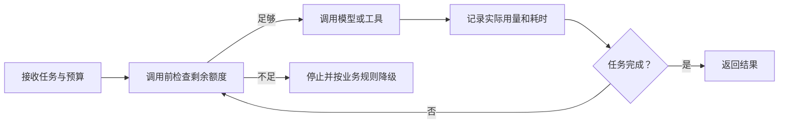

# 💰 Agent 成本控制与降级

> [!abstract] 本文要解决什么
> 一次 Agent 任务可能多次调用模型、查询工具和重试。成本控制需要覆盖整次任务，降级则要在资源不足或服务异常时给用户一个真实、可继续的处理方式。

## 🎯 为什么一次任务会越来越贵？

假设用户要求分析订单异常。Agent 先读订单，再查物流、查询退款规则，之后又因工具超时重试。每一轮模型调用都可能再次携带历史消息、工具描述和已有结果；因此，即使用户只问了一个问题，也不等于只产生一次模型调用。

常见成本来自模型输入与输出 Token、工具或第三方 API、检索和存储、重试以及人工处理。耗时也要考虑：模型变慢或工具阻塞时，用户体验可能先于费用出现问题。

## 📏 先给任务设预算

预算应覆盖整个任务，而不是只限制某一次模型回答。可以根据业务场景设置：
- 模型和工具最多调用多少次，避免循环或重复查询。
- 输入、输出 Token 和金额的上限，分别累计并按服务商用量结算。
- 总截止时间、单次调用超时和重试次数，避免一直等待。
- 子 Agent 与主 Agent 共同使用的任务预算，防止并发时分别超支。

例如订单查询最多允许 4 次模型调用、5 次工具调用和 15 秒总耗时；数值只是示例，需要结合真实场景和评测调整。一次模型调用的最大输出 Token 不等于整个任务的 Token 或费用上限。



并发调用时，多条分支可能同时看到“预算还有剩余”。需要在共享预算上原子预留额度，调用后再按实际用量结算；模型或外部服务已经产生的费用不能因为任务取消而假定为零。

## 🛠️ 可以从哪里减少开销？

| 做法 | 具体方式 | 需要权衡 |
| :--- | :--- | :--- |
| 选择模型 | 简单分类或抽取交给经过验证的较小模型 | 成本可能降低，也要检查正确率 |
| 控制上下文 | 保留当前任务需要的消息、证据和工具描述 | 裁剪过多可能丢失关键条件 |
| 筛选工具 | 按场景提供工具，数量很多时评估动态工具发现 | 多一次搜索也会有延迟和成本 |
| 合理缓存 | 缓存适合复用的公开资料或查询结果 | 设置有效期，并隔离用户与租户数据 |
| 控制重试 | 仅对适合重试的错误限次重试 | 写操作需幂等，不能盲目重复执行 |

Spring AI 提供动态工具发现能力，可按需向模型提供相关工具定义；具体接口与可用版本应查看对应文档，并用实际任务验证准确率、Token 和耗时。

## 🚦预算不足或服务异常时怎么办？

降级不是统一返回“系统繁忙”，而是根据已经完成的步骤选择安全的后续路径：
- 只读查询失败：说明当前无法取得最新结果，提供重试或人工入口。
- 已有部分可靠证据：可以明确说明已查到什么、哪些信息尚未确认。
- 需要人工处理：在工单实际创建成功后，再告知用户已转交并给出编号。
- 写操作结果不明：先查询业务状态或由人工核实，不能假定失败后直接重复执行。

模型服务不可用、工具超时和预算耗尽的处理方式可以不同。尤其是退款、发消息等有副作用的动作，降级时不能把“请求已发送”当作“执行成功”。

## ☕ Java 中的简单步骤限制

下面只展示一次调用前的计数检查，`BudgetExceededException` 由项目定义。它没有实现跨线程原子预留、Token 统计、超时或整个 Agent 循环，不能直接作为完整的生产预算控制器。

```java
void checkCallBudget(int usedCalls, int maxCalls) {
    if (usedCalls >= maxCalls) {
        throw new BudgetExceededException("模型调用次数已用尽");
    }
}
```

真正接入时，每次模型、工具和重试都要经过对应预算检查，并将实际用量与执行结果关联到任务 Trace，详见 [[18-Agent可观测]]。

> [!question]- 为什么限制单次输出长度仍可能超预算？
> Agent 可能连续多次调用模型，每轮都要处理输入上下文，还可能产生工具费用；需要累计整次任务的调用和用量。

> [!question]- 降级到小模型就一定更好吗？
> 不一定。小模型可能需要更多重试，或在关键任务上效果不足，应比较完成率、总费用和延迟，再决定适用场景。

## 🔗 关联与资料

- [[18-Agent可观测|可观测]]、[[19-Agent评估|评估]]、[[21-Agent权限治理与分级自治|权限治理]]
- [Spring AI：Dynamic Tool Discovery](https://docs.spring.io/spring-ai/reference/guides/dynamic-tool-search.html)
- [Spring AI：Tool Calling](https://docs.spring.io/spring-ai/reference/api/tools.html)
