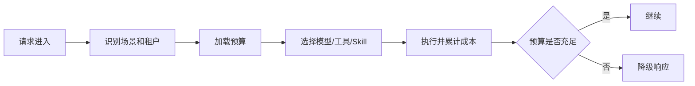

# Agent成本控制与降级

> [!abstract] 一句话总结
> Agent 成本控制是把“模型选择、上下文长度、工具数量、循环步数、并发和缓存”变成可配置预算，并在预算耗尽前降级到更便宜、更确定的路径。

## 📌 这是什么

Agent 成本主要来自五处：

1. 模型输入输出 token。
2. ReAct / Reflection / Supervisor 带来的多轮模型调用。
3. 工具描述、MCP tools 列表、RAG chunks 占用上下文。
4. 外部工具 API、向量检索、数据库和网络调用。
5. 失败重试、超时等待、人工复核。

成本控制不是简单换小模型，而是为每类任务设预算：最多几步、最多多少 token、可用哪些工具、失败后怎样退回确定性流程。

## 🤔 解决什么问题 / 为什么需要

- **避免一次复杂任务打穿预算**：长上下文、多 Agent 并行和工具循环很容易指数级变贵。
- **让降级可预期**：超预算时给模板答案、人工工单或只读查询，而不是让请求随机失败。
- **提升稳定性**：限制工具数量和上下文长度后，模型更容易选对工具。
- **便于运营计费**：按租户、用户、场景统计 token 与外部 API 成本。

## 🧩 成本杠杆

| 杠杆 | 做法 | 适用场景 |
| ---- | ---- | -------- |
| 模型路由 | 简单分类用小模型，复杂推理用强模型。 | 客服、工单、内容审核。 |
| 上下文裁剪 | 只放 top-k 证据和必要工具描述。 | RAG、多工具 Agent。 |
| 工具搜索 | 从工具库检索相关 tools，而不是全量塞给模型。 | MCP server 多、工具多。 |
| 步数限制 | `maxSteps`、超时、重试次数硬限制。 | ReAct、Plan-and-Execute。 |
| 缓存 | 缓存分类、RAG 召回、稳定工具结果。 | 高频重复问题。 |
| 降级 | 模板、FAQ、人工流转、只读模式。 | 预算耗尽或模型不可用。 |

## ⚙️ 落地步骤



1. 定义 `AgentBudget`：最大 token、最大模型调用次数、最大工具调用次数、最大耗时。
2. 在 Agent 循环里每一步扣减预算，扣减点包括 prompt tokens、completion tokens、tool latency。
3. 将 tools 分组：默认只暴露当前场景需要的 tools；大量 MCP tools 使用工具搜索或白名单。
4. 对低风险任务使用缓存，对高风险写操作只缓存只读上下文，不缓存执行结果。
5. 降级路径提前产品化：例如“给出基于已有信息的回答 + 创建人工工单”。

## 💻 Java / Spring AI 示例

```java
record AgentBudget(int maxSteps, int maxInputTokens, int maxOutputTokens, Duration timeout) {
    AgentBudget consumeStep() {
        if (maxSteps <= 0) {
            throw new BudgetExceededException("agent step budget exceeded");
        }
        return new AgentBudget(maxSteps - 1, maxInputTokens, maxOutputTokens, timeout);
    }
}
```

```java
String replyWithBudget(String question, AgentBudget budget) {
    try {
        return chatClient.prompt()
                .system("优先使用订单查询工具；如果信息不足，说明需要人工处理。")
                .user(question)
                .options(OpenAiChatOptions.builder()
                        .maxTokens(budget.maxOutputTokens())
                        .temperature(0.2)
                        .build())
                .tools(orderTools)
                .call()
                .content();
    } catch (BudgetExceededException | ResourceAccessException ex) {
        return "当前自动处理资源不足，已为你转人工并保留问题摘要。";
    }
}
```

## ⚠️ 工程坑

- 只限制输出 token，不限制 ReAct 步数；模型可能多次工具调用后才输出。
- 工具描述过长，业务 prompt 还没开始就消耗大量上下文。
- 降级文案没接业务流程，用户看到“系统繁忙”却没有工单或后续入口。
- 缓存包含用户私有数据，跨租户命中造成泄露。
- 只统计模型账单，不统计 MCP server、搜索、向量库和第三方 API 成本。

## 🎯 面试问题

> [!question] 高频问题
> - Q: Agent 为什么比单次 ChatCompletion 更难控成本？
>   - A: Agent 会多轮规划、调用工具、反思和重试；每轮都会新增 token、延迟和外部 API 成本。
> - Q: 工具很多时怎么减少 token？
>   - A: 按场景白名单或使用工具搜索，只把相关工具定义传给模型；不把全量 MCP tools 每次都塞进上下文。
> - Q: 模型不可用时怎么降级？
>   - A: 对只读查询走确定性接口或 FAQ；对复杂任务创建人工工单；对高风险写操作保持不可自动执行。

## ✅ 精通检查清单

- 能计算一次 Agent 请求的主要成本项。
- 能设计 step、token、timeout 三类预算。
- 能说明工具搜索和上下文裁剪的收益。
- 能给出业务可接受的降级路径。

## 🔗 关联笔记

- [[_index]]
- [[18-Agent可观测]]
- [[17-Agent-MCP-Skills组合实战]]
- [[../00-总览/学习仪表盘]]

## 📚 参考资料

- [Spring AI Dynamic Tool Discovery](https://docs.spring.io/spring-ai/reference/guides/dynamic-tool-search.html)
- [Spring AI Tool Calling](https://docs.spring.io/spring-ai/reference/api/tools.html)
