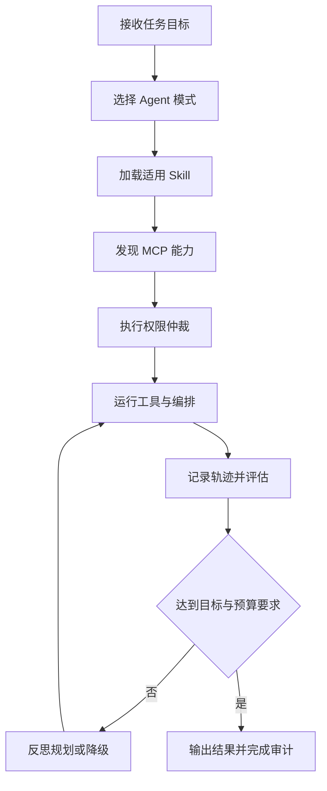

# 05 · Agent · MCP · Skills · 本章总结与复习

本章按当前物理编号从 `01` 到 `22` 展开：先学习 Agent 模式与编排，再掌握 MCP 的协议和实现，接着用 Skills 与 AGENTS.md 固化方法和项目约束，最后补齐可观测、评估、安全、权限与成本治理。

## 核心知识概览表

| 编号 | 核心主题 | 复习要点 |
| ---- | -------- | -------- |
| [[01-Agent设计模式详解]] | Agent 模式全景 | 根据任务复杂度在 Tool Use、ReAct、Plan-and-Execute、Reflection、REWOO 和 Multi-Agent 等模式间选型。 |
| [[02-Tool-Use工具调用-代码实践]] | Tool Use | 用明确的工具描述和参数 schema 连接模型决策与确定性业务能力。 |
| [[03-ReAct-Spring-AI实现]] | ReAct | 在观察、工具调用和结果判断的循环中推进需要外部事实的任务。 |
| [[04-Plan-and-Execute-实现]] | 规划与执行 | 先生成可检查的结构化计划，再逐步执行，并处理审批与失败恢复。 |
| [[05-Reflection-实现]] | 反思修正 | 按明确检查项评审输出并有限次修正，避免无边界自循环。 |
| [[06-Multi-Agent-Supervisor实现]] | 多 Agent 协作 | 由 Supervisor 拆分、分派和验收，专业 Agent 保持工具与上下文边界。 |
| [[07-LangGraph生产级Agent编排]] | 状态图编排 | 用持久状态、检查点、人工介入和可恢复执行承载生产级 Agent。 |
| [[08-OpenAI-Agents-SDK与Handoffs-Guardrails]] | 交接与护栏 | 用 Handoffs 切换专业 Agent，用 Guardrails 在输入、输出和工具侧建立边界。 |
| [[09-MCP协议详解]] | MCP 协议 | 统一 tools、resources、prompts 的发现与调用，并覆盖生命周期、传输、鉴权和审计。 |
| [[10-MCP-Server开发-Java实战]] | MCP Server | 将企业能力按清晰 schema 暴露，权限校验与审计必须由服务端执行。 |
| [[11-MCP-Client开发实战]] | MCP Client | 发现服务端能力并转换为 Agent 可调用工具，处理连接、鉴权、超时与降级。 |
| [[12-MCP调试-Inspector]] | MCP 调试 | 先验证连接、能力列表、schema 和真实调用，再排查模型选工具的问题。 |
| [[13-Skills详解]] | Skills 原理 | 用包含 `SKILL.md` 的目录封装程序化知识，并按需渐进式加载。 |
| [[14-设计自己的Skill实战]] | Skill 设计 | 明确触发条件、步骤、输入输出、资源和验收方式，让方法可重复执行。 |
| [[15-Skills在企业落地的模式]] | Skill 治理 | 围绕复用、版本、分发、权限、评测和维护建立企业级使用方式。 |
| [[16-AGENTS规范详解]] | 项目级指令 | 用 `AGENTS.md` 说明构建测试、代码规范、项目结构和禁止触碰的边界。 |
| [[17-Agent-MCP-Skills组合实战]] | 三层协同 | Agent 负责决策，Skills 提供方法，MCP 提供标准化外部能力。 |
| [[18-Agent可观测]] | 执行轨迹 | 串联 prompt、规划、工具、MCP、Skill、token、成本和失败原因。 |
| [[19-Agent评估]] | 结果与过程评估 | 同时评价任务结果、Skill 与工具选择、参数、权限遵守和预算表现。 |
| [[20-Agent安全与防注入]] | 信任边界 | 区分系统指令与不可信输入，防止检索内容、工具结果和 Skill 文本触发越权。 |
| [[21-Agent权限治理与分级自治]] | 权限与自治 | 模型只提出动作建议，平台侧负责授权、审批、审计、回滚和补偿。 |
| [[22-Agent成本控制与降级]] | 预算治理 | 控制模型、上下文、工具、循环和并发，在预算耗尽前切换更便宜或更确定的路径。 |

## Agent 执行与治理流程

## 快速复习

1. Agent 是模型、工具、记忆和编排逻辑的组合，不等于一次普通模型调用。
2. 简单确定的任务优先 Tool Use 或工作流；只有任务确实需要动态决策时才增加循环和多 Agent。
3. ReAct 边执行边判断，Plan-and-Execute 先形成计划；Reflection 必须限制检查标准与迭代次数。
4. MCP 解决跨应用能力连接，Skills 解决方法知识复用，AGENTS.md 解决项目内工作约束。
5. MCP Server 是权限执行边界，不能把模型提出的工具调用直接视为已授权动作。
6. 生产编排要能检查点恢复、人工介入、超时重试、幂等执行和失败补偿。
7. Agent 评估既看最终任务是否完成，也看过程是否选对工具、遵守权限并控制预算。
8. 安全、权限、可观测和成本不是上线后的附加项，而是 Agent 自治能力的前置条件。

## 自测问题

1. 对一个固定三步审批流程，为什么工作流可能比 ReAct 或 Multi-Agent 更合适？
2. MCP 的 tools、resources、prompts 各表示什么，Function Calling 与 MCP 的边界在哪里？
3. Skills 与 AGENTS.md 都能写步骤和约束，它们在作用域、触发方式和目标读者上有何区别？
4. 如何设计一条从 Agent 动作建议到服务端授权、人工审批、执行、审计和补偿的链路？
5. Agent 评估为什么必须同时记录最终结果和中间工具轨迹？

## 下一章衔接

下一章 [[10-AI应用开发/06-平台与工程化/_index|06 · 平台与工程化]] 将关注 Agent 与 AI 应用如何被部署、接入、观测、评估和统一治理。本章的 trace、评估、安全、权限与成本概念会继续落到 Langfuse、Ragas、AI 网关和私有化推理架构中。

## 相关编号双链

- Agent 模式与编排：[[01-Agent设计模式详解]] → [[02-Tool-Use工具调用-代码实践]] → [[03-ReAct-Spring-AI实现]] → [[04-Plan-and-Execute-实现]] → [[05-Reflection-实现]] → [[06-Multi-Agent-Supervisor实现]] → [[07-LangGraph生产级Agent编排]] → [[08-OpenAI-Agents-SDK与Handoffs-Guardrails]]
- MCP：[[09-MCP协议详解]] → [[10-MCP-Server开发-Java实战]] → [[11-MCP-Client开发实战]] → [[12-MCP调试-Inspector]]
- Skills 与规范：[[13-Skills详解]] → [[14-设计自己的Skill实战]] → [[15-Skills在企业落地的模式]] → [[16-AGENTS规范详解]] → [[17-Agent-MCP-Skills组合实战]]
- 工程治理：[[18-Agent可观测]] → [[19-Agent评估]] → [[20-Agent安全与防注入]] → [[21-Agent权限治理与分级自治]] → [[22-Agent成本控制与降级]]
- 本章索引：[[_index|05 · Agent · MCP · Skills]]
