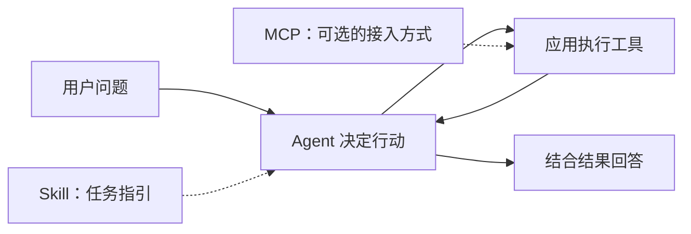

# 🎯 Agent、MCP 与 Skills：总结与复习

> [!abstract] 一句话总结
> Agent 负责在应用约束内选择行动，MCP 用于连接外部能力，Skill 提供可复用的任务指引。三者可以组合，权限、审批和执行结果仍需由应用控制和验证。

## 🗺️ 用订单查询串起本章

用户让 Agent 查询订单 A1001：应用把可用工具交给模型，模型提出查询请求，应用执行并把结果交回模型，模型再根据结果回答。工具既可以由应用直接提供，也可以通过 MCP 接入；Skill 可以补充查单流程，但不是必需组件。

除了能完成任务，还要检查查询权限、最终答案、调用耗时和费用；退款等有副作用的动作可能需要审批。下面的表格和问题可用来回顾这些概念。

## 📊 核心知识速览

| 内容 | 学习重点 | 对应笔记 |
| :--- | :--- | :--- |
| Agent | 根据应用约束选择行动，并结合工具结果决定下一步 | [[00-Agent-MCP-Skills全景与心智模型|全景]] |
| 决策模式 | ReAct 根据反馈调整行动；Plan-and-Execute 先规划再执行 | [[01-Agent设计模式详解|模式对比]] · [[03-ReAct-Spring-AI实现|ReAct]] · [[04-Plan-and-Execute-实现|计划与执行]] |
| MCP | 统一发现和调用工具、资源与模板；授权仍由应用控制 | [[09-MCP协议详解|协议]] · [[10-MCP-Server开发-Java实战|Server]] · [[11-MCP-Client开发实战|Client]] |
| Skills | 用 `SKILL.md` 组织可复用的流程、模板和资源 | [[13-Skills详解|Skills]] · [[14-设计自己的Skill实战|设计 Skill]] · [[16-AGENTS规范详解|AGENTS 规范]] |
| 权限与安全 | 服务端校验身份和权限，高风险操作按业务策略处理 | [[20-Agent安全与防注入|安全]] · [[21-Agent权限治理与分级自治|权限治理]] · [[22-Agent成本控制与降级|成本控制]] |

## ❓ 本章自测

> [!question]- Agent 与一次模型调用有什么区别？
> 一次模型调用生成模型响应；Agent 可以在应用设定的边界内根据目标选择工具，并结合执行结果决定下一步。普通程序也能执行多个固定步骤，因此要看具体决策权与控制流程。

> [!question]- ReAct 如何工作，为什么需要限制循环？
> ReAct 交替进行行动与观察：例如先查订单，再根据查询结果决定是否查物流。模型可能反复调用相同工具或遇到无法恢复的错误，应限制调用次数、耗时并记录失败；不应假定模型会公开完整内部推理。

> [!question]- MCP 的 Tools、Resources 和 Prompts 分别做什么？
> Tools 暴露可调用能力，Resources 提供可读取的数据，Prompts 提供可复用的提示模板。能力发现与实际授权是两件事，服务端仍要检查用户权限。

> [!question]- Function Calling 和 MCP 如何配合？
> 模型通过 Function Calling 提出工具名称和参数，应用负责执行；MCP 负责客户端与能力服务之间的发现和通信。两者可以组合，也可以分别使用。

> [!question]- Skill 和普通工具有什么区别？
> Skill 主要组织可复用的任务指引及相关资源；工具提供实际可调用的能力。宿主可以先提供 Skill 的名称和描述，按需加载正文；具体方式和工具权限由宿主决定。

> [!question]- 检查点能解决哪些问题，又不能保证什么？
> 检查点保存工作流状态，配合相应存储和恢复机制可以从中断处继续；它不能自动回滚已发送的邮件、数据库写入或外部请求。副作用仍要设计幂等、补偿和人工处理。

> [!question]- 如何降低外部文档中的提示注入风险？
> 区分外部内容和可信指令，限制可用工具，在服务端验证身份、资源权限与参数；提示词和内容边界只能辅助，不能单独保证模型不会受影响。

> [!question]- 多 Agent 为什么可能更慢、更贵？
> 各角色会产生额外模型调用、上下文传递和结果汇总，错误还可能在步骤间传播。先用单 Agent 或固定工作流做基线，再根据任务分工与测量结果决定是否增加角色。

> [!question]- 高风险动作为什么要在执行前审批？
> 审批应绑定发起人、目标动作和关键参数，执行前再检查授权与审批是否仍有效。审批后如果参数或业务状态变化，需按策略重新确认；模型口头表示“已批准”不算审批凭据。

> [!question]- 怎样评估 Agent 的实际表现？
> 同时看最终任务是否完成和过程是否合规：用测试集检查工具选择、参数、权限、证据、步数、延迟与成本；模型评判可辅助，但关键事实需要程序断言或人工复核。

## 🛡️ 工程实践提醒

- 设置最大步数、超时和成本预算，测试异常与退出路径。
- 高风险操作按业务规则审批；不允许自动执行的操作应直接拦截。
- 跨系统复用能力时，可以评估 MCP；工具接入方式应结合实际需求选择。
- 工具只返回任务需要的数据，并处理敏感字段，避免无关内容占满上下文。
- 先验证单 Agent 或固定流程能否完成任务，再决定是否引入多 Agent。
- 服务端根据真实用户、租户和资源权限执行授权，不把模型输出当凭证。
- 关联模型调用、工具请求、结果和错误，按权限脱敏；不要假设内部推理完整可见。
- 工具较多时评估白名单或动态发现，并测量准确率、延迟和成本。
- 写操作按需要设计幂等、补偿或人工处理；并非所有副作用都能回滚。
- 为 `AGENTS.md` 和 `SKILL.md` 保留版本与评审记录，变更后验证关键行为。

## 🔗 下一步学习

继续学习 [[../06-平台与工程化/_index|平台与工程化]]，了解 AI 网关、链路观测、评测和模型部署。
