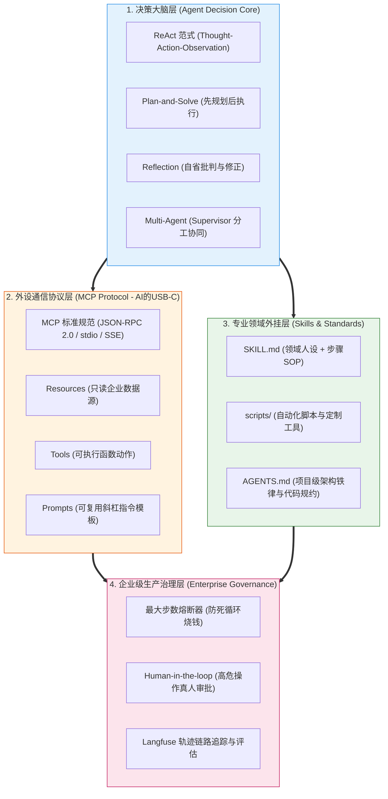

# 🎯 Agent、MCP 与 Skills：本章通关总结与复习

> [!abstract] 一句话总结
> 从 Chatbot 到自主数字员工的跃迁，依赖于**“以 ReAct / 状态机为决策大脑，以 MCP 开放协议为通用外设总线，以 Skills 为即插即用领域专业技能包，并以 Human-in-the-Loop（人机协同）建立安全终极底线”**的工业闭环。

---

## 🗺️ 全章知识拓扑大一统

---

## 📊 核心模块关键结论总览

| 模块分层 | 核心攻坚问题 | 第一性原理关键结论 | 对应笔记精读 |
| :--- | :--- | :--- | :--- |
| **00 全景心智** | 为什么 Chatbot 会被淘汰，Agent 才是未来？ | Chatbot 只是动嘴的顾问，人类仍需手动干活；Agent 具备“感知-规划-行动-反思”闭环，真正交付确定性业务结果。 | [[00-Agent-MCP-Skills全景与心智模型]] |
| **01 决策模式** | ReAct 与 Plan-and-Solve 怎么选型？ | 未知动态环境、排障、即时客服选 **ReAct**（走一步看一步）；确定性强、长链路大任务选 **Plan-and-Solve**（全局拆解）。 | [[01-Agent设计模式详解]] [[03-ReAct-Spring-AI实现]] [[04-Plan-and-Execute-实现]] |
| **09 MCP 协议** | 为什么说 MCP 是 AI 时代的 USB-C 接口？ | 打破工具与框架私有绑定的数据孤岛；通过标准 JSON-RPC 规范统一对外暴露 Resources、Tools 与 Prompts，实现多对多自由插拔。 | [[09-MCP协议详解]] [[10-MCP-Server开发-Java实战]] [[11-MCP-Client开发实战]] |
| **13 Skills 体系** | 有了 MCP 为什么还需要 Skills？ | MCP 解决“怎么连工具”，Skills 解决“怎么用专业 SOP 干好业务”；通过 `SKILL.md` 实现领域知识、推理模板与校验脚本的即插即用。 | [[13-Skills详解]] [[14-设计自己的Skill实战]] [[16-AGENTS规范详解]] |
| **21 权限与安全** | 如何防止 Agent 成为“内网破坏狂”？ | 绝对不能把工具当全权信任；只读工具自动执行，写操作做 RBAC 校验，破坏性操作（删库/发钱/部署）必须阻断并走 **Human-in-the-loop** 人工审批。 | [[20-Agent安全与防注入]] [[21-Agent权限治理与分级自治]] [[22-Agent成本控制与降级]] |

---

## ⚡ 大厂面试 30 秒绝杀 10 连问

> [!important] 高频核心问题直击要害
>
> 1. **什么是 Agent（智能体）？它与传统的单次大模型调用（LLM Call）有什么本质区别？**
>    - 答：传统 LLM 调用是“单次输入 $\to$ 概率生成”的被动无状态映射；Agent 是**以大语言模型为决策大脑，结合了感知（Perception）、内部记忆（Memory）、自主规划（Planning）与工具执行（Tool Use）的自主闭环系统**。它能够根据目标自主拆解步骤、调用外部物理工具并根据执行反馈（Observation）动态纠偏，直至最终交付业务结果。
>
> 2. **请阐述 ReAct 范式的核心运行机制，并指出其最常遭遇的生产缺陷与应对策略？**
>    - 答：ReAct 核心为 `Thought → Action → Observation` 状态机循环：模型先进行因果推理提出假设，选择工具执行行动，捕获外部真实结果作为新输入纠偏下一步。**最常见缺陷**是工具报错时模型陷入**“死循环调用”**。**应对策略**：① 设置 `max_iterations` 硬步数熔断；② 检测连续相同调用的签名哈希；③ 工具返回值进行脱敏截断，防止大段自然语言撑爆上下文。
>
> 3. **Anthropic 提出的 MCP（Model Context Protocol）协议解决了什么行业痛点？其核心架构包含哪三大部分？**
>    - 答：MCP 解决了各大 AI 客户端与外部数据源/工具私有协议碎片化的问题，充当**“AI 时代的 USB 接口”**。核心三要素：
>      - **Resources**：向大模型提供只读的上下文数据（如文件、数据库表结构）；
>      - **Tools**：向大模型暴露可执行的函数或动作（如发邮件、写 SQL、调终端）；
>      - **Prompts**：标准化的提示词模板与斜杠指令，实现交互标准化。
>
> 4. **Function Calling 与 MCP 有何本质区别与联系？**
>    - 答：Function Calling 是**大模型厂商在 API 层面提供的单次函数参数决策能力**（模型输出 JSON 格式的函数名和入参）；MCP 是**建立在系统之上的跨进程/跨网络应用层通信协议标准**。MCP Server 将工具封装为标准化服务，Agent（MCP Client）通过 JSON-RPC 发现并借助 Function Calling 完成物理调用，MCP 是 Function Calling 在企业级生态上的大一统标准化扩展。
>
> 5. **什么是 Skills？它与 System Prompt 或普通工具有何不同？**
>    - 答：Skill 是一个**高内聚的领域专业能力包（包含 SKILL.md、执行脚本、知识引用）**。普通 System Prompt 只是宽泛的人设，容易遗忘细节；普通工具只是原子函数。Skill 将“怎么拆解问题、调哪个工具、怎么校验结果”的完整 SOP（标准作业程序）打包，平时仅暴露名称与简述，被触发时才渐进式加载（Progressive Disclosure），极大节约上下文。
>
> 6. **在 LangGraph 或基于状态图（StateGraph）的生产编排中，为什么必须引入 Checkpointing（检查点持久化）？**
>    - 答：复杂 Agent 任务可能耗时数分钟甚至跨越数小时，若节点中途发生网络超时、容器重启或等待人类审批（Human-in-the-loop），内存状态会全部丢失。基于 Checkpointing，系统在每一步状态转移后将图状态持久化至 Redis/PostgreSQL，不仅支持跨节点断点续跑，还天然支持时间旅行（Time Travel）回溯调试。
>
> 7. **如何防止 Agent 遭遇间接提示注入（Indirect Prompt Injection）并沦为“内鬼”？**
>    - 答：当 Agent 读取第三方网页、外部文档或客服邮件时，其中可能隐藏了恶意提权指令。防御必须实施**“最小权限与数据沙箱”**：① 工具执行的凭证必须绑定当前人类用户的真实 Session Token，绝不给 Agent 超级管理员提权凭证；② 涉及外发邮件、转账、写库的动作必须经过代码层白名单与参数清洗；③ 关键高危动作必须阻断并弹出人机协同审批。
>
> 8. **在企业落地多智能体（Multi-Agent）时，为什么很多项目最后演变成了“低效的灾难”？**
>    - 答：盲目追求拟人化角色扮演（如让“产品经理Agent”、“架构师Agent”、“程序员Agent”在群里闲聊开会）。缺陷在于：多智能体之间来回通信不仅浪费巨额 Token 和漫长延迟，而且误差会级联放大（Cascading Errors）。**生产法则**：优先采用 **单个强力 Agent + 确定性工作流（Workflow）**；只有当子任务领域知识极端垂直且必须物理隔离工具栈时，才采用 Supervisor 树状层级分发。
>
> 9. **什么是 Human-in-the-Loop（人机协同）？在 Agent 架构中如何优雅落地？**
>    - 答：对于具备不可逆副作用或高风险的写操作，大模型只负责“分析并起草参数提案（Drafting）”，系统状态机在执行前主动挂起（Suspended），向前端 WebSocket 推送待确认卡片。只有当真实人类在 UI 界面点击“确认授权”后，状态机才唤醒并由普通后端 API 真实提交物理调用。
>
> 10. **如何量化评估一个企业级 Agent 的真实生产表现？**
>     - 答：建立**“端到端结果 + 中间执行轨迹”**的双重评估体系：
>       - **结果指标**：任务成功率（Task Success Rate）、最终输出准确度；
>       - **过程指标**：工具选择准确率（Tool Selection Accuracy）、参数合法率、平均循环步数（Steps to Complete）、死循环率以及单任务 Token 消耗成本。

---

## 🚨 生产落地十诫（Architectural Commandments）

1. **一戒无死循环熔断裸奔**：Agent 循环必须设置 `max_iterations`（硬上限 6~10 次），绝不允许无休止试错。
2. **二戒高危写操作全自动**：删库、转账、改密、发生产邮件必须接入 Human-in-the-Loop 真人点击授权。
3. **三戒私有协议反复造轮子**：跨系统能力集成优先拥抱 **MCP 标准协议**，实现工具组件全生态自由复用。
4. **四戒工具返回自然语言小作文**：工具方法返回值必须做结构化 DTO 提炼，坚决防止冗余数据撑爆上下文。
5. **五戒沉迷多智能体角色过家家**：能用单个 ReAct/Plan-Solve 解决的，坚决不用 Multi-Agent 树状开会。
6. **六戒赋予 Agent 越权超级凭证**：工具方法必须继承当前登录用户的真实 RBAC 权限，严防间接注入跨权攻击。
7. **七戒缺乏单步 Trace 链路观测**：生产 Agent 必须接入 Langfuse / OpenTelemetry，对每一次 Thought、Action、Observation 完整留痕。
8. **八戒全量加载所有工具 Schema**：工具超过 20 个时必须采用语义检索动态路由挂载，避免大量无用 Schema 稀释注意力。
9. **九戒忽略工具幂等性与失败补偿**：长链路 Agent 工具必须具备幂等性（Idempotency），并配套设计失败回滚（Compensating Action）机制。
10. **十戒静态文档当作代码维护**：AGENTS.md 与 SKILL.md 必须纳入 Git 版本控制，享受与业务代码同等的审查与 CI 验证流程。

---

## 🔗 下一章通关衔接

你已经登顶了自主智能体与开放协议的巅峰！接下来我们将跨入企业级落地的最后一公里：

👉 进入下一章：[[../06-平台与工程化/_index|06 · 平台与工程化]]
- 企业级 AI 网关（路由、限流、鉴权、缓存降本）；
- 全链路可观测性（Langfuse / OpenTelemetry）与大模型评测体系；
- 本地私有化大模型推理底座（vLLM / Ollama）与微服务治理闭环！
