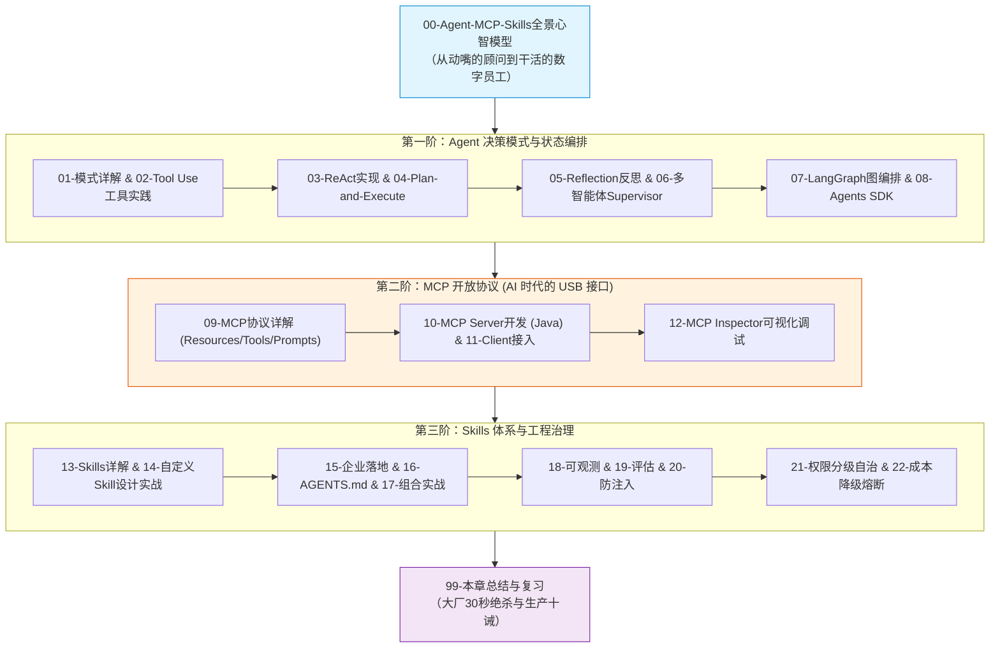

# 🤖 05 · Agent · MCP · Skills

> [!info] 本区说明
> 对应学习路径 **阶段五**。系统攻坚大模型从“对话框”走向“数字化员工”的核心三要素：Agent 决策模式、MCP 开放总线协议与 Skills 领域技能包。

---

## 🗺️ 通关全景学习路线

---

## 📚 知识笔记清单

### 00 · 全景心智
- [ ] [[00-Agent-MCP-Skills全景与心智模型]] 🌟（数字员工心智模型、三大支柱解耦、MCP USB-C 革命）

### 01 · Agent 核心设计模式
- [ ] [[01-Agent设计模式详解]]（七大模式：ReAct/Plan-Solve/Reflection/Multi-Agent）
- [ ] [[02-Tool-Use工具调用-代码实践]]（参数自省、JSON Schema 编译与反射）
- [ ] [[03-ReAct-Spring-AI实现]]（Thought-Action-Observation 状态机闭环）
- [ ] [[04-Plan-and-Execute-实现]]（先规划后执行、长任务自顶向下拆解）
- [ ] [[05-Reflection-实现]]（自我批判与循环修正）
- [ ] [[06-Multi-Agent-Supervisor实现]]（主管路由与多智能体分工协作）
- [ ] [[07-LangGraph生产级Agent编排]]（基于状态图 StateGraph 的持久化与检查点）
- [ ] [[08-OpenAI-Agents-SDK与Handoffs-Guardrails]]（会话交接 Handoffs 与安全护栏）

### 02 · MCP 开放协议实战
- [ ] [[09-MCP协议详解]]（Model Context Protocol 规范：Resources/Tools/Prompts）
- [ ] [[10-MCP-Server开发-Java实战]]（Java 编写原生 MCP Server 暴露服务）
- [ ] [[11-MCP-Client开发实战]]（Spring AI 接入外部 MCP 工具与连接池管理）
- [ ] [[12-MCP调试-Inspector]]（使用官方 Inspector 工具单步调试与抓包）

### 03 · Skills 领域技能体系
- [ ] [[13-Skills详解]]（SKILL.md 规范、元数据与渐进式加载机制）
- [ ] [[14-设计自己的Skill实战]]（手写标准化自动化排障/代码生成 Skill）
- [ ] [[15-Skills在企业落地的模式]]（版本治理、分发中心与企业私有技能仓库）
- [ ] [[16-AGENTS规范详解]]（AGENTS.md 项目级边界指令与代码规范）
- [ ] [[17-Agent-MCP-Skills组合实战]]（大脑+接口+技能包终极联动）

### 04 · 生产治理与可观测
- [ ] [[18-Agent可观测]]（Langfuse 轨迹追踪、耗时分析与 Token 归因）
- [ ] [[19-Agent评估]]（任务完成率与工具调用准确率 Benchmark）
- [ ] [[20-Agent安全与防注入]]（间接提示注入拦截与数据沙箱）
- [ ] [[21-Agent权限治理与分级自治]]（Human-in-the-loop 人机协同审批门禁）
- [ ] [[22-Agent成本控制与降级]]（Max Iterations 熔断与模型降级策略）

### 99 · 本章通关总结
- [ ] [[99-本章总结与复习]]（全章核心拓扑、大厂 30 秒必杀 10 连问、生产落地十诫）

---

## 🔗 相关链接

- 上级总览：[[../00-总览/学习仪表盘]]
- 前置章节：[[../04-多轮对话与上下文工程/_index|04 · 多轮对话与上下文工程]]
- 下一章节：[[../06-平台与工程化/_index|06 · 平台与工程化]]
