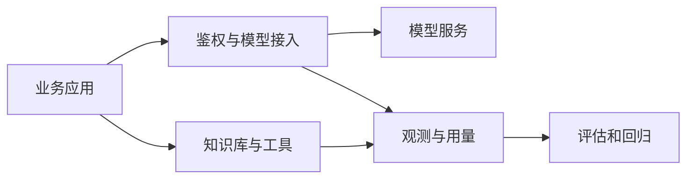

# 🏭 AI 平台与工程化全景

> [!abstract] 一句话总结
> AI 应用上线不仅要能调用模型，还要根据业务需要处理权限、成本、故障、观测和评估；先确定问题，再选择平台与组件。

## 🎯 从一个知识库问答应用出发

原型可能只需接入模型、检索资料并回答。多人使用后，还要知道谁能查哪些资料、每次调用花了多少、结果为什么错误，以及更新模型后旧问题是否退化。工程化就是逐项补上这些能力，不代表必须一次部署全部组件。

## 🧩 各类组件解决什么？

| 组件 | 主要作用 | 本章内容 |
| :--- | :--- | :--- |
| 应用编排平台 | 配置流程、模型和知识库 | [[01-Dify部署与使用]]、[[04-RAGFlow]] |
| 模型网关 | 集中鉴权、路由、限流和用量统计 | [[10-LiteLLM与One-API]]、[[11-AI网关生产架构-限流-计费-审计]] |
| 可观测平台 | 记录链路、耗时、用量和错误 | [[06-Langfuse接入]] |
| 评估工具 | 在测试集上比较回答与检索效果 | [[07-Ragas评估实践]]、[[09-AI应用评估数据集与回归测试]] |
| 推理服务 | 在自己的硬件上运行模型 | [[12-私有化部署-Ollama-vLLM-SGLang]] |

同一种产品可能覆盖多个职责；是否自建推理服务、使用低代码平台或部署独立网关，取决于权限要求、模型能力、预算和团队运维能力。

## ⚙️ 上线前先验证什么？

1. **授权**：识别用户和租户，检查可访问的模型、资料和工具。
2. **可观测**：关联请求与模型、检索和工具日志；敏感数据按需求脱敏。
3. **评估**：准备包含正常、无答案和越权场景的问题集，对比召回、回答、耗时和成本。
4. **故障处理**：验证超时、限流、流式中断和上游异常；重试与切换要有边界。

> [!question]- 为什么接口兼容 OpenAI 格式，也不能假设换模型一定没有问题？
> 不同服务支持的参数、工具调用、流式事件和用量字段可能不同，还要检查质量、权限、延迟和价格。

## 🔗 关联与资料

- 选型：[[05-平台选型对比]]；实践路线：[[_index]]。
- [Spring AI：Observability](https://docs.spring.io/spring-ai/reference/observability/index.html)
