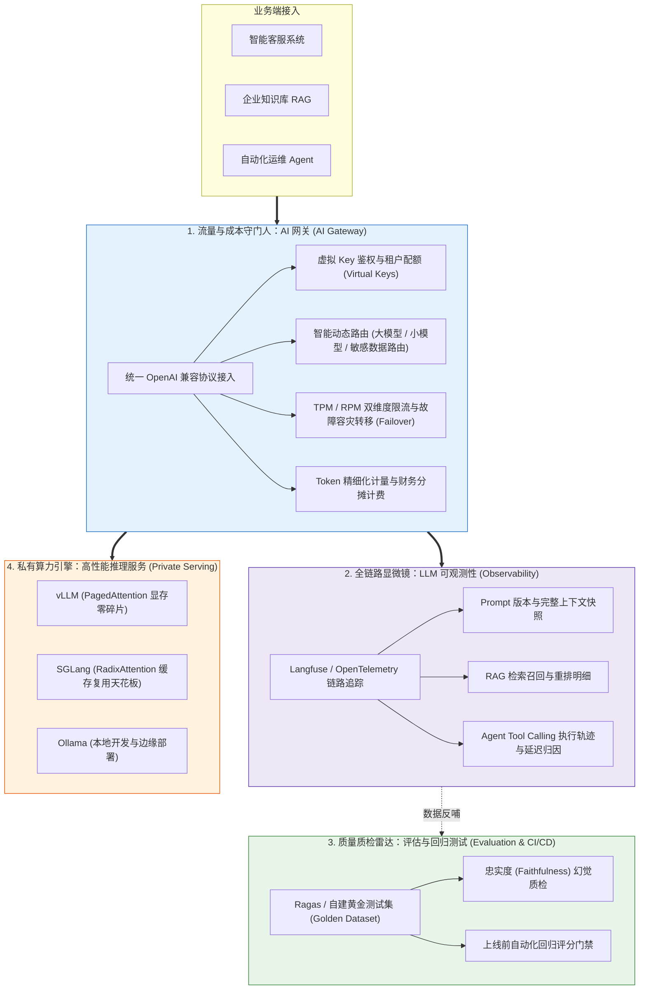
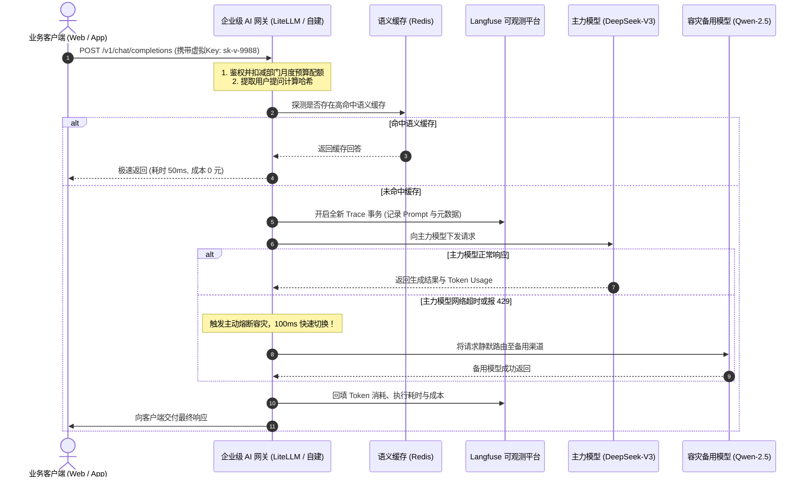
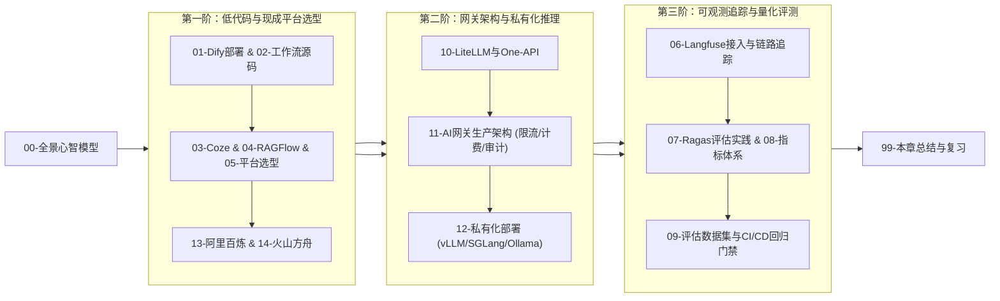

# 🏭 AI 平台与工程化全景心智模型：从“手工作坊”到“工业流水线”

> [!abstract] 一句话总结
> AI 应用从“个人玩具（Demo）”走向“企业级生产（Production）”的鸿沟，必须依靠**“AI 网关收敛流量与计费、Langfuse 统一可观测链路追踪、vLLM/SGLang 榨干私有算力、Ragas 自动化回归评估”**四大工程基础设施来填平。

---

## 🗣️ 白话版（先建立直觉）

想象你们团队刚刚写完了一个非常惊艳的 AI 智能助手 Demo，老板兴奋地宣布：“下周立刻全公司上线，向全体外部客户开放！”
这时候，如果你把这个**裸跑的 Demo**直接推向公网，一周之内你将面临**四大灾难级惨案**：

1. **财务失控惨案（无网关治理）**：
   某个业务方写了个死循环脚本，或者黑客用脚本疯狂并发刷接口，OpenAI 绑定的信用卡一晚上被刷爆 20 万元！财务总监直接拿着账单提刀找你。
2. **服务瘫痪惨案（无供应商容灾）**：
   周二下午 2 点，主力模型供应商突然海外服务网络波动，返回大面积 `503 Service Unavailable`。由于你的代码里直接写死了这个供应商的 URL 和 Key，全公司数十个业务线同时瘫痪，客服电话被打爆。
3. **幽灵悬案（无可观测 Trace）**：
   大客户向高管投诉：“你们的 AI 刚才给我报了一个完全离谱的虚假价格，导致我们合同签错了！”你打开服务器控制台，日志里只有零散的 `200 OK`，你根本不知道当时模型看到了哪篇 RAG 文档？调了哪个工具？为什么会说出这句话？完全无法复盘推责！
4. **模型升级踩雷惨案（无量化评估门禁）**：
   听说 DeepSeek 或 OpenAI 出了一个更便宜的新模型，你兴冲冲地在代码里把模型名字改了。上线后才发现，这个新模型在特定退款政策计算上的准确率从 95% 暴跌到了 60%，引发大面积退款客诉！

**从写一个“调 API 的 Demo”，到支撑“高并发、高可用、低成本、强审计”的企业级生产系统，中间差了一整个工业化基础设施体系！**

---

## 📌 第一性原理：企业级 AI 工程化的四大基石

---

## 🧩 工业级四大基石的核心职责解析

### 基石 1：AI 网关（AI Gateway）——绝不允许业务直连外部模型！
- **屏蔽多厂商协议异构**：统一对外提供 OpenAI 兼容的 HTTP 接口，底层可无缝桥接 Claude、Gemini、DeepSeek、阿里云百炼以及私有化部署模型；
- **虚拟 Key 与多租户预算治理**：业务方只能拿到网关分配的 `sk-virtual-xxxx` 虚拟令牌，网关按部门设置每月 Token 配额（如财务部限额 5000 元），超额自动拦截；
- **主动故障转移（Failover）**：当主力供应商超时或返回 `429 Too Many Requests` 时，网关在 100 毫秒内自动将请求静默重试切换到备用模型渠道，业务层零感知；
- **缓存降本（Semantic Cache）**：对于常见的高频相同提问，网关直接命中语义缓存返回，根本无需请求底层大模型，节省 80% 成本。

### 基石 2：全链路可观测性（Langfuse / OpenTelemetry）
- 传统的 APM（如 SkyWalking、Pinpoint）只能记录 HTTP 请求耗时，对大模型内部的交互是“两眼一抹黑”；
- **LLM-Specific Trace（大模型专用链路追踪）**：
  必须清晰展现单次请求中：
  - 发送给大模型的**完整精确 Prompt 字符串**（包含渲染后的变量）；
  - 检索召回了哪 3 个 Chunk，每个 Chunk 的余弦相似度是多少；
  - Agent 的每一步 `Thought` 是什么，调用了什么工具，参数是什么；
  - 本次调用的真实 Token 消耗（Prompt Tokens, Completion Tokens）以及按公有云单价换算后的**真实美元/人民币成本**。

### 基石 3：私有化高性能推理底座（vLLM vs SGLang vs Ollama）
- 当涉及核心敏感数据（如金融风控、医疗病历）必须在企业内网私有化部署时，如何榨干昂贵的 GPU（如 A100/H800/4090）显存？
- **vLLM**：首创 **PagedAttention** 技术，像操作系统虚拟内存分页一样管理 KV Cache，彻底消除了显存碎片，吞吐量比原生 HuggingFace 提升 5~10 倍；
- **SGLang**：首创 **RadixAttention**，将前缀 KV Cache 组织为基数树，在复杂多轮对话与 Agent 场景下缓存复用率极高，并发推理速度顶尖；
- **Ollama**：基于 `llama.cpp`，主打个人单机极速运行，一键安装 GGUF 量化模型。

### 基石 4：自动化评估与回归测试门禁（Evaluation CI/CD）
- 传统的代码可以用 JUnit 单测保证 100% 确定性；但大模型输出是非确定性的，**如何知道改了一句 Prompt 是让系统变得更好还是更差了？**
- 构建由 200 个真实业务问答组成的 **黄金测试集（Golden Dataset）**；
- 每次修改 Prompt、更换 Embedding 或切换大模型版本时，CI/CD 自动化流水线自动运行测试集，利用 **Ragas** 评测框架对**忠实度（Faithfulness）、答案相关性（Answer Relevance）**进行打分；
- 若评分相比基线下降超过 2%，直接中断部署、阻止合并上线！

---

## 🗺️ 企业级大模型请求全链路工业时序

---

## 🧭 本章通关路线指引

> [!TIP]
> 学习心法：对于刚开始接触 AI 的企业，先用 **Dify / 阿里百炼** 快速验证商业可行性；当业务规模扩大、涉及敏感合规与多团队成本分摊时，再逐步自建 **AI 网关 + Langfuse 链路追踪 + vLLM 私有算力**，切忌在业务尚不明确时就投入巨资盲目采购重型 GPU 集群！
