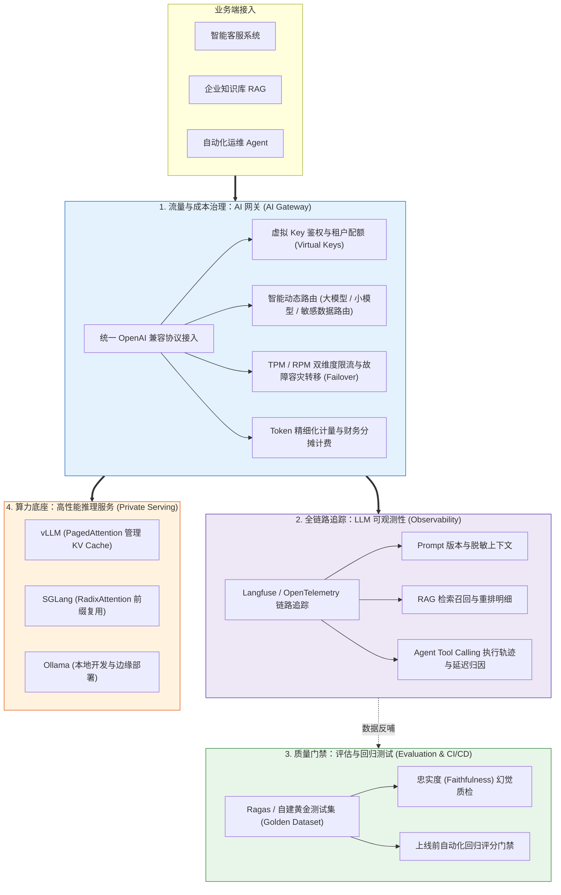
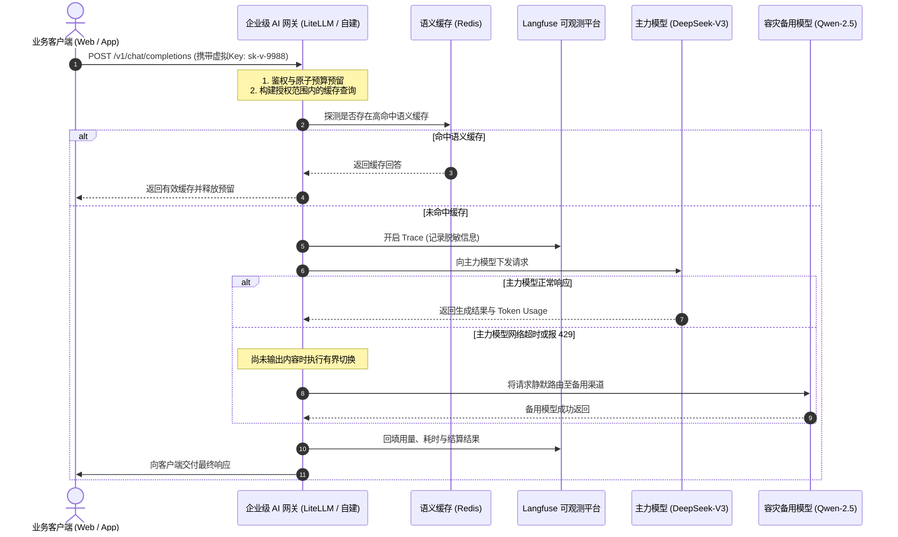
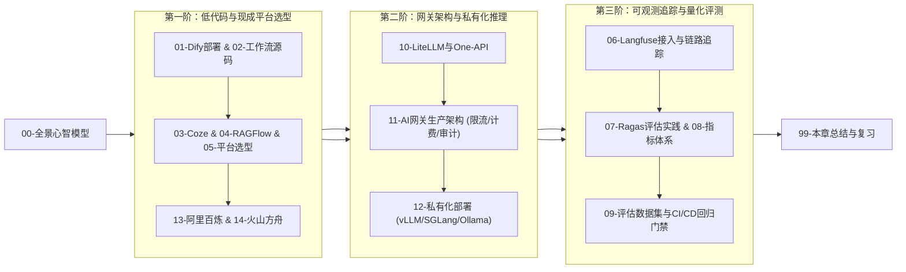

# 🏭 AI 平台与工程化全景心智模型

> [!abstract] 一句话总结
> AI 应用从原型走向生产环境，需要系统化解决流量治理、成本核算、故障容灾、链路可观测与持续质量评测等工程问题。本章围绕低代码编排平台、AI 网关、可观测与评估体系以及私有化推理服务四大核心板块，梳理企业级 AI 工程化的架构设计与选型边界。

---

## 📌 核心工程诉求

在原型验证阶段，开发重点通常是验证提示词与业务逻辑能否跑通；而在生产环境中，系统还需具备多租户权限与配额控制、全链路 Token 成本核算、上游模型限流或故障时的平滑切换，以及 Prompt 或模型升级前的自动化回归验证。团队可根据业务发展阶段、调用规模与数据合规要求，按需分阶段引入对应的工程组件。

---

## 📌 第一性原理：企业级 AI 工程化的四大基石

---

## 🧩 工业级四大基石的核心职责解析

### 基石 1：AI 网关（AI Gateway）——统一接入与流量治理
- **协议标准化适配**：对外提供统一的 OpenAI 兼容接口层，屏蔽不同模型厂商的底层 API 差异；对于工具调用（Tool Calling）、流式事件（SSE）及多模态输入输出，需结合具体目标渠道做兼容性验证。
- **鉴权与配额预算**：集中托管上游供应商真实 API Key，向内部业务方签发受控虚拟 Key（Virtual Keys），实施 RPM/TPM 多维限流，并通过“调用前预留额度 + 调用后幂等结算”实现租户级成本管控。
- **高可用容灾切换（Failover）**：针对上游网络超时、429 限流或 5xx 错误执行有界退避重试；在流式响应尚未输出首包前可透明切换至备用模型渠道，若已向客户端输出部分内容则直接中止并通知调用方，避免跨模型拼接响应。
- **语义与精确缓存**：在严格绑定租户权限、模型版本、系统提示词与知识库版本的前提下复用高频问答结果，降低推理延迟与调用成本。

### 基石 2：全链路可观测性（Langfuse / OpenTelemetry）
- **分布式追踪串联**：将入口业务请求、RAG 检索召回、Prompt 模板渲染、多轮模型推理与工具执行串联在同一条 Trace 下，可结合 OpenTelemetry 标准埋点与 Langfuse 等专项平台协同分析。
- **全维度审计与脱敏**：采集每次调用的 Prompt 版本、检索片段摘要、工具执行状态、首字延迟（TTFT）、Token 用量与费用明细；在落盘前对密钥、个人隐私等敏感字段执行脱敏，并设置合规的数据保留周期。

### 基石 3：私有化高性能推理底座（vLLM / SGLang / Ollama）
- **vLLM**：通过 PagedAttention 将 KV Cache 划分为固定大小的物理块进行非连续管理，显著减少显存分配浪费，结合 Continuous Batching 支撑高并发吞吐。
- **SGLang**：通过 RadixAttention 在显存中维护基数树（Radix Tree）以管理跨请求公共前缀缓存（Prefix Caching），在长 System Prompt、多轮对话与结构化输出场景下大幅降低重复计算与首字延迟。
- **Ollama**：基于 `llama.cpp` 提供开箱即用的单机模型管理与运行体验，适用于本地开发调试与轻量级边缘部署；生产高并发场景则应根据目标模型、硬件配置与压测吞吐指标选用 vLLM 或 SGLang 等服务化推理引擎。

### 基石 4：自动化评估与回归测试门禁（Evaluation & CI/CD）
- **独立基准测试集**：维护覆盖核心业务问答、无答案拒答、权限边界与提示词注入的黄金测试集（Golden Dataset），并与日常调参样本严格隔离。
- **多维指标联合度量**：在固定测试集、模型版本与评分配置的前提下，综合评估检索召回质量、上下文忠实度（Faithfulness）、业务事实正确性（Correctness）以及延迟与成本。
- **发布门禁与人工复核**：依据业务风险设定回归通过阈值，对安全越权与高危错误实施单独一票否决，并结合人工抽检完成上线验收。

---

## 🗺️ 企业级大模型请求全链路工业时序

---

## 🧭 本章通关路线指引

> [!TIP]
> 学习心法：对于刚开始接触 AI 的企业，先用 **Dify / 阿里百炼** 快速验证商业可行性；当业务规模扩大、涉及敏感合规与多团队成本分摊时，再逐步自建 **AI 网关 + Langfuse 链路追踪 + vLLM 私有算力**，切忌在业务尚不明确时就投入巨资盲目采购重型 GPU 集群！
