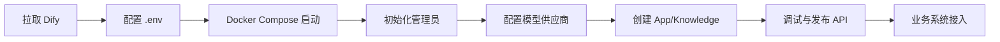

# Dify部署与使用

> [!abstract] 一句话总结
> Dify 是面向企业 AI 应用的低代码平台，适合快速搭建聊天助手、Agent、Workflow 和 RAG 应用；学习重点是把模型、知识库、工具、工作流、发布和运维串成一条可上线链路。

## 📌 定位

Dify 不是单纯的 Prompt 管理工具，而是应用编排平台：

- **应用层**：Chatbot、Agent、Workflow、Text Generator 等应用形态。
- **数据层**：Dataset/Knowledge 负责文档导入、切分、Embedding、召回和引用。
- **运维层**：API 发布、日志、应用调试、模型供应商配置、权限与密钥管理。

它适合团队先用低代码验证业务闭环，再把稳定链路通过 API 接到后端服务中；不适合把强事务、复杂权限流或重计算逻辑全部塞进工作流节点。

## 🤔 解决什么问题 / 为什么需要

- **缩短 AI 应用试错周期**：产品、算法、后端可以在同一个画布上调整 Prompt、知识库和工具调用。
- **统一模型接入**：OpenAI、Azure OpenAI、通义千问、火山方舟、本地模型等可以通过 Provider 配置进入同一应用。
- **沉淀 RAG 流程**：文档上传、解析、切分、索引、召回测试、引用展示都有平台化入口。
- **降低交付风险**：上线前能在调试台看到变量、节点输出、模型输入和错误信息。

## 🧩 核心组件

| 组件 | 作用 | 学习重点 |
| ---- | ---- | -------- |
| App | 对外发布的 AI 应用。 | 区分 Chatbot、Agent、Workflow 的适用场景。 |
| Workflow | 用节点编排输入、LLM、条件、工具、HTTP、变量和输出。 | 关注变量作用域、失败分支和节点超时。 |
| Knowledge/Dataset | 文档知识库与向量检索。 | 调 chunk size、overlap、TopK、rerank 和引用。 |
| Model Provider | 模型供应商配置。 | 模型能力、上下文窗口、价格、限流和区域合规。 |
| API/嵌入发布 | 将应用暴露给业务系统。 | Key 管理、调用日志、限流、灰度和回滚。 |

## ⚙️ 部署与接入流程



1. 准备 Docker、Docker Compose、域名/反向代理和持久化目录。
2. 复制官方 `.env.example`，配置 `SECRET_KEY`、数据库、Redis、对象存储、外部访问地址和模型 Provider。
3. 使用 Docker Compose 启动 API、Web、Worker、数据库、Redis、向量库等服务。
4. 在控制台配置模型 Key，创建知识库并用小样本文档验证召回。
5. 创建 Workflow 或 Chat App，固定输入变量、异常输出和引用展示格式。
6. 发布 API，后端只保存 Dify App Key，不把平台管理员 Key 下发到前端。

## 💻 接入示例

```bash
curl -X POST "$DIFY_BASE_URL/v1/chat-messages" \
  -H "Authorization: Bearer $DIFY_APP_API_KEY" \
  -H "Content-Type: application/json" \
  -d '{
    "inputs": {"tenant": "demo"},
    "query": "这份合同的付款条件是什么？",
    "response_mode": "blocking",
    "user": "u-1001"
  }'
```

后端接入时要记录 `conversation_id`、业务用户、请求耗时、Dify 返回错误码和模型 token 用量，方便把平台日志和业务日志对齐。

## ⚠️ 生产坑

- `.env` 中的外部 URL、回调地址和对象存储地址配置错，会导致文件预览、引用链接或 API 回调异常。
- 知识库只导入不评测，容易出现切分过碎、表格丢列、PDF 页眉污染召回的问题。
- Workflow 节点没有失败出口，模型超时、HTTP 500、工具返回空值时会把用户卡在无解释错误里。
- 多团队共用一个 Workspace 时要提前规划命名、权限、Key 归属和应用发布流程。
- Dify 适合做应用编排，不要把核心订单、支付、审批等事务状态只放在工作流变量里。

## 🎯 面试 / 选型

> [!question] 高频问题
> - Q: Dify 和 LangChain/Spring AI 的区别是什么？
>   - A: Dify 是平台和运行时，强调低代码编排、知识库和发布；LangChain/Spring AI 是代码框架，强调可控性和工程集成。团队要快速验证选 Dify，强定制和深度后端集成选代码框架。
> - Q: Dify 上线前怎么验收 RAG？
>   - A: 准备业务问题集，检查召回片段、引用来源、答案忠实度、拒答边界、耗时和 token 成本。
> - Q: 什么时候不建议用 Dify？
>   - A: 流程涉及复杂事务、一致性要求高、节点逻辑需要大量自定义代码，或平台运维能力不足时，应该用后端服务承载主流程。

## ✅ 精通检查清单

- 能独立完成 Docker Compose 部署并解释每个核心服务的作用。
- 能创建带知识库的 Chat App，并用 API 接入后端。
- 能定位一次知识库召回失败是解析、切分、Embedding、TopK 还是 Prompt 问题。
- 能说清 Dify、Coze、RAGFlow、LangChain/Spring AI 的取舍。

## 🔗 关联笔记

- [[_index]]
- [[10-AI应用开发/00-总览/学习仪表盘]]

## 📚 参考资料

- [Dify Docs](https://docs.dify.ai/)
- [Dify GitHub](https://github.com/langgenius/dify)
