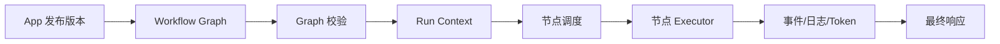

# Dify工作流引擎源码

> [!abstract] 一句话总结
> Dify 工作流引擎的核心价值是把节点图、变量、模型调用、工具调用和运行日志组织成可执行的节点图；读源码时要盯住图如何校验、节点如何调度、状态如何落库、异常如何返回。

## 📌 定位

Dify Workflow 是低代码平台的执行内核，负责把画布配置转换成一次可追踪的运行过程。它不是普通流程审批引擎，也不是 LangGraph 的一层 UI 包装，而是围绕 AI 应用定制的节点调度器。

适合重点阅读的对象：

- Workflow 定义：节点、边、变量、输入输出 schema。
- Runtime：一次执行中的上下文、节点状态、事件流和日志。
- Node executor：LLM、Code、HTTP、Knowledge Retrieval、Condition、Variable Aggregator、End 等节点。
- Persistence：应用版本、运行记录、节点输出、错误信息和 token 用量。

## 🤔 解决什么问题 / 为什么需要

- **让低代码画布可执行**：用户拖出来的是图，服务端必须校验节点依赖、变量引用和控制流。
- **把 AI 节点标准化**：模型调用、知识库检索、工具调用、代码执行都统一成节点输入输出。
- **支持调试复盘**：每个节点的入参、出参、耗时、错误和 token 成本都要能追踪。
- **隔离业务与平台**：业务系统只调用发布后的应用 API，不需要理解内部节点细节。

## 🧩 核心概念

| 概念 | 含义 | 精通要点 |
| ---- | ---- | -------- |
| Graph | Workflow 的节点和边。 | 检查非法依赖、不可达节点与缺失输入；显式 Loop/Iteration 按其规则校验。 |
| Node | 最小执行单元。 | 每类节点都有自己的参数 schema、校验和执行器。 |
| Variable | 节点间传递的数据。 | 注意系统变量、用户输入、节点输出和聚合变量的作用域。 |
| Event Stream | 调试和流式响应事件。 | 前端展示依赖节点开始、完成、失败、文本增量等事件。 |
| Run Record | 一次工作流执行记录。 | 生产排障要能从用户请求追到具体节点。 |

## ⚙️ 源码阅读路径



1. 从应用 API 入口开始，看请求如何绑定 app、conversation、user 和输入变量。
2. 找 Workflow 版本加载逻辑，确认运行时读的是已发布版本还是草稿版本。
3. 顺着 Graph 校验逻辑看节点 schema、边合法性和变量引用检查。
4. 阅读节点执行器基类，再挑 LLM、Knowledge Retrieval、HTTP、Code、Condition 五类节点深挖。
5. 观察异常处理：节点失败时是中断、重试、走分支，还是返回平台错误。
6. 对照调试台，验证源码中的事件类型如何被前端渲染成执行轨迹。

## 💻 调试建议

```text
最小样例：
Start -> Knowledge Retrieval -> LLM -> End

观察点：
1. Start 输入变量如何进入上下文
2. Retrieval 返回片段如何绑定到 LLM Prompt
3. LLM token 用量如何写入 run record
4. End 节点如何选择输出字段
```

读源码时不要先追全部模块，先用一个最小 Workflow 跑通，再把断点放在节点执行器、变量解析和事件发送处。

## ⚠️ 生产坑

- 画布里变量名改了，后续节点引用没同步，调试阶段能暴露，发布后会变成线上运行失败。
- Code/HTTP 节点把外部系统错误原样传给用户，容易泄露内部地址、参数和异常栈。
- 长链路 Workflow 没有节点级超时和预算，单次请求会被慢模型或慢接口拖垮。
- 流式输出和最终输出不是同一个阶段，前端不能只靠最后响应判断节点是否全部成功。
- 读源码时只看 API 层会误判能力边界，真正的限制通常在节点 schema、沙箱和运行时配置里。

## 🎯 面试 / 选型

> [!question] 高频问题
> - Q: Dify Workflow 为什么要做 DAG 校验？
>   - A: 图拓扑校验能够在调试与发布阶段提前拦截非法节点依赖、悬空变量引用与不可达分支；对于需要循环处理的场景，引擎通过专门的 Loop / Iteration 容器节点提供受控迭代，并在容器内强制约束最大迭代次数、终止条件与超时时间。
> - Q: 工作流引擎和普通后端编排有什么区别？
>   - A: AI 工作流要额外处理 Prompt、模型流式输出、token 成本、知识库片段、工具结果和可复盘 trace。
> - Q: 什么时候应该绕开 Dify Workflow？
>   - A: 流程需要复杂事务、强一致性、精细权限或高并发低延迟时，把主流程放回后端服务，Dify 只承担模型编排片段。

## ✅ 精通检查清单

- 能画出 Dify Workflow 从发布配置到运行响应的路径。
- 能解释 LLM、HTTP、Knowledge、Condition 节点的输入输出。
- 能根据一次失败 trace 判断是变量解析、节点执行还是模型返回问题。
- 能说清平台工作流和代码编排框架的边界。

## 🔗 关联笔记

- [[_index]]
- [[01-Dify部署与使用]]
- [[../00-总览/学习仪表盘]]

## 📚 参考资料

- [Dify Docs](https://docs.dify.ai/)
- [Dify GitHub](https://github.com/langgenius/dify)
