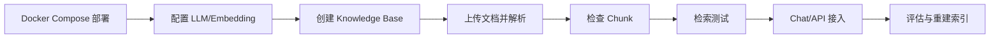

# RAGFlow

> [!abstract] 一句话总结
> RAGFlow 是偏“文档理解 + RAG 问答”的开源平台，强项是复杂文档解析、知识库管理、检索调试和带引用回答；学习重点是部署后把文档解析、索引、召回、回答评估串起来。

## 📌 定位

RAGFlow 更像 RAG 专用平台，不是通用 Agent 画布。它适合 PDF、Word、表格、扫描件等知识密集型场景，尤其适合先把文档解析和召回质量做好，再对外提供问答或 API。

和 Dify 的区别：

- RAGFlow 更重文档解析、chunk 可视化、知识库问答和检索效果。
- Dify 更重应用编排、Workflow、模型接入和发布。
- 复杂企业文档先用 RAGFlow 打磨知识库，再由业务系统或 Dify 编排上层流程，是常见组合。

## 🤔 解决什么问题 / 为什么需要

- **处理复杂文档**：表格、标题层级、页眉页脚、版面结构会直接影响召回质量。
- **可视化检索调试**：能查看命中的 chunk、相似度、引用来源和回答依据。
- **知识库 API 化**：后端可以把检索或问答能力接入客服、OA、搜索和审计系统。
- **减少 RAG 黑盒感**：从文档导入到回答引用，每一步都有可检查对象。

## 🧩 核心组件

| 组件 | 作用 | 学习重点 |
| ---- | ---- | -------- |
| Document Parser | 抽取文本、表格、图片和版面结构。 | PDF 表格、扫描件 OCR、页眉噪声和目录层级。 |
| Chunk | 可检索片段。 | chunk 大小、重叠、标题继承和元数据。 |
| Embedding/Index | 向量化与索引。 | 模型维度、距离函数、批量入库和重建索引。 |
| Retrieval | 用户问题召回片段。 | TopK、相似度阈值、关键词/向量混合检索、rerank。 |
| Chat/Agent | 基于召回片段生成答案。 | 引用、拒答、上下文预算和模型选择。 |

## ⚙️ 部署与使用流程



1. 使用官方 Docker Compose 部署，确认 Elasticsearch/Infinity、MySQL、Redis、MinIO 等依赖正常。
2. 配置聊天模型、Embedding 模型和必要的 OCR/解析能力。
3. 按业务域拆知识库，不要把制度、合同、产品手册全部混进一个库。
4. 上传文档后先检查解析结果，再决定是否调整解析模板、chunk 策略和元数据。
5. 用业务问题集测试召回，记录未命中、误命中和答案无引用的样例。
6. 通过 Chat 或 API 接入业务系统，并保存文档版本、chunk ID 和引用链接。

## 💻 接入示例

```text
用户问题 -> RAGFlow 检索 -> 命中 chunk + 引用
                       -> LLM 生成答案
业务系统 <- answer + reference + conversation_id
```

接入时要把“答案文本”和“依据片段”一起返回给前端；只展示答案不展示引用，会让 RAG 失去可审核性。

## ⚠️ 生产坑

- 复杂 PDF 直接入库不验 chunk，表格列名和单元格内容可能被拆散，答案看似合理但依据错误。
- Embedding 模型替换后不重建索引，会出现维度不匹配或召回质量异常。
- 知识库按组织架构粗暴合并，检索时跨部门命中无关制度，导致回答污染。
- 只调 TopK 不调 chunk 和 rerank，很难解决“召回多但有效少”的问题。
- 文档更新没有版本策略，旧 chunk 残留会让模型引用过期条款。

## 🎯 面试 / 选型

> [!question] 高频问题
> - Q: RAGFlow 适合解决哪类问题？
>   - A: 适合企业文档问答，尤其是 PDF、表格、制度、合同、手册等需要解析质量和引用溯源的场景。
> - Q: RAGFlow 和向量数据库的区别是什么？
>   - A: 向量数据库只管存储和检索向量；RAGFlow 覆盖文档解析、切分、索引、问答、引用和调试。
> - Q: RAGFlow 上线前怎么验收？
>   - A: 用固定问题集检查召回率、引用正确率、拒答、过期文档、表格问答和响应耗时。

## ✅ 精通检查清单

- 能部署 RAGFlow 并配置聊天模型、Embedding 模型。
- 能解释文档解析、chunk、Embedding、rerank 对答案质量的影响。
- 能用问题集定位 RAG 失败发生在解析、召回还是生成阶段。
- 能把 RAGFlow 和 Dify/Ragas/Langfuse 组合成生产闭环。

## 🔗 关联笔记

- [[_index]]
- [[06-Langfuse接入]]
- [[07-Ragas评估实践]]
- [[../00-总览/学习仪表盘]]

## 📚 参考资料

- [RAGFlow Docs](https://ragflow.io/docs)
- [RAGFlow GitHub](https://github.com/infiniflow/ragflow)
