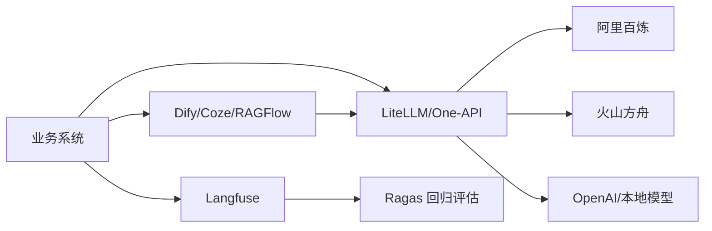

# 平台选型对比

> [!abstract] 一句话总结
> AI 应用平台选型要按“应用编排、RAG、观测评估、模型网关、云模型供应商”分层判断；Dify、Coze、RAGFlow、Langfuse、Ragas、LiteLLM、百炼和方舟解决的是不同工程问题。

## 📌 选型地图

不要把所有平台放在同一张横向表里硬比。更实用的分层是：

- **应用编排**：Dify、Coze。
- **RAG 平台**：RAGFlow、Dify Knowledge。
- **可观测/评估**：Langfuse、Ragas。
- **模型网关**：LiteLLM、One-API、自研网关。
- **模型供应商**：阿里百炼、火山方舟、OpenAI、Azure、本地模型。

一个生产系统通常不是选一个，而是组合：业务后端 + AI 网关 + 模型供应商 + RAG/Workflow 平台 + Langfuse/Ragas 评估闭环。

## 🤔 选型维度

| 维度 | 要问的问题 | 影响 |
| ---- | ---------- | ---- |
| 部署方式 | SaaS、自托管、私有化、国内云？ | 数据合规、运维成本、网络连通性。 |
| 应用类型 | 问答、Agent、Workflow、抽取、RAG？ | 决定选 Dify、Coze、RAGFlow 还是代码框架。 |
| 模型策略 | 单供应商还是多供应商？ | 决定是否需要 LiteLLM/One-API。 |
| 观测评估 | 是否要 trace、dataset、自动评分？ | 决定接 Langfuse/Ragas 的深度。 |
| 团队能力 | 产品低代码还是研发主导？ | 影响可控性、上线速度和维护成本。 |
| 生产要求 | 权限、审计、限流、成本、SLA？ | 决定是否需要自研补齐平台短板。 |

## 🧩 平台对比

| 平台 | 定位 | 适合 | 谨慎点 |
| ---- | ---- | ---- | ------ |
| Dify | 自托管应用编排平台。 | Workflow、RAG、API 发布、企业内部应用。 | 复杂事务和强权限不要全放画布。 |
| Coze/扣子 | Bot/Agent 和渠道发布平台。 | 快速做 Bot、插件、渠道分发。 | 私有化、深度定制和内网集成要评估。 |
| RAGFlow | 文档理解和 RAG 平台。 | 复杂 PDF/表格/制度问答。 | 按具体版本验证工作流、权限和扩展能力。 |
| Langfuse | LLM 可观测与评估平台。 | trace、prompt、dataset、score。 | 需要做好敏感数据脱敏。 |
| Ragas | RAG/LLM 评估框架。 | 离线指标、回归测试、方案对比。 | 自动分数要配合人工复核。 |
| LiteLLM | OpenAI 兼容模型网关。 | 多供应商路由、虚拟 Key、fallback。 | 不同模型能力不能强行等价。 |
| One-API | 轻量模型聚合与额度分发。 | 快速统一渠道、用户额度和倍率。 | 深度工程治理能力有限。 |
| 阿里百炼 | 阿里云模型与应用平台。 | 阿里云生态、通义模型、国内合规。 | 需要关注模型能力、限流和计费。 |
| 火山方舟 | 火山引擎模型服务平台。 | 豆包模型、火山云生态、国内合规。 | endpoint、区域和安全策略要验收。 |

## ⚙️ 典型组合方案



1. **快速 Demo**：Coze 或 Dify + 单一模型供应商，先验证业务价值。
2. **企业内部 RAG**：RAGFlow 或 Dify Knowledge + Langfuse + Ragas。
3. **多模型生产**：业务后端 + LiteLLM + 百炼/方舟/OpenAI + Langfuse。
4. **强定制系统**：Spring AI/LangChain4j + 自研网关 + Ragas/Langfuse，只把平台用于管理和观测。

## 💻 选型检查模板

```text
场景：企业制度问答
数据：PDF/Word，含表格，内网知识库
平台：RAGFlow 做文档解析，Dify 做问答应用编排
模型：LiteLLM 路由到百炼 qwen-plus，方舟作为备用
观测：Langfuse 记录 trace，Ragas 做发布前回归
门禁：引用命中率 >= 90%，faithfulness >= 0.85，P95 <= 5s
```

在实际落地时，准入门槛应结合具体业务风险等级与基线评测结果设定，并按团队当前痛点渐进式引入所需组件。

## ⚠️ 生产坑

- 只看平台 Demo 漂亮，不检查 API、权限、日志、导出、备份和升级策略。
- 平台选型时忽略数据合规，后来才发现文档、trace 或模型请求不能出域。
- 不做模型网关，业务代码散落多个供应商 SDK，后续替换模型成本很高。
- 评估平台最后才接入，坏例没有沉淀，Prompt 和知识库变更无法回归。
- 把低代码平台当作核心后端，事务、审计、权限和灰度都变得难控制。

## 🎯 面试 / 选型

> [!question] 高频问题
> - Q: 如何给企业 AI 应用做平台选型？
>   - A: 先按应用编排、RAG、模型网关、可观测评估、模型供应商分层，再根据部署方式、合规、团队能力和生产指标选组合。
> - Q: Dify、RAGFlow、Langfuse、Ragas 分别放在哪里？
>   - A: Dify 做应用编排，RAGFlow 做文档 RAG，Langfuse 做 trace 和数据集，Ragas 做离线评估指标。
> - Q: 为什么要引入 LiteLLM？
>   - A: 它把多模型接入集中到网关层，方便路由、降级、限流、预算和供应商切换。

## ✅ 精通检查清单

- 能按分层说明每个平台的定位。
- 能给一个业务场景设计平台组合和上线门禁。
- 能列出自托管、SaaS、国内云平台的合规差异。
- 能说明低代码平台、代码框架和模型网关的边界。

## 🔗 关联笔记

- [[_index]]
- [[01-Dify部署与使用]]
- [[03-Coze扣子]]
- [[04-RAGFlow]]
- [[06-Langfuse接入]]
- [[07-Ragas评估实践]]
- [[10-LiteLLM与One-API]]
- [[13-阿里百炼]]
- [[14-火山方舟]]
- [[../00-总览/学习仪表盘]]

## 📚 参考资料

- [Dify Docs](https://docs.dify.ai/)
- [RAGFlow Docs](https://ragflow.io/docs)
- [Langfuse Docs](https://langfuse.com/docs)
- [LiteLLM Docs](https://docs.litellm.ai/)
