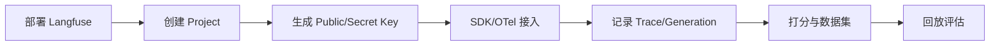

# Langfuse接入

> [!abstract] 一句话总结
> Langfuse 是 LLM 应用可观测与评估平台，用来记录 trace、span、generation、prompt、score 和 dataset；学习重点是把每次模型调用变成可复盘、可打分、可对比的工程数据。

## 📌 定位

Langfuse 解决的是“线上模型为什么这样回答”的问题。它不是业务日志替代品，也不是单纯 APM，而是专门面向 LLM 链路的 trace 平台。

适合接入的链路：

- Chat/RAG/Agent 的一次用户请求。
- 模型输入输出、token、耗时、模型名、成本。
- 检索片段、工具调用、重试和异常。
- 人工评分、自动评估、数据集回放和 Prompt 版本对比。

## 🤔 解决什么问题 / 为什么需要

- **线上复盘**：保留 Prompt、上下文、工具结果和模型输出，避免只剩一句“用户说效果不好”。
- **成本治理**：按模型、用户、应用、租户统计 token、耗时和失败率。
- **评估闭环**：把线上坏例加入 dataset，用 Ragas 或自定义 evaluator 回放。
- **Prompt 管理**：版本化 Prompt，比较新旧版本在同一批样例上的表现。

## 🧩 核心组件

| 组件 | 作用 | 学习重点 |
| ---- | ---- | -------- |
| Trace | 一次完整用户请求。 | trace_id 要和业务 request_id 互通。 |
| Span | 链路中的普通步骤。 | 检索、重排、工具调用、后处理都适合记录 span。 |
| Generation | 模型调用。 | 记录 model、prompt、completion、usage、latency。 |
| Score | 人工或自动评分。 | 评分维度要固定，避免不同人随意打分。 |
| Dataset | 可回放样例集。 | 从线上坏例沉淀回归集。 |

## ⚙️ 部署与接入流程



1. 选择 Langfuse Cloud 或自托管；自托管要准备数据库、对象存储、密钥和外部访问域名。
2. 创建项目，生成 `public_key`、`secret_key` 和 `host`。
3. 在后端 SDK 或 OpenTelemetry 链路中创建 trace，写入用户、会话、租户、应用版本等 metadata。
4. 包裹模型调用，记录 prompt、completion、usage、model、latency 和 error。
5. 把检索、rerank、工具调用写成 span，方便定位 RAG 或 Agent 失败点。
6. 对关键样例打 score，并把坏例加入 dataset 做回归。

## 💻 接入示例

```python
from langfuse import Langfuse

langfuse = Langfuse()

trace = langfuse.trace(
    name="contract-qa",
    user_id="u-1001",
    metadata={"tenant": "demo", "app_version": "2026-07-04"},
)

generation = trace.generation(
    name="answer",
    model="qwen-plus",
    input=[{"role": "user", "content": "付款条件是什么？"}],
)

# 调用模型后补全结果
generation.end(
    output="合同约定验收后 30 日内付款。",
    usage={"input": 1200, "output": 80},
)
```

## ⚠️ 生产坑

- 把完整身份证、手机号、合同金额等敏感字段原样写入 trace，后续导出和共享会有合规风险。
- 只记录最终答案，不记录检索片段和工具结果，排查时仍然无法判断错误来源。
- trace_id 没有回写到业务日志，Langfuse 和后端日志对不上。
- 自动评分没有固定样例和 rubric，分数波动会被误判成模型质量波动。
- 高并发场景同步上报 trace 会增加响应耗时，必要时使用异步 flush 或队列。

## 🎯 面试 / 选型

> [!question] 高频问题
> - Q: Langfuse 和普通日志平台有什么区别？
>   - A: 普通日志偏文本和系统事件；Langfuse 按 LLM 链路组织 trace、span、generation、prompt、score 和 dataset。
> - Q: 接 Langfuse 最少要记录什么？
>   - A: trace_id、用户/租户、模型名、输入、输出、token、耗时、错误、检索片段和工具结果。
> - Q: Langfuse 怎么和 Ragas 配合？
>   - A: Langfuse 负责采集线上样例和存 score，Ragas 负责对 RAG 样例计算 faithfulness、context precision、answer relevancy 等指标。

## ✅ 精通检查清单

- 能部署或接入 Langfuse 项目并生成密钥。
- 能在一次 RAG 请求中记录 trace、span、generation。
- 能把线上坏例加入 dataset，并跑一次回归评估。
- 能说明敏感数据脱敏和 trace_id 贯通方案。

## 🔗 关联笔记

- [[_index]]
- [[07-Ragas评估实践]]
- [[08-LLM评估指标体系]]
- [[../00-总览/学习仪表盘]]

## 📚 参考资料

- [Langfuse Docs](https://langfuse.com/docs)
- [Langfuse Self-hosting](https://langfuse.com/self-hosting)
