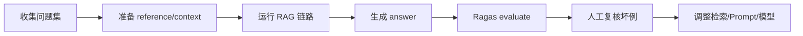

# Ragas评估实践

> [!abstract] 一句话总结
> Ragas 是 RAG/LLM 应用评估框架，用固定样例集和指标衡量回答是否忠实、相关、召回是否命中；学习重点是把“感觉效果不错”改成可重复的离线评估。

## 📌 定位

Ragas 不是线上监控平台，而是评估工具。它通常和 Langfuse、Dify、RAGFlow、LangChain 一起使用：平台产生日志和样例，Ragas 负责对样例打指标，结果再回写到看板或 CI。

适合评估：

- RAG 回答是否基于给定 context。
- 检索片段是否覆盖标准答案。
- 生成答案是否回答了用户问题。
- Prompt、chunk、embedding、rerank、模型版本变更前后的效果差异。

## 🤔 解决什么问题 / 为什么需要

- **把主观判断量化**：用一组固定问题比较不同方案，而不是凭几条 demo 判断。
- **定位 RAG 失败阶段**：context 差说明召回问题，faithfulness 差说明生成幻觉。
- **支持回归测试**：模型或 Prompt 更新后跑同一批样例，防止旧能力退化。
- **积累面试表达**：能讲清评估集、指标、阈值、抽样和人工复核。

## 🧩 核心指标

| 指标 | 看什么 | 常见用途 |
| ---- | ---- | -------- |
| Faithfulness | 答案是否被 context 支持。 | 识别幻觉和无依据补充。 |
| Answer Relevancy | 答案是否回应问题。 | 识别答非所问。 |
| Context Precision | 排在前面的 context 是否有用。 | 调 TopK、rerank 和检索排序。 |
| Context Recall | 标准答案需要的信息是否被召回。 | 判断知识库是否漏召回。 |
| Answer Correctness | 答案和参考答案是否一致。 | 有标准答案的数据集适用。 |

## ⚙️ 评估流程



1. 从线上日志、客服 FAQ、业务验收题中选样例，按主题和难度分层。
2. 为每条样例保存 `question`、`answer`、`contexts`、`ground_truth` 或 `reference`。
3. 固定模型、Prompt、chunk、TopK、rerank 配置，跑出基线分数。
4. 每次改动只变一个关键参数，避免不知道分数变化来自哪里。
5. 对低分样例人工复核，区分评估器误判、召回失败、生成幻觉和参考答案错误。
6. 把稳定样例接入 CI 或发布前检查。

## 💻 示例

```python
from datasets import Dataset
from ragas import evaluate
from ragas.metrics import Faithfulness, AnswerRelevancy, ContextPrecision

dataset = Dataset.from_dict({
    "question": ["合同付款条件是什么？"],
    "answer": ["验收通过后 30 日内付款。"],
    "contexts": [
        ["合同第 5 条：甲方应在验收通过后 30 日内支付款项。"],
    ],
    "ground_truth": ["验收通过后 30 日内付款。"],
})

result = evaluate(
    dataset,
    metrics=[Faithfulness(), AnswerRelevancy(), ContextPrecision()],
)

print(result)
```

> [!note] 版本提示
> 以上为 Ragas 0.2+ 的类名 API。旧版（0.1.x）用函数式 API（如 `from ragas.metrics import faithfulness, answer_relevancy`），0.3+ 已移除，直接按新写法即可。

## ⚠️ 生产坑

- 样例集只有简单 FAQ，分数很高但上线后复杂组合问题全失败。
- 评估模型和生产模型混用成本高且有偏差，要记录 evaluator model 版本。
- context 中混入过多无关片段，答案碰巧正确，但 context precision 会暴露检索噪声。
- 只看平均分会掩盖关键业务问题，必须查看低分样例和高风险主题。
- 没有固定随机种子、Prompt 和模型版本，导致两次评估不可比。

## 🎯 面试 / 选型

> [!question] 高频问题
> - Q: Ragas 如何判断 RAG 失败点？
>   - A: context recall/precision 低多半是检索问题，faithfulness 低是答案没有被 context 支持，answer relevancy 低是回答没有对准问题。
> - Q: 没有标准答案能评估吗？
>   - A: 可以用无参考指标，如 faithfulness、answer relevancy、context precision；但高风险场景仍要抽样人工复核。
> - Q: Ragas 和 Langfuse 怎么分工？
>   - A: Langfuse 采集、管理和展示样例与分数；Ragas 计算评估指标。

## ✅ 精通检查清单

- 能构造一份 RAG 评估数据集。
- 能解释 faithfulness、answer relevancy、context precision 的含义。
- 能对比两套 chunk/TopK/rerank 配置并给出选择理由。
- 能把低分样例转成修复任务。

## 🔗 关联笔记

- [[_index]]
- [[06-Langfuse接入]]
- [[04-RAGFlow]]
- [[../00-总览/学习仪表盘]]

## 📚 参考资料

- [Ragas Docs](https://docs.ragas.io/)
- [Ragas GitHub](https://github.com/explodinggradients/ragas)
