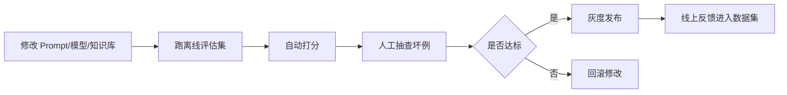

# AI 应用评估数据集与回归测试

> [!abstract] 一句话总结
> AI 应用上线后最怕“改 prompt / 换模型 / 改召回后悄悄变差”，所以必须把真实 badcase 沉淀成评估数据集并接入回归测试。

## 🎯 本节定位

- **评估与回归环节的数据资产课**：承接 [[08-LLM评估指标体系]] 的指标定义和 [[07-Ragas评估实践]] 的评估方法，本篇解决“样例从哪来、字段怎么设计、如何接入回归流水线”。
- **延伸阅读**：评估数据的采集与展示依托 [[06-Langfuse接入]]；本文末尾的 Java 落地要点属于本章工程化实践的一部分。

## 为什么最近更重要

生产级 AI 岗位开始强调 eval、observability、prompt management、A/B、灰度。原因很简单：AI 系统不是写完就稳定，模型版本、提示词、知识库、工具描述、Rerank 参数都会改变结果。

## 评估数据集从哪里来

| 来源 | 价值 | 处理方式 |
| ---- | ---- | -------- |
| 线上 badcase | 最真实 | 脱敏后加入回归集 |
| 高频问题 | 覆盖核心业务 | 每个意图至少 10~30 条 |
| 边界问题 | 测安全和鲁棒性 | 越权、注入、无答案、歧义 |
| 人工构造 | 补覆盖 | 用模板生成但要人工审核 |
| 历史工单 | 贴近客服/办公场景 | 抽取问法、标准答案和证据 |

## 数据集字段设计

```yaml
id: rag_refund_001
task_type: rag_qa
user_query: "会员退款规则是什么？"
expected_answer: "..."
expected_sources:
  - "refund_policy_v3.pdf#page=2"
must_contain:
  - "7天内"
must_not_contain:
  - "无条件退款"
metadata:
  tenant: demo
  risk_level: low
  tags: [客服, 退款, RAG]
```

## 回归测试流水线



## 指标体系

| 类型 | 指标 | 说明 |
| ---- | ---- | ---- |
| RAG | faithfulness、context precision、召回命中 | 答案是否基于证据 |
| Agent | 工具选择准确率、步骤成功率 | 是否会选对工具并完成任务 |
| 安全 | 越权率、敏感信息泄露率 | 是否触发安全风险 |
| 体验 | 首 token 延迟、总耗时、用户点赞率 | 是否能被真实用户接受 |
| 成本 | tokens/次、模型成本/租户 | 是否可规模化 |

## 工具组合

- **Langfuse**：trace、dataset、prompt 版本、人工标注。
- **promptfoo**：本地/CI 回归测试，适合 prompt 和模型对比。
- **Ragas**：RAG 指标评估和测试集生成。
- **自研表**：业务标准答案、权限、证据、风险等级。

## Java 项目落地

1. 线上每次调用生成 `trace_id`。
2. 用户差评、人工标注、异常 trace 进入 badcase 池。
3. 每周把 badcase 脱敏后加入 eval dataset。
4. CI 中跑核心数据集，低于阈值禁止发布。
5. 灰度后继续按 trace 抽样复核。

## 面试讲法

> 我会把 AI 应用当成需要持续回归的系统。每次改 prompt、换模型、改 RAG 参数，都跑固定 eval dataset；线上 badcase 脱敏后沉淀进数据集。这样能避免“局部优化导致整体退化”。

## 关联

- [[_index]]
- [[08-LLM评估指标体系]]
- [[07-Ragas评估实践]]
- [[06-Langfuse接入]]

## 📚 参考资料

- [Langfuse Docs：Datasets](https://langfuse.com/docs/datasets/overview)
- [promptfoo Docs：LLM evals and red teaming](https://www.promptfoo.dev/docs/intro/)
- [Ragas Docs](https://docs.ragas.io/)
- [OpenAI Evals](https://github.com/openai/evals)

