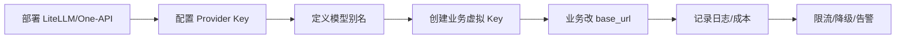

# LiteLLM与One-API

> [!abstract] 一句话总结
> LiteLLM 和 One-API 都用于把多家模型统一成 OpenAI 兼容入口；LiteLLM 更偏工程网关和 SDK，One-API 更偏轻量聚合、渠道管理和额度分发。

## 📌 定位

AI 网关解决“业务代码不要直接绑死某一家模型”的问题。后端统一调用 `/v1/chat/completions` 或兼容接口，网关负责把请求路由到 OpenAI、Azure、通义千问、火山方舟、Claude、本地模型等。
选型边界：
- **LiteLLM**：适合 Python/服务端工程，支持模型别名、fallback、重试、预算、虚拟 Key、日志和 OpenAI 兼容代理。
- **One-API**：适合快速搭建统一转发服务，管理渠道、用户额度、倍率和 Key 分发。
- **自研网关**：适合强合规、强审计、复杂路由、深度计费和企业权限模型。

## 🤔 解决什么问题 / 为什么需要

模型网关可以提供统一调用入口，并集中处理路由、额度和使用量统计。主模型限流或报错时，也可以按配置切换备用模型；即使接口兼容，接入时仍需验证具体模型参数与响应格式。

## 🧩 核心组件

| 组件 | 作用 | 学习重点 |
| ---- | ---- | -------- |
| Provider | 实际模型供应商。 | 鉴权方式、base_url、模型名、限流和价格。 |
| Model Alias | 对业务暴露的模型名。 | 例如 `fast-chat` 映射到不同厂商模型。 |
| Virtual Key | 网关发给业务方的 Key。 | 按租户、预算、模型白名单控制权限。 |
| Fallback | 失败降级策略。 | 区分限流、超时、内容安全、参数错误。 |
| Logging/Spend | 调用日志和成本统计。 | 对接 Langfuse、Prometheus 或数据库账单。 |

## ⚙️ 部署与接入流程



1. 部署代理服务，准备数据库或持久化配置。
2. 为每个 Provider 配置 Key、base_url、模型名和价格倍率。
3. 对业务暴露稳定模型别名，例如 `chat-prod`、`chat-cheap`、`embedding-prod`。
4. 给每个业务线发虚拟 Key，绑定预算、模型白名单和速率限制。
5. 业务配置网关地址、虚拟 Key 和模型别名，并验证所用 SDK 与网关的接口、参数及流式协议兼容。
6. 接入日志、告警和成本报表，定期复盘失败率和供应商表现。

## 💻 LiteLLM 配置示例

```yaml
model_list:
  - model_name: chat-prod
    litellm_params:
      model: openai/qwen-plus
      api_base: os.environ/DASHSCOPE_COMPAT_BASE_URL
      api_key: os.environ/DASHSCOPE_API_KEY
  - model_name: chat-backup
    litellm_params:
      model: openai/REPLACE_WITH_ARK_MODEL_OR_ENDPOINT
      api_base: https://ark.cn-beijing.volces.com/api/v3
      api_key: os.environ/ARK_API_KEY

router_settings:
  fallbacks:
    - chat-prod: [chat-backup]
```

上述 YAML 是配置片段，`DASHSCOPE_COMPAT_BASE_URL` 从百炼当前工作空间与区域的官方控制台获取；模型标识、网关版本和供应商配置以实际文档为准，替换占位符后仍要验证连接、权限和模型能力。
业务侧可以使用 Spring AI。下面假设 `chatClient` 已指向网关、配置虚拟 Key 和 `chat-prod` 模型别名，`text` 是待总结内容：

```java
String answer = chatClient.prompt()
        .user("请总结：" + text)
        .call().content();
```

## ⚠️ 生产坑

- 只做协议转发，不做模型能力表，导致 JSON mode、function calling、vision、embedding 等能力被误用。
- fallback 不区分错误类型，内容安全拒答也切模型，可能绕过安全策略。
- 不记录原始 provider 错误码，线上只看到网关 500，无法判断是限流、鉴权还是参数问题。
- 价格倍率和 token 统计没有版本化，供应商价格变化后账单对不上。
- 多供应商模型输出风格不同，不能把降级模型当作完全等价替代。

## 🎯 面试 / 选型

> [!question]- 为什么需要 AI 网关？
> 统一协议、集中鉴权、模型路由、成本统计、限流降级，并把业务代码和供应商解耦。

> [!question]- LiteLLM 和 One-API 怎么选？
> 需要工程化路由、fallback、Python SDK 和细粒度网关能力，选 LiteLLM；需要轻量渠道聚合、额度和用户管理，One-API 更直接。

> [!question]- 网关层最容易踩什么坑？
> 把所有模型抽象成完全一样，忽略上下文窗口、工具调用、流式输出、价格和安全策略差异。

## ✅ 精通检查清单

- 能部署一个 OpenAI 兼容模型网关。
- 能配置百炼、方舟和备用模型路由。
- 能用虚拟 Key 控制租户预算和模型白名单。
- 能解释 fallback、限流、成本统计和能力差异。

## 🔗 关联笔记

- [[_index]]
- [[13-阿里百炼]]
- [[14-火山方舟]]
- [[../00-总览/学习仪表盘]]

## 📚 参考资料

- [LiteLLM Docs](https://docs.litellm.ai/)
- [Spring AI：OpenAI Chat 配置](https://docs.spring.io/spring-ai/reference/api/chat/openai-chat.html)
- [One-API GitHub](https://github.com/songquanpeng/one-api)
