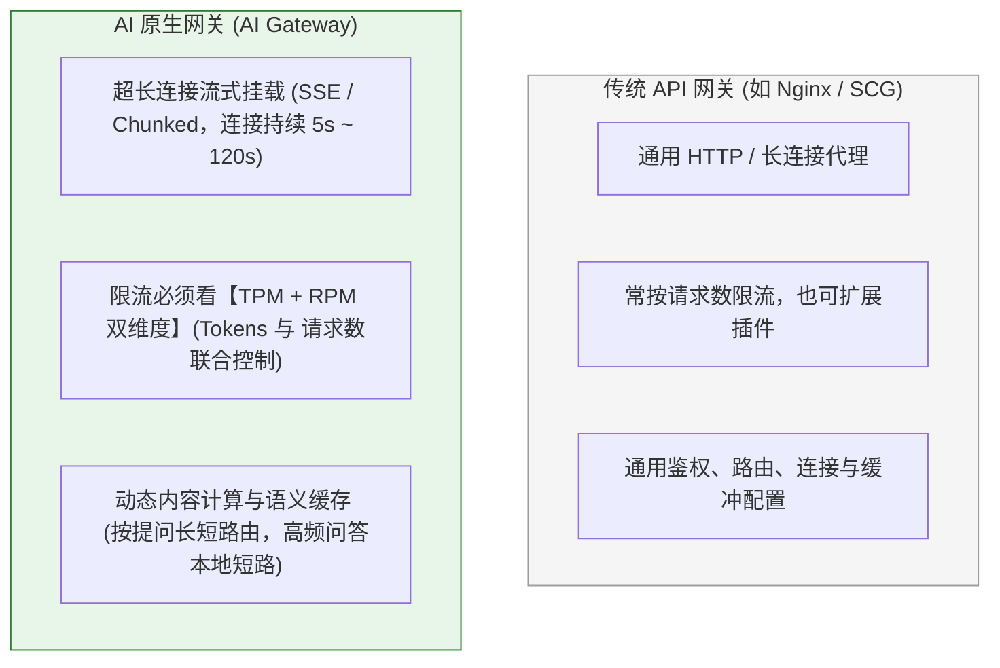
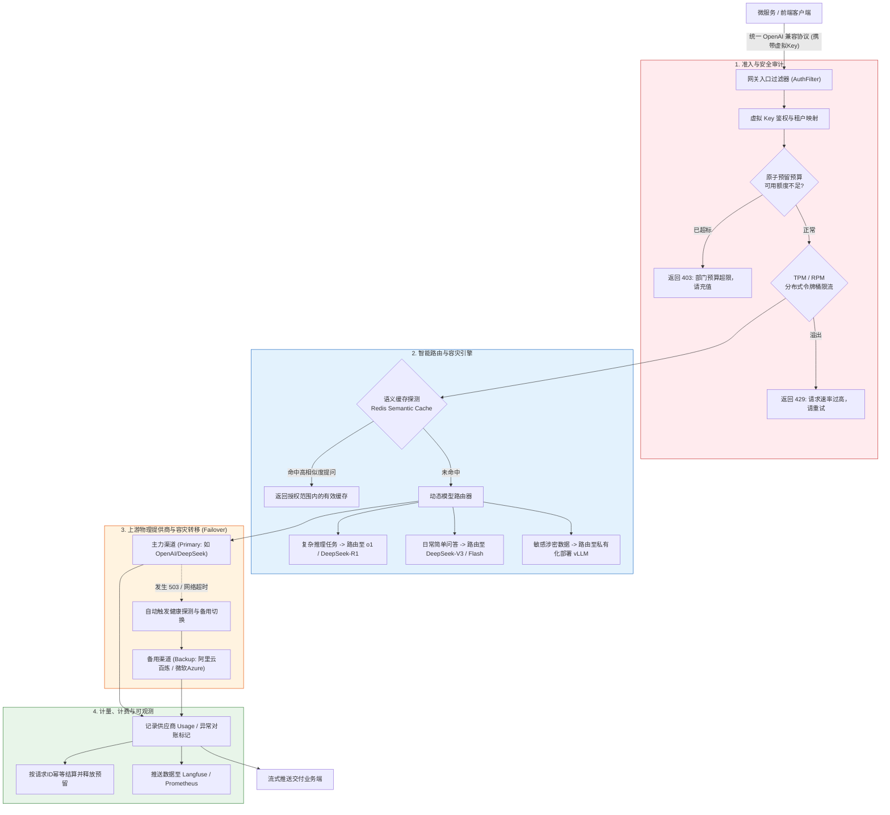
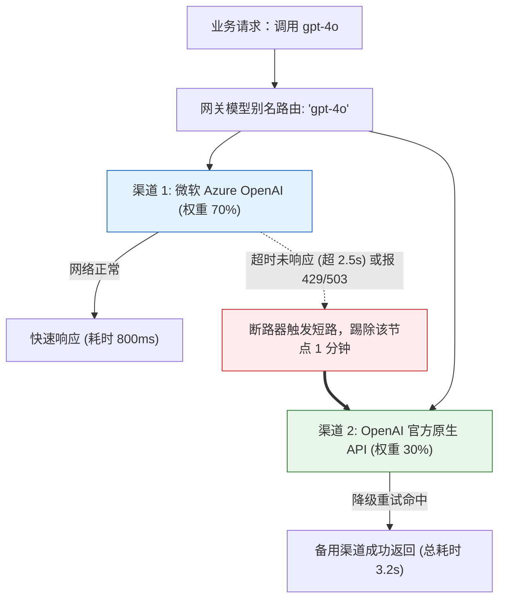

# 🚪 AI 网关生产架构：限流、计费、路由与安全审计

> [!abstract] 一句话总结
> AI 网关作为企业模型调用的统一治理接入层，集中承担异构协议适配、虚拟 Key 鉴权、RPM/TPM 多维限流、多渠道故障切换与 Token 成本核算职责。

---

## 📌 核心定位与演进路径

当企业内部存在多个业务系统共用多个模型渠道时，AI 网关集中托管上游供应商真实 API Key，向各业务线分发绑定配额的受控虚拟凭证（Virtual Keys），并统一采集调用日志、Token 消耗与异常状态。在早期单业务、小流量阶段，可先在后端服务层封装统一客户端；随着多团队协作、成本分摊与多模型路由需求增长，再演进为独立的 AI 网关服务。

---

## 📌 第一性原理：AI 网关与传统 API 网关的三大本质差异

传统 API 网关（如 Nginx、Spring Cloud Gateway）主要面向标准短连接 HTTP 请求与固定 QPS 限流设计；而 AI 网关在此基础上，针对大模型推理的长连接流式输出、Token 级算力消耗与异构模型协议进行了专项扩展：



### 1. 为什么限流必须从 QPS 转向 TPM / RPM？
在大模型推理场景中，单次请求的 Prompt 长度、生成 Token 上限与算力开销跨度极大（例如 100 Token 的简单分类与 32K Token 的长文档总结消耗算力相差数百倍），单纯按请求数（QPS）限流难以准确约束底层算力与上游配额消耗。
- **RPM 与 TPM 联合限流**：同时约束每分钟请求数（RPM）与每分钟 Token 吞吐量（TPM），并结合并发连接数、单次请求输入/输出上限与总超时时间实施多维控制。
- **原子预留与幂等结算**：在高并发计费场景下，采用“调用前按预估上限原子冻结额度 $\to$ 响应完成后按实际 `usage` 幂等扣减并释放剩余预留”的两阶段核算机制，并使用最小货币单位整数（如厘/分）或 `BigDecimal` 进行精确计算，防止并发请求穿透配额上限。

---

## 🗺️ 工业级 AI 网关核心架构大图



---

## 💻 工业级实战：基于 Java / Spring Cloud 的 AI 网关核心拦截器

以下示例演示在 Spring Cloud Gateway（WebFlux）中基于 Redis Lua 脚本实现租户级 **RPM 限流过滤器**。在职责划分上，前置鉴权过滤器先验证虚拟 Key 的哈希签名、有效期与启用状态，解析出真实租户标识并写入交换机上下文属性 `authenticatedTenantId`（避免信任客户端直接传入的租户 Header，且日志中严禁打印原始密钥），随后由限流过滤器执行原子计数：

```java
@Component
public class AiRpmFilter implements GlobalFilter, Ordered {
    private final ReactiveStringRedisTemplate redis;
    private static final RedisScript<Long> COUNT = RedisScript.of("""
        local n = redis.call('INCR', KEYS[1])
        if n == 1 then redis.call('EXPIRE', KEYS[1], ARGV[1]) end
        return n
        """, Long.class);

    public AiRpmFilter(ReactiveStringRedisTemplate redis) { this.redis = redis; }

    @Override
    public int getOrder() { return 10; } // 前置鉴权过滤器的 order 必须更小

    @Override
    public Mono<Void> filter(ServerWebExchange exchange, GatewayFilterChain chain) {
        String tenantId = exchange.getAttribute("authenticatedTenantId");
        if (tenantId == null) {
            exchange.getResponse().setStatusCode(HttpStatus.UNAUTHORIZED);
            return exchange.getResponse().setComplete();
        }
        return redis.execute(COUNT, List.of("ai:rpm:" + tenantId), List.of("60"))
            .single()
            .flatMap(count -> {
                if (count > 120) { // 示例阈值；生产按租户配置
                    exchange.getResponse().setStatusCode(HttpStatus.TOO_MANY_REQUESTS);
                    return exchange.getResponse().setComplete();
                }
                return chain.filter(exchange);
            });
    }
}
```

在工程实现中，通过 Lua 脚本将 `INCR` 与 `EXPIRE` 封装为原子操作，并在响应式链路中直接编排执行；若需进一步消除固定窗口边界处的突发流量，可将脚本升级为滑动时间窗或令牌桶算法，同时在全局异常处理器中统一定义 Redis 故障时的降级策略。

---

## ⚡ 故障转移（Failover）与渠道熔断实战

在网关层设计跨渠道故障转移（Failover）时，应针对网络建连超时、HTTP 429（配合 `Retry-After` 退避）或 502/503/504 等可恢复异常执行有界重试。**流式切换边界**：仅当主力渠道尚未向客户端推送任何有效内容块（First Chunk 未发出）时，才可透明切换至备用渠道重新发起请求；若流式输出已经开始，则应向客户端发送明确的流中断错误事件，避免将不同模型的生成片段拼接在同一回复中。



> [!TIP]
> **开源与商业选型建议**：
> 如果团队不想从零用 Java 手写整个网关，可按协议兼容性、部署成本和治理需求评估：
> - **LiteLLM Proxy**：基于 Python 构建的轻量高并发 AI 网关，提供 OpenAI 兼容接口，自带精细的 Load Balancing、Failover 和 Langfuse 原生集成；
> - **One-API / New-API**：Go 语言编写，国内使用极广，拥有非常直观的后台多租户充值、兑换码、渠道权重可视化看板。

---

## ⚠️ 常见问题与边界

### 1. 流式响应（SSE）代理缓冲与超时配置
- **逐跳关闭响应缓冲**：在 Nginx 反代层显式配置 `proxy_buffering off`，或在网关响应头中注入 `X-Accel-Buffering: no`；同时检查链路上的 CDN、WAF 与云负载均衡器的缓冲、Gzip 压缩及长连接空闲超时（`proxy_read_timeout`）设置，确保每个 SSE 数据块实时推送到客户端。

### 2. 流式调用的 Token 计量与对账机制
- **开启流式尾包 Usage 统计**：向 OpenAI 兼容上游发起流式请求时，附加 `stream_options: {"include_usage": true}` 参数，使上游在 `data: [DONE]` 前的最后一个 Chunk 中返回精确的 Token 统计。
- **异常断流兜底与账单对账**：若客户端中途断开连接或网络异常中断导致未收到尾包 `usage`，网关应将该笔记录标记为待对账状态并基于已接收文本长度估算预扣，定期与上游供应商账单进行异步核对；所有预留、扣减与释放操作均绑定唯一 `request_id` 保证幂等。

---

## 🎯 高频面试问题

> [!question] 面试高频问题 3 连击
>
> **Q1：传统 API 网关与 AI 网关在核心能力上有哪些区别？**
> - **答**：传统 API 网关具备长连接与 SSE 转发基础，而 AI 网关在此之上专项扩展了四项能力：① 异构模型接口向统一 OpenAI 协议的转换适配；② 从单一 QPS 升级为 **RPM（每分钟请求数）+ TPM（每分钟 Token 数）** 联合限流；③ 基于预估上限冻结与尾包 `usage` 结算的租户配额管控；④ 首包输出前的多渠道健康探测与自动容灾切换（Failover）。
>
> **Q2：在流式生成场景下，网关层的 Failover（故障转移）需要注意什么边界？**
> - **答**：透明 Failover 仅适用于**首包尚未输出（客户端未收到任何生成内容）**且错误属于网络超时、429 限流或 5xx 服务端异常的场景，同时备用渠道须满足相同的数据合规与工具调用能力要求。一旦已经向客户端推送了部分流式文本，若上游中断则应直接返回流错误事件，由客户端或上层应用决定是否重新发起完整请求，严禁在流式半途中静默拼接另一个模型的输出。
>
> **Q3：在 AI 网关层落地语义缓存（Semantic Cache）时，如何防止跨租户泄露或答非所问？**
> - **答**：语义缓存不能仅凭 Query 向量相似度直接返回，缓存 Key 的检索域必须严格绑定 **租户 ID（Tenant ID）、用户权限域、模型名称、System Prompt 版本及知识库版本**；同时对于包含实时金额、个性化状态或强时效性的查询应跳过语义缓存，高相似度阈值需结合业务测试集实测标定。

---

## 🪝 一分钟复盘记忆卡

```
┌────────────────────────────────────────────────────────┐
│               AI 网关生产架构 复盘卡                 │
├────────────────────────────────────────────────────────┤
│  1. 核心定位：企业模型流量咽喉，统一屏蔽异构协议与真Key│
│  2. 限流本质：告别单纯 QPS，必须实施 TPM + RPM 联合限流│
│  3. 容灾王牌：输出前有界 Failover，输出后明确失败│
│  4. 降本利器：语义缓存（Semantic Cache）高频问答直接短路│
│  5. 生产底线：禁止流式代理缓冲，确保 SSE 打字机极速推流│
└────────────────────────────────────────────────────────┘
```

---

## 🔗 关联笔记

- [[00-AI平台与工程化全景心智模型]] - 工业级 AI 工程化全景体系
- [[06-Langfuse接入]] - 网关流量全量透传至 Langfuse 链路追踪
- [[10-LiteLLM与One-API]] - 深入开源主流 AI 网关实操部署
- [[12-私有化部署-Ollama-vLLM-SGLang]] - 网关下游对接私有化推理算力
- [[_index]] - 返回平台与工程化专题索引
