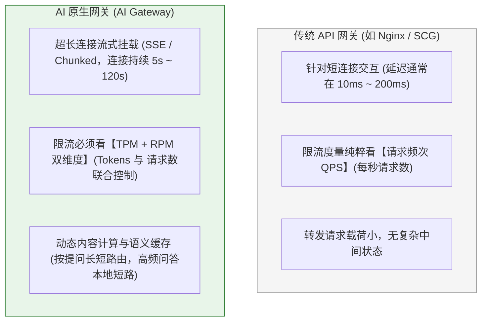
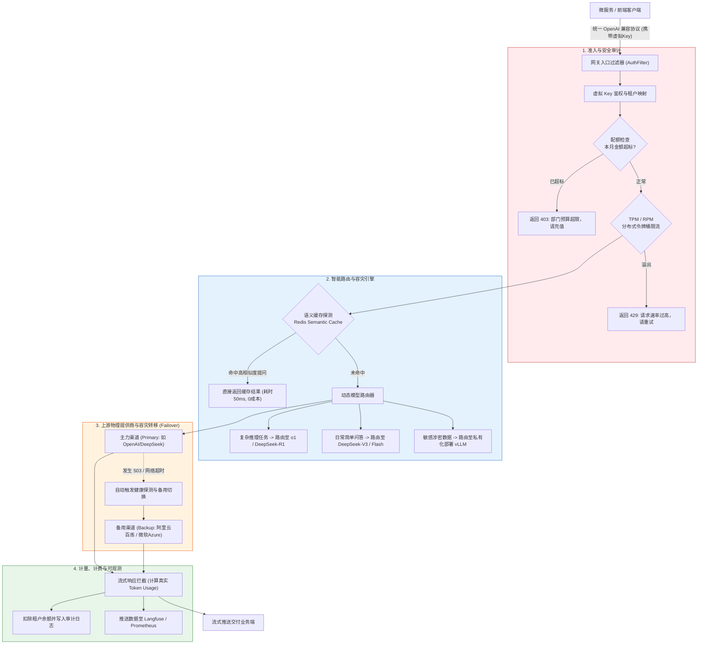

# 🚪 AI 网关生产架构：限流、计费、路由与安全审计

> [!abstract] 一句话总结
> AI 网关（AI Gateway）是企业大模型流量的**唯一统一咽喉**，它抹平了外部多模型厂商协议碎片，通过**“虚拟 Key 租户隔离、TPM/RPM 双维限流、秒级故障容灾转移（Failover）与 Token 财务计费”**，彻底解决生产环境下的财务失控与高可用容灾难题。

---

## 🗣️ 白话版（先建立直觉）

在微服务时代，我们都知道不能让外部客户端直接访问底层的微服务，必须在最前面挡一个 **API 网关（如 Spring Cloud Gateway / Nginx）**。

在 AI 大模型时代，这个矛盾被放大了 100 倍：
- 如果每个业务团队（电商、客服、财务、HR）都直接拿着真实的 OpenAI、Claude、DeepSeek 官方 API Key 在代码里调用：
  1. **密钥满天飞**：哪个实习生手滑把包含官方 Key 的代码提交到 GitHub，公司账户立刻被黑客盗刷光；
  2. **账单一本糊涂账**：月底收到 10 万元账单，财务问“这笔钱哪个部门花的？”，没人能说清；
  3. **单点暴毙无容灾**：主力模型一旦宕机或被限流报 `429`，业务直接瘫痪，无法动态切备用模型。

**AI 网关就是大模型时代的“海关与中央调度大楼”**：
所有业务调用必须走网关：
- **发通行证（虚拟 Key）**：给客服部分配 `sk-kf-888`，给 HR 分配 `sk-hr-666`，真 Key 牢牢锁在网关金库里；
- **称重收费（Token 计费）**：精确统计每个部门每分钟消耗的 Prompt Tokens 和 Completion Tokens，超额直接拦截；
- **智能调度（路由与容灾）**：平时把简单请求发给便宜的 DeepSeek-V3；一旦 DeepSeek 网络波动，网关在 100 毫秒内自动悄悄把请求重试切给备用的 Qwen-2.5，业务代码完全零感知！

---

## 📌 第一性原理：AI 网关与传统 API 网关的三大本质差异

很多人误以为“直接拿现有的 Nginx 或 Spring Cloud Gateway 就能管大模型”，这是致命的误区！大模型流量有极其特殊的物理属性：



### 1. 为什么限流必须从 QPS 转向 TPM / RPM？
在传统 Web 接口中，每个请求的计算量基本相当。
但在 LLM 中：
- 请求 A：输入 20 字，输出 50 字（消耗约 100 Token，GPU 耗时 200ms）；
- 请求 B：用户上传了一篇 5 万字的小说要求总结，模型输出 2000 字（消耗约 60,000 Token，GPU 耗时 40 秒，费用差了 600 倍！）。
如果网关只按 QPS=10 限流，10 个并发的请求 B 会瞬间打爆模型提供商的速率墙并产生巨额账单！
因此，**AI 网关必须同时监控两项指标**：
- **RPM（Requests Per Minute）**：每分钟请求数；
- **TPM（Tokens Per Minute）**：每分钟 Token 流通总量。

---

## 🗺️ 工业级 AI 网关核心架构大图



---

## 💻 工业级实战：基于 Java / Spring Cloud 的 AI 网关核心拦截器

在企业自建网关中，我们通常基于 Spring WebFlux / Gateway 构建响应式非阻塞过滤器：

```java
package com.example.ai.gateway.filter;

import lombok.extern.slf4j.Slf4j;
import org.springframework.cloud.gateway.filter.GatewayFilterChain;
import org.springframework.cloud.gateway.filter.GlobalFilter;
import org.springframework.core.Ordered;
import org.springframework.data.redis.core.ReactiveStringRedisTemplate;
import org.springframework.http.HttpStatus;
import org.springframework.stereotype.Component;
import org.springframework.web.server.ServerWebExchange;
import reactor.core.publisher.Mono;

import java.time.Duration;

@Slf4j
@Component
public class AiQuotaAndRateLimitFilter implements GlobalFilter, Ordered {

    private final ReactiveStringRedisTemplate redisTemplate;

    public AiQuotaAndRateLimitFilter(ReactiveStringRedisTemplate redisTemplate) {
        this.redisTemplate = redisTemplate;
    }

    @Override
    public int getOrder() {
        // 在网关全局过滤器中置于最高优先级
        return Ordered.HIGHEST_PRECEDENCE + 5;
    }

    @Override
    public Mono<Void> filter(ServerWebExchange exchange, GatewayFilterChain chain) {
        // 1. 从 Authorization Header 提取虚拟 Key (如: Bearer sk-virtual-sales-001)
        String authHeader = exchange.getRequest().getHeaders().getFirst("Authorization");
        if (authHeader == null || !authHeader.startsWith("Bearer sk-virtual-")) {
            exchange.getResponse().setStatusCode(HttpStatus.UNAUTHORIZED);
            return exchange.getResponse().setComplete();
        }

        String virtualKey = authHeader.substring(7);
        String tenantKey = "ai:tenant:quota:" + virtualKey;

        // 2. 检查部门月度资金配额 (基于 Redis 实时缓存)
        return redisTemplate.opsForValue().get(tenantKey)
                .defaultIfEmpty("0.00")
                .flatMap(remainingQuota -> {
                    double balance = Double.parseDouble(remainingQuota);
                    if (balance <= 0.0) {
                        log.warn("拒绝请求：虚拟Key [{}] 绑定的租户预算已耗尽！", virtualKey);
                        exchange.getResponse().setStatusCode(HttpStatus.FORBIDDEN);
                        return exchange.getResponse().setComplete();
                    }

                    // 3. 执行 RPM (每分钟请求数) 滑动窗口限流
                    String rpmKey = "ai:ratelimit:rpm:" + virtualKey;
                    return redisTemplate.opsForValue().increment(rpmKey)
                            .flatMap(count -> {
                                if (count == 1) {
                                    // 首次访问，设置 60 秒过期时间
                                    redisTemplate.expire(rpmKey, Duration.ofSeconds(60)).subscribe();
                                }
                                if (count > 120) { // 限制每分钟最多 120 次请求
                                    log.warn("触发频控限流：虚拟Key [{}] RPM 超过阈值 120！", virtualKey);
                                    exchange.getResponse().setStatusCode(HttpStatus.TOO_MANY_REQUESTS);
                                    return exchange.getResponse().setComplete();
                                }

                                // 4. 准入通过，放行至下游模型路由与熔断管道
                                log.info("AI 网关鉴权与频控通过，租户余额: {} 元，放行转发...", balance);
                                return chain.filter(exchange);
                            });
                });
    }
}
```

---

## ⚡ 故障转移（Failover）与渠道熔断实战

大模型公有云服务有着不可预测的**偶发抖动与排队限流（Rate Limit）**。
成熟的网关绝不把鸡蛋放在一个篮子里：

```mermaid
flowchart TD
    Req["业务请求：调用 gpt-4o"] --> Route["网关模型别名路由: 'gpt-4o'"]
    Route --> C1["渠道 1: 微软 Azure OpenAI (权重 70%)"]
    Route --> C2["渠道 2: OpenAI 官方原生 API (权重 30%)"]
    
    C1 -->|网络正常| S1["快速响应 (耗时 800ms)"]
    C1 -.超时未响应 (超 2.5s) 或报 429/503.-> Break["断路器触发短路，踢除该节点 1 分钟"]
    Break ==> C2
    C2 -->|降级重试命中| S2["备用渠道成功返回 (总耗时 3.2s)"]

    style C1 fill:#e3f2fd,stroke:#1565c0,stroke-width:1px
    style Break fill:#ffebee,stroke:#c62828,stroke-width:1px
    style C2 fill:#e8f5e9,stroke:#2e7d32,stroke-width:1px
```

> [!TIP]
> **开源与商业选型建议**：
> 如果团队不想从零用 Java 手写整个网关，企业级首推：
> - **LiteLLM Proxy**：基于 Python 构建的轻量高并发 AI 网关，对 OpenAI 协议支持最全，自带精细的 Load Balancing、Failover 和 Langfuse 原生集成；
> - **One-API / New-API**：Go 语言编写，国内使用极广，拥有非常直观的后台多租户充值、兑换码、渠道权重可视化看板。

---

## ⚠️ 生产避坑指南与致命陷阱

### 1. 致命缺陷：未在网关层关闭响应式缓冲导致 SSE 流失效
- **灾难现场**：前端原本应该像打字机一样一个字一个字出，结果过了 15 秒之后，网关“一口气把整篇长文章瞬间吐出来”！
- **根因**：网关或其前置 Nginx 默认开启了 HTTP 反向代理缓冲（`proxy_buffering on;`），把流式 chunks 攒满了 4KB 缓冲区才整体刷新一次。
- **治理**：网关层必须设置 Header `X-Accel-Buffering: no`，且配置 `Cache-Control: no-cache`。

### 2. 致命漏洞：Token 计费只看流式最后一条
- 有些大模型厂商在开启流式（`stream: true`）时，最后一个 Chunk 默认**不包含 `usage` 字段**（如早期版本的 OpenAI）！
- **治理**：网关必须要么在调用时显式传参 `stream_options: {"include_usage": true}`，要么在网关内部针对流出的文本挂载本地 Tokenizer（如 `jtokkit`）进行实时 Token 离线统计保底。

---

## 🎯 大厂高频面试 30 秒绝杀

> [!question] 面试高频问题 3 连击
> 
> **Q1：为什么企业级 AI 架构中必须引入专门的 AI 网关？传统的 API 网关（如 Spring Cloud Gateway / Kong）能直接平替吗？**
> - **答（满分绝杀）**：
>   不能直接平替。主要原因有三：
>   1. **流式长连接特性**：大模型交互是以 SSE（Server-Sent Events）为主的长连接（持续数秒到数分钟），传统网关针对毫秒级短请求设计，连接池与缓冲机制易导致线程耗尽或打字机截留；
>   2. **限流维度变革**：传统网关只按 QPS 限流，无法感知单次请求内部的上下文长度差异；AI 网关必须支持 **TPM（Tokens Per Minute）与 RPM 联合滑动窗口限流**，防止超长上下文击穿算力；
>   3. **AI 原生治理闭环**：AI 网关内置了模型协议标准化、多供应商毫秒级 Failover 容灾切换、基于语义缓存（Semantic Cache）的降本短路，以及按输入/输出 Token 细分单价的财务核算体系，这些是传统网关完全缺失的核心能力。
>
> **Q2：当主力大模型供应商遭遇突发限流（HTTP 429）或服务不可用（503）时，AI 网关是如何实现“无感故障转移（Failover）”的？**
> - **答（满分绝杀）**：
>   网关引入“模型别名路由”与“断路器重试链”：
>   - 业务方请求统一指向逻辑模型名（如 `model="enterprise-general-v1"`）；
>   - 网关维护优先级渠道池（如：首选 Azure 渠道，备用官方 OpenAI 渠道，托底阿里云渠道）；
>   - 当首选渠道在建立连接或生成首 Token 时抛出 429、503 或超时，网关内部的断路器立即拦截并执行“快速重试路由”，在 100 毫秒内将包含原请求体的 Context 发送至备选渠道。由于流式连接尚未向终端客户端提交最终中断信号，业务端仅感知到轻微的首字延迟波动，完全实现了供应商故障的透明自愈。
>
> **Q3：如何利用 AI 网关大幅降低高频重复提问的企业 API 账单成本？**
> - **答（满分绝杀）**：
>   部署 **语义缓存（Semantic Cache）** 拦截层：
>   对于企业客服、制度问答等高频业务，用户的提问具有极强的同义集中性（如“怎么报销机票”与“飞机票报销流程”）。AI 网关在收到提问时，先通过轻量 Embedding 计算 Query 向量并在 Redis 中进行高维近似检索。如果命中相似度高于阈值（如 0.96）的历史回答，网关直接短路返回缓存内容。此举不仅将原本需要 2~3 秒的模型推理时间缩短至 50 毫秒以内，更能在高频业务中削减 50%~80% 的外部大模型 API 调用费用。

---

## 🪝 一分钟复盘记忆卡

```
┌────────────────────────────────────────────────────────┐
│               AI 网关生产架构 极速通关卡                 │
├────────────────────────────────────────────────────────┤
│  1. 核心定位：企业模型流量咽喉，统一屏蔽异构协议与真Key│
│  2. 限流本质：告别单纯 QPS，必须实施 TPM + RPM 联合限流│
│  3. 容灾王牌：秒级 Failover 故障转移，业务无感切备用渠道│
│  4. 降本利器：语义缓存（Semantic Cache）高频问答直接短路│
│  5. 生产底线：禁止流式代理缓冲，确保 SSE 打字机极速推流│
└────────────────────────────────────────────────────────┘
```

---

## 🔗 关联笔记

- [[00-AI平台与工程化全景心智模型]] - 工业级 AI 工程化全景体系
- [[06-Langfuse接入]] - 网关流量全量透传至 Langfuse 链路追踪
- [[10-LiteLLM与One-API]] - 深入开源主流 AI 网关实操部署
- [[12-私有化部署-Ollama-vLLM-SGLang]] - 网关下游对接私有化推理算力
- [[_index]] - 返回平台与工程化专题索引
