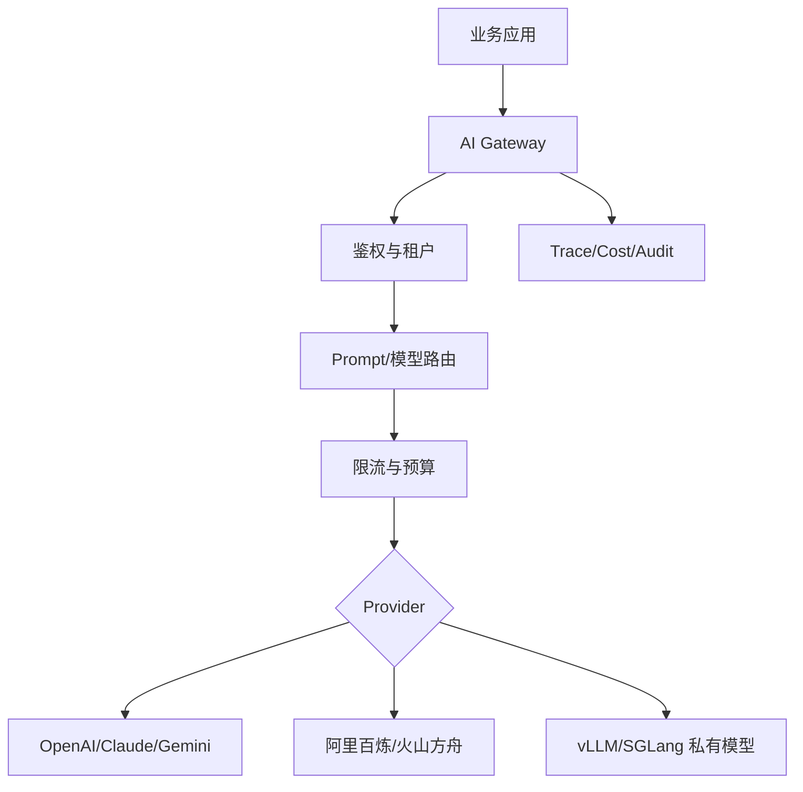

# AI 网关生产架构：限流、计费、审计

> [!abstract] 一句话总结
> AI 网关是企业 AI 应用的模型入口层，负责把模型调用从“各业务自己调 API”收敛成可限流、可计费、可审计、可灰度的基础设施。

## 为什么要单独补

多模型、多供应商、私有部署和成本治理变成常态后，业务系统直接调模型 API 会越来越难管。AI 网关的岗位价值在于统一治理模型调用。

## 核心能力

| 能力 | 说明 |
| ---- | ---- |
| 统一协议 | OpenAI-compatible API，屏蔽供应商差异 |
| 模型路由 | 按任务、租户、成本、可用性选择模型 |
| 限流熔断 | 防止单业务打爆模型额度 |
| 成本计费 | 统计 token、金额、租户、应用 |
| 审计追踪 | 记录 trace、模型、prompt 版本、工具调用 |
| 安全脱敏 | 请求和响应中的敏感信息处理 |
| 灰度回滚 | 新模型、新 prompt 小流量验证 |

## 架构图

## 路由策略

- 简单分类、摘要：小模型或私有模型。
- 高价值复杂任务：强模型。
- 敏感数据：私有模型或合规云。
- 供应商限流：自动切备用模型。
- 低优先级任务：异步队列或降级。

## Java 落地要点

- 网关入口不要暴露真实 Provider Key，业务方只拿虚拟 Key。
- 按应用、租户、用户、模型维度统计成本。
- prompt、工具参数、RAG 证据要脱敏后落 trace。
- 模型切换必须配 eval dataset，不能只靠人工感觉。
- 高风险工具调用要打通 [[21-Agent权限治理与分级自治]]。

## 与 LiteLLM / One-API 的关系

- [[10-LiteLLM与One-API]] 更偏现成工具和使用方式。
- 本文重点是企业内部要补齐的治理架构。

## 面试讲法

> 我会把模型调用收敛到 AI 网关。业务系统不直接持有模型 Key，而是通过虚拟 Key 调用。网关负责模型路由、限流、预算、审计、trace、脱敏和灰度，这样才能支撑多团队、多模型和生产成本治理。

## 📚 参考资料

- [LiteLLM Documentation](https://docs.litellm.ai/)
- [One API GitHub](https://github.com/songquanpeng/one-api)
- [Spring AI Observability](https://docs.spring.io/spring-ai/reference/observability/)
- [Langfuse Documentation](https://langfuse.com/docs)

