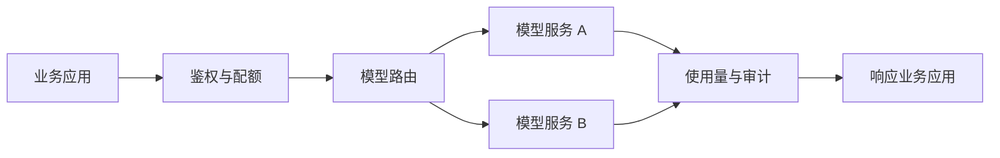

# 🚪 AI 网关：限流、计费与审计

> [!abstract] 一句话总结
> AI 网关集中管理模型接入、鉴权、路由、配额、调用记录和成本，具体能力取决于所选网关和业务要求。

## 🎯 为什么需要 AI 网关？

多个应用接入不同模型时，如果各自保存供应商密钥、处理限流和记录账单，会产生重复工作，也很难按团队统计成本。网关可以统一提供入口，让上游凭据留在受控服务中；小规模应用也可以先在服务内部封装客户端，不一定需要独立部署网关。

## 🧩 有哪些职责？

| 能力 | 做什么 | 需要注意 |
| :--- | :--- | :--- |
| 鉴权与授权 | 验证应用身份，绑定租户和可用模型 | 不信任请求体中自行声明的租户 |
| 路由与兼容 | 根据策略选择模型和提供商 | 兼容接口不意味着所有参数和工具能力一致 |
| 限流与配额 | 限制请求、Token、并发或预算 | 请求数相同，长短文本成本也可能差很多 |
| 计量与审计 | 记录调用结果、使用量与价格版本 | 日志脱敏，缺失 usage 时不能当作零成本 |

## 💰 限流和结算怎么配合？

假设租户剩余额度 100 元，两个请求同时进来时，仅在完成后检查余额可能造成超额。可在调用前根据输入和最大输出估算并原子预留额度；请求结束后按实际 usage 和价格结算，释放剩余预留。预留、结算和释放要基于请求 ID 幂等；超时或无法取得 usage 时应标记待对账。
请求数限制可用 RPM，Token 吞吐限制可用 TPM，还可能需要并发和单次输入上限。具体策略要看上游规则和业务流量，不是所有业务都必须同时开启全部限制。

## 🧮 额度预留的例子

假设一个请求预计最多花 6 元，网关先从可用额度中预留 6 元；调用结束后，根据实际用量和对应价格计算为 4 元，则结算 4 元并释放剩余 2 元。金额只是示例，实际计费还要考虑输入、输出、缓存和供应商价格版本。
如果调用超时而上游是否收费未知，不能直接当作免费；应保留请求状态并进行对账。重复回调或请求重试需要用同一业务请求标识防止重复结算，但是否重复发起上游请求仍需单独控制。

## 🔄 流式响应与故障切换

上游尚未向用户输出内容时，可以按错误类型、超时和预算决定是否切换兼容的备用渠道；已经输出部分内容后，静默拼接另一个模型的结果可能产生矛盾，应明确告知中断并由上层决定是否重新请求。备用渠道也要符合数据处理权限、模型能力和成本要求。
流式 usage 是否返回、字段名称和缓存计费由供应商决定；断流时可能收不到完整统计，需保留请求记录并对账。还应检查各层代理的缓冲和空闲超时，以免 SSE 输出被长时间积压。

## ⚠️ 缓存与安全

语义相近的问题不一定答案相同，例如“我能退款吗”会随用户、订单和时间变化。若使用语义缓存，应限定租户、权限、模型、提示词和知识版本，并评估有效期；实时信息或个人数据场景可能不适合缓存。

> [!question]- 流已经输出一半，上游突然失败，可以直接切到另一个模型接着输出吗？
> 不宜透明拼接。备用模型不知道前一模型的实际生成状态，后续内容可能重复或矛盾；应结束并说明失败，再由应用决定是否重新请求。

## 🔗 关联与资料

- [[10-LiteLLM与One-API]]：可选的网关产品；[[06-Langfuse接入]]：观测与评估。
- [LiteLLM：Proxy 文档](https://docs.litellm.ai/docs/proxy/quick_start)
