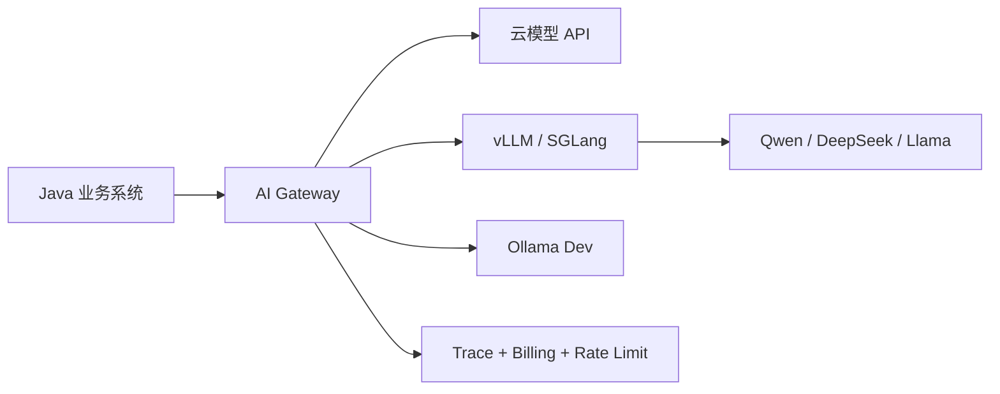

# 私有化部署：Ollama / vLLM / SGLang

> [!abstract] 一句话总结
> 私有化部署不是“本地跑个模型”这么简单，而是围绕数据不出域、成本、吞吐、延迟、模型路由和运维治理做取舍。

## 🎯 本节定位

本篇承接 [[10-LiteLLM与One-API]] 和 [[11-AI网关生产架构-限流-计费-审计]]，介绍推理服务的选型、压测与验收。模型选型和多供应商接入可分别参考 [[../01-LLM基础与Prompt/05-主流模型选型对比]]、[[../02-框架-SpringAI与LangChain4j/SpringAI/05-多模型接入与切换]]。

## 🎯 什么时候考虑私有部署

当业务对数据出域、模型可控性或成本有特定要求时，可以评估私有部署。是否自建推理服务还要结合模型能力、硬件和运维成本判断。

## 🧩 三类工具定位

| 工具 | 定位 | 适合 |
| ---- | ---- | ---- |
| Ollama | 本地开发和轻量部署 | 个人学习、内网小工具、原型验证 |
| vLLM | 高吞吐推理服务 | OpenAI 兼容 API、批量并发、生产服务 |
| SGLang | 面向复杂生成程序的高性能运行时 | Agent、多轮工具调用、结构化生成、高并发 |

## ⚖️ 选型考虑

- 开发调试：Ollama 可作为简单的本地模型运行入口，启动和响应速度仍要实测。
- 生产 API 服务：优先看 vLLM / SGLang。
- 强 Java 后端团队：模型服务独立部署，Java 通过 OpenAI-compatible API 调用。
- 对延迟敏感：压测 TTFT、TPOT、并发和 KV cache。
- 对成本敏感：小模型处理高频简单任务，大模型处理复杂任务。

## 🏗️ 典型架构

## 🧠 PagedAttention 和 RadixAttention 解决什么问题？

生成时，服务通常需要保存已经计算过的 KV Cache，后续 Token 才能复用。每个请求的长度不同，并发时这些缓存会占用大量显存，固定预留整块连续空间可能浪费资源。
**PagedAttention** 将 KV Cache 划分为块，按需映射到不必连续的显存位置，有助于减少预分配浪费。**RadixAttention** 利用共享前缀组织和复用缓存，例如多个请求带同一段长制度时，后续请求可能复用先前前缀的计算。两者关注点不同；缓存命中和性能收益受模型、版本、配置和请求模式影响，需要实测。

## 🔌 OpenAI Compatible API 的意义

vLLM、SGLang、Ollama 都在不同程度上支持 OpenAI 风格接口。对 Java 应用来说，这意味着：
- 调用层可以统一到一个模型网关。
- Spring AI / LangChain4j 的适配成本降低。
- 云模型和私有模型可以做灰度切换。
- 评估集可以复用同一套请求结构。

## ✅ 私有化验收清单

- [ ] 模型许可证允许商用和私有部署。
- [ ] 分别估算模型权重和 KV Cache，加上运行时显存开销。
- [ ] 使用实际上下文长度和并发量压测，确认单机容量。
- [ ] 支持流式输出和超时取消。
- [ ] 有 OpenAI-compatible API 或清晰 SDK。
- [ ] 日志/Trace 脱敏，检查遥测、外部工具和回退云模型路径，避免“模型在内网、数据仍出域”。
- [ ] 有模型版本、Prompt 版本和回滚策略。
- [ ] 网关层做限流、熔断、额度和审计。

## ⚠️ 常见问题

- 只看单轮效果，不测并发吞吐。
- 本地能跑，不代表生产显存和延迟可接受。
- 忘记模型许可证，后续商用合规有风险。
- 不同模型能力有差异，上线前需测试结构化输出、工具调用和长上下文任务。

## ❓ 面试问题

> [!question]- 选择私有化推理工具时需要考虑什么？
> Ollama 可用于本地开发，vLLM 和 SGLang 可作为推理服务的候选。选型时要结合模型兼容性、硬件和运维能力，并测试并发、延迟、显存、结构化输出与工具调用效果。

## 🔗 关联笔记

- [[_index]]
- [[10-LiteLLM与One-API]]
- [[../02-框架-SpringAI与LangChain4j/SpringAI/05-多模型接入与切换]]
- [[../01-LLM基础与Prompt/05-主流模型选型对比]]

## 📚 参考资料

- [Ollama Documentation](https://docs.ollama.com/)
- [vLLM Documentation](https://docs.vllm.ai/)
- [SGLang Documentation](https://docs.sglang.ai/)
- [SGLang 论文](https://arxiv.org/abs/2312.07104)
- [vLLM KV Cache 实现](https://docs.vllm.ai/en/v0.5.3.post1/automatic_prefix_caching/details.html)
- [Spring AI OpenAI Chat](https://docs.spring.io/spring-ai/reference/api/chat/openai-chat.html)
