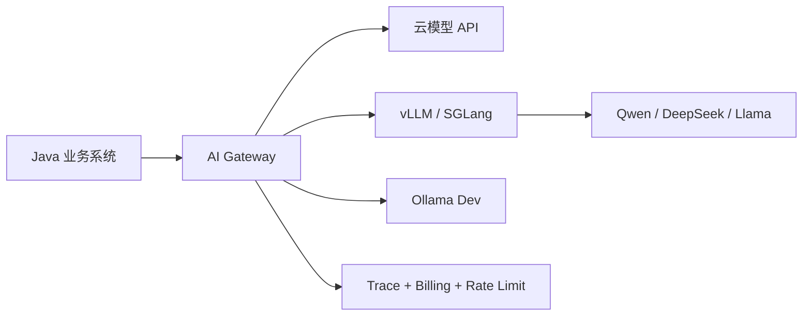

# 私有化部署：Ollama / vLLM / SGLang

> [!abstract] 一句话总结
> 私有化部署不是“本地跑个模型”这么简单，而是围绕数据不出域、成本、吞吐、延迟、模型路由和运维治理做取舍。

## 为什么 2026 岗位会问

国内企业尤其关注数据合规、国产模型、私有部署和成本控制。AI 应用开发不一定要训练模型，但要知道什么时候用云 API，什么时候用本地模型，什么时候上推理服务。

## 三类工具定位

| 工具 | 定位 | 适合 |
| ---- | ---- | ---- |
| Ollama | 本地开发和轻量部署 | 个人学习、内网小工具、原型验证 |
| vLLM | 高吞吐推理服务 | OpenAI 兼容 API、批量并发、生产服务 |
| SGLang | 面向复杂生成程序的高性能运行时 | Agent、多轮工具调用、结构化生成、高并发 |

## 选型心法

- 开发调试：Ollama 最快。
- 生产 API 服务：优先看 vLLM / SGLang。
- 强 Java 后端团队：模型服务独立部署，Java 通过 OpenAI-compatible API 调用。
- 对延迟敏感：压测 TTFT、TPOT、并发和 KV cache。
- 对成本敏感：小模型处理高频简单任务，大模型处理复杂任务。

## 典型架构

## OpenAI Compatible API 的意义

vLLM、SGLang、Ollama 都在不同程度上支持 OpenAI 风格接口。对 Java 应用来说，这意味着：

- 调用层可以统一到一个模型网关。
- Spring AI / LangChain4j 的适配成本降低。
- 云模型和私有模型可以做灰度切换。
- 评估集可以复用同一套请求结构。

## 私有化验收清单

- [ ] 模型许可证允许商用和私有部署。
- [ ] 显存、并发、上下文长度经过压测。
- [ ] 支持流式输出和超时取消。
- [ ] 有 OpenAI-compatible API 或清晰 SDK。
- [ ] 日志不落敏感原文，trace 可脱敏。
- [ ] 有模型版本、Prompt 版本和回滚策略。
- [ ] 网关层做限流、熔断、额度和审计。

## 常见坑

- 只看单轮效果，不测并发吞吐。
- 本地能跑，不代表生产显存和延迟可接受。
- 忘记模型许可证，后续商用合规有风险。
- 私有模型结构化输出和工具调用能力弱于云模型，需要单独评估。

## 面试讲法

> 私有化部署我会分开发、服务、治理三层看。Ollama 适合本地开发，vLLM/SGLang 适合生产推理服务，Java 侧通过模型网关统一调用。上线前必须压测并发、延迟、显存、上下文长度、结构化输出和工具调用能力。

## 关联

- [[05-多模型接入与切换]]
- [[10-LiteLLM与One-API]]
- [[05-主流模型选型对比]]

## 📚 参考资料

- [Ollama Documentation](https://docs.ollama.com/)
- [vLLM Documentation](https://docs.vllm.ai/)
- [SGLang Documentation](https://docs.sglang.ai/)
- [Spring AI OpenAI Chat](https://docs.spring.io/spring-ai/reference/api/chat/openai-chat.html)

