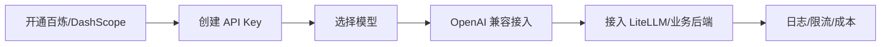

# 阿里百炼

> [!abstract] 一句话总结
> 阿里百炼是阿里云的大模型开发与应用平台，核心是通义系列模型、DashScope/API、应用构建、知识库和企业云资源整合；工程上常通过 OpenAI 兼容模式接入现有后端。

## 📌 定位

阿里百炼适合已经使用阿里云、需要中文模型、企业合规、云上权限和国产模型接入的团队。它既提供模型 API，也提供模型服务、应用构建、插件/知识库等平台能力。

常见接入方式：

- 直接使用 DashScope SDK。
- 使用 OpenAI 兼容接口，复用 OpenAI SDK、LangChain、Spring AI 或 LiteLLM。
- 在百炼控制台创建应用/知识库，再通过 API 接入业务系统。

## 🤔 解决什么问题 / 为什么需要

- **中文场景模型选择**：通义千问、Embedding、多模态等能力适合中文业务。
- **云上企业集成**：账号、RAM 权限、日志、计费、网络和阿里云生态更容易统一。
- **兼容现有工程**：OpenAI 兼容模式让业务代码少改，只替换 `base_url`、Key 和模型名。
- **国产化与合规诉求**：部分政企和金融场景会优先要求国内云厂商。

## 🧩 核心组件

| 组件 | 作用 | 学习重点 |
| ---- | ---- | -------- |
| DashScope API | 模型调用入口。 | API Key、模型名、流式输出、错误码和限流。 |
| OpenAI Compatible API | 兼容 OpenAI SDK。 | base_url、model 映射、工具调用兼容差异。 |
| Model Studio/百炼控制台 | 模型、应用和知识库管理。 | 应用发布、调试、权限和计费。 |
| 通义模型 | Chat、Embedding、多模态等。 | 上下文窗口、能力边界、价格和区域。 |
| RAM/计费 | 云上权限与账单。 | Key 最小权限、按项目拆账、额度告警。 |

## ⚙️ 接入流程



1. 开通阿里云百炼或 DashScope 服务，确认账号实名认证、区域和计费方式。
2. 创建 API Key，生产环境通过密钥管理或环境变量注入，不写入代码仓库。
3. 选择聊天模型、Embedding 模型和重排模型，并记录上下文窗口、价格和限流。
4. 业务后端使用 OpenAI 兼容接口接入，或把百炼配置到 LiteLLM/Dify/Spring AI。
5. 建立调用日志：模型名、输入输出 token、错误码、耗时、租户和请求 ID。
6. 设置额度告警和降级策略，避免突发流量导致账单或限流事故。

## 💻 OpenAI 兼容示例

```python
from openai import OpenAI

client = OpenAI(
    api_key=os.environ["DASHSCOPE_API_KEY"],
    base_url="https://dashscope.aliyuncs.com/compatible-mode/v1",
)

resp = client.chat.completions.create(
    model="qwen-plus",
    messages=[{"role": "user", "content": "用三句话总结这份需求"}],
)
```

## ⚠️ 生产坑

- 模型名、区域、兼容接口路径写错时，错误看起来像普通鉴权失败，要保留 provider 原始错误码。
- 不同模型对 function calling、JSON 输出、多模态输入的支持程度不同，接入前要做能力矩阵。
- Embedding 模型替换后必须重建向量索引，否则 RAG 召回质量会失真。
- 企业账号下多个项目共用 Key，后续成本、权限和责任很难拆清。
- 国内云平台内容安全策略可能影响输出，降级和重试不能绕过安全拒答。

## 🎯 面试 / 选型

> [!question] 高频问题
> - Q: 百炼适合什么团队？
>   - A: 已在阿里云上、中文业务占比高、需要国内云合规和统一云资源管理的团队。
> - Q: 为什么优先用 OpenAI 兼容接口？
>   - A: 可以复用现有 SDK、网关和框架，减少业务代码和平台耦合。
> - Q: 百炼接入 RAG 要注意什么？
>   - A: 聊天模型、Embedding 模型、rerank、向量库维度和知识库更新要成套管理。

## ✅ 精通检查清单

- 能用 OpenAI SDK 调通百炼模型。
- 能把百炼接入 LiteLLM 或 Dify。
- 能列出模型能力矩阵和成本估算。
- 能说明 Key 管理、限流、日志和内容安全策略。

## 🔗 关联笔记

- [[_index]]
- [[10-LiteLLM与One-API]]
- [[05-平台选型对比]]
- [[10-AI应用开发/00-总览/学习仪表盘]]

## 📚 参考资料

- [阿里云百炼文档](https://help.aliyun.com/zh/model-studio/)
- [DashScope 文档](https://help.aliyun.com/zh/dashscope/)
