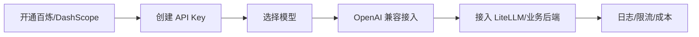

# 阿里百炼

> [!abstract] 一句话总结
> 阿里百炼是阿里云的大模型开发与应用平台，核心是通义系列模型、DashScope/API、应用构建、知识库和企业云资源整合；工程上常通过 OpenAI 兼容模式接入现有后端。

## 📌 定位

阿里百炼适合已经使用阿里云、需要中文模型、企业合规、云上权限和国产模型接入的团队。它既提供模型 API，也提供模型服务、应用构建、插件/知识库等平台能力。
常见接入方式：
- 直接使用 DashScope SDK。
- 使用 OpenAI 兼容接口，复用 OpenAI SDK、LangChain、Spring AI 或 LiteLLM。
- 在百炼控制台创建应用/知识库，再通过 API 接入业务系统。

## 🤔 解决什么问题 / 为什么需要

阿里百炼提供通义千问、Embedding 和多模态等能力，可与阿里云的账号、权限、网络、日志和计费体系配合。部分接口提供 OpenAI 兼容模式，但迁移时仍要检查模型能力、参数和响应差异；涉及国产化或合规要求时，还要核对服务地域、数据处理和协议。

## 🧩 核心组件

| 组件 | 作用 | 学习重点 |
| ---- | ---- | -------- |
| DashScope API | 模型调用入口。 | API Key、模型名、流式输出、错误码和限流。 |
| OpenAI Compatible API | 兼容 OpenAI SDK。 | base_url、model 映射、工具调用兼容差异。 |
| Model Studio/百炼控制台 | 模型、应用和知识库管理。 | 应用发布、调试、权限和计费。 |
| 通义模型 | Chat、Embedding、多模态等。 | 上下文窗口、能力边界、价格和区域。 |
| RAM/计费 | 云上权限与账单。 | Key 最小权限、按项目拆账、额度告警。 |

## ⚙️ 接入流程



1. 开通阿里云百炼或 DashScope 服务，确认账号实名认证、区域和计费方式。
2. 创建 API Key，生产环境通过密钥管理或环境变量注入，不写入代码仓库。
3. 选择聊天模型、Embedding 模型和重排模型，并记录上下文窗口、价格和限流。
4. 业务后端使用 OpenAI 兼容接口接入，或把百炼配置到 LiteLLM/Dify/Spring AI。
5. 建立调用日志：模型名、输入输出 token、错误码、耗时、租户和请求 ID。
6. 设置额度告警和降级策略，避免突发流量导致账单或限流事故。

## 💻 Spring AI 接入片段

假设已引入 Spring AI 2.x 的 OpenAI 兼容 Starter。以下属性是配置示意，需要按百炼控制台的区域、模型和接口文档填写；先检查该版本客户端与供应商地址的拼接方式，避免重复 `/v1`；其他 Spring AI 版本的属性可能不同。

```properties
spring.ai.openai.base-url=${PROVIDER_BASE_URL}
spring.ai.openai.api-key=${DASHSCOPE_API_KEY}
spring.ai.openai.chat.model=${PROVIDER_MODEL}
```

假设 `chatClient` 已由应用配置并注入，`text` 为待处理文本，下面只展示调用关系；片段未连接外部模型运行。

```java
String answer = chatClient.prompt()
        .user("请概括：" + text)
        .call().content();
```

例如北京区域当前官方文档给出的 OpenAI 兼容 base URL 为 `https://{WorkspaceId}.cn-beijing.maas.aliyuncs.com/compatible-mode/v1`。区域、工作空间和配置项均以当前文档与控制台为准，实际请求路径需要联调验证。

## ⚠️ 生产坑

- 模型名、区域、兼容接口路径写错时，错误看起来像普通鉴权失败，要保留 provider 原始错误码。
- 不同模型对 function calling、JSON 输出、多模态输入的支持程度不同，接入前要做能力矩阵。
- 更换 Embedding 模型后，通常需要重新生成向量并重建索引。
- 即使向量维度相同，也要检查空间兼容性并评测召回。
- 企业账号下多个项目共用 Key，后续成本、权限和责任很难拆清。
- 国内云平台内容安全策略可能影响输出，降级和重试不能绕过安全拒答。

## 🎯 面试 / 选型

> [!question]- 百炼适合什么团队？
> 已在阿里云上、中文业务占比高、需要国内云合规和统一云资源管理的团队。

> [!question]- 为什么优先用 OpenAI 兼容接口？
> 可以复用现有 SDK、网关和框架，减少业务代码和平台耦合。

> [!question]- 百炼接入 RAG 要注意什么？
> 聊天模型、Embedding 模型、rerank、向量库维度和知识库更新要成套管理。

## ✅ 精通检查清单

- 能按官方接口配置 Spring AI 并验证百炼模型调用。
- 能把百炼接入 LiteLLM 或 Dify。
- 能列出模型能力矩阵和成本估算。
- 能说明 Key 管理、限流、日志和内容安全策略。

## 🔗 关联笔记

- [[_index]]
- [[10-LiteLLM与One-API]]
- [[05-平台选型对比]]
- [[../00-总览/学习仪表盘]]

## 📚 参考资料

- [阿里云百炼文档](https://help.aliyun.com/zh/model-studio/)；[OpenAI 兼容接口](https://help.aliyun.com/zh/model-studio/compatibility-of-openai-with-dashscope)
- [DashScope 文档](https://help.aliyun.com/zh/dashscope/)
