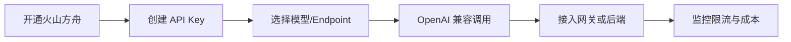

# 火山方舟

> [!abstract] 一句话总结
> 火山方舟是火山引擎的大模型服务平台，常用于接入豆包等模型、模型推理、知识库/应用构建和企业级 API 调用；工程上重点掌握 endpoint、OpenAI 兼容接口、鉴权、限流和成本监控。

## 📌 定位

火山方舟适合已经使用火山引擎、需要豆包模型、国内云服务、内容安全和企业部署管理的团队。它既能作为模型 API 供应商接入业务，也能作为上层平台做模型体验、应用构建和知识库能力。

和阿里百炼的差异主要体现在云生态、模型族、价格、区域、内容安全策略和企业已有基础设施，而不是“谁完全替代谁”。

## 🤔 解决什么问题 / 为什么需要

- **接入豆包模型**：聊天、推理、多模态、Embedding 等能力可服务中文应用。
- **企业云集成**：账号、权限、账单、VPC、日志和安全策略可以纳入火山引擎体系。
- **OpenAI 兼容迁移**：业务可以用 OpenAI SDK 访问方舟兼容接口。
- **多供应商备份**：通过 LiteLLM 和百炼/OpenAI/本地模型组成主备路由。

## 🧩 核心组件

| 组件 | 作用 | 学习重点 |
| ---- | ---- | -------- |
| Endpoint/模型服务 | 具体可调用模型入口。 | endpoint ID、模型版本、区域和限流。 |
| Ark API | 方舟推理 API。 | 鉴权、base_url、错误码和流式输出。 |
| OpenAI Compatible API | 兼容 OpenAI 客户端。 | 模型名映射、messages 格式、工具调用差异。 |
| Knowledge/Application | 平台应用与知识能力。 | 是否满足业务知识库、发布和权限要求。 |
| 监控计费 | 调用量、token、错误和账单。 | 按租户和应用拆分成本。 |

## ⚙️ 接入流程



1. 开通火山方舟，确认账号权限、地域、计费和可用模型。
2. 创建 API Key 或服务凭证，生产环境通过密钥管理系统注入。
3. 选择模型或 endpoint，记录上下文窗口、价格、限流和支持能力。
4. 使用 OpenAI 兼容接口接入后端，或配置到 LiteLLM、Dify、LangChain/Spring AI。
5. 建立日志字段：endpoint、模型名、用户、租户、token、耗时、错误码。
6. 配置配额告警、限流策略和备用模型。

## 💻 OpenAI 兼容示例

```python
from openai import OpenAI

client = OpenAI(
    api_key=os.environ["ARK_API_KEY"],
    base_url="https://ark.cn-beijing.volces.com/api/v3",
)

resp = client.chat.completions.create(
    model="doubao-seed-1-6",
    messages=[{"role": "user", "content": "提取这段文本中的风险点"}],
)
```

实际模型名和 endpoint 以控制台配置为准，生产代码不要把测试 endpoint 写死。

## ⚠️ 生产坑

- endpoint、模型名和区域混用，测试环境能调通，生产环境因权限或区域不一致失败。
- OpenAI 兼容不等于能力完全一致，工具调用、JSON 输出、图像输入要逐项验收。
- 重试策略没有避开 4xx 参数错误，导致错误请求被重复扣费或放大限流。
- 方舟作为备用模型时，输出风格和安全策略与主模型不同，需要业务回归。
- 账单只按总 Key 看，无法按应用/租户拆分成本，后续很难治理。

## 🎯 面试 / 选型

> [!question] 高频问题
> - Q: 火山方舟适合什么场景？
>   - A: 已在火山引擎生态、需要豆包模型、国内云合规、企业级权限和模型服务管理的场景。
> - Q: 方舟和百炼怎么选？
>   - A: 看企业云生态、模型能力、价格、区域、内容安全和团队运维习惯；工程上最好通过网关保留多供应商切换能力。
> - Q: 接入方舟上线前测什么？
>   - A: endpoint 权限、模型能力、流式响应、工具调用、内容安全、限流、成本和备用模型一致性。

## ✅ 精通检查清单

- 能使用 OpenAI SDK 调通火山方舟模型。
- 能把方舟配置进 LiteLLM 或 Dify。
- 能解释 endpoint、模型名、区域和 Key 的关系。
- 能制定限流、重试、成本和降级策略。

## 🔗 关联笔记

- [[_index]]
- [[10-LiteLLM与One-API]]
- [[05-平台选型对比]]
- [[../00-总览/学习仪表盘]]

## 📚 参考资料

- [火山方舟文档](https://www.volcengine.com/docs/82379)
- [火山引擎方舟 API](https://www.volcengine.com/docs/82379/1298459)
