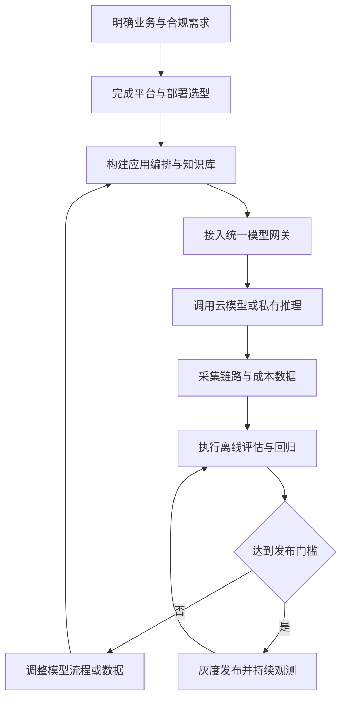

# 06 · 平台与工程化 · 本章总结与复习

本章把 AI 应用从“能运行”推进到“可上线”：先按应用编排、RAG、观测评估、模型网关和供应商分层选型，再通过数据集、回归测试、统一入口、私有化推理与国内云平台形成交付闭环。

## 核心知识概览表

| 编号 | 核心主题 | 复习要点 |
| ---- | -------- | -------- |
| [[01-Dify部署与使用]] | Dify 应用平台 | 串联模型、知识库、工具、Workflow、发布和运维，快速交付 AI 应用。 |
| [[02-Dify工作流引擎源码]] | 工作流执行内核 | 理解节点图校验、DAG 调度、变量传递、运行状态、异常与持久化。 |
| [[03-Coze扣子]] | Bot 与 Agent 平台 | 利用插件、工作流、知识库和多渠道发布快速完成 Bot 产品化。 |
| [[04-RAGFlow]] | RAG 专用平台 | 强化复杂文档解析、知识库管理、检索调试和带引用回答。 |
| [[05-平台选型对比]] | 分层选型 | 不把所有产品横向硬比，而是按编排、RAG、观测、网关和供应商组合。 |
| [[06-Langfuse接入]] | LLM 可观测 | 用 trace、span、generation、prompt、score 和 dataset 复盘质量、延迟与成本。 |
| [[07-Ragas评估实践]] | RAG 离线评估 | 用固定样例和忠实度、相关性、召回等指标比较不同方案。 |
| [[08-LLM评估指标体系]] | 发布门禁 | 同时衡量正确性、安全、稳定性、成本、延迟与业务效果。 |
| [[09-AI应用评估数据集与回归测试]] | 持续回归 | 将线上 badcase 脱敏沉淀为数据集，在模型、Prompt 或检索变更时自动回放。 |
| [[10-LiteLLM与One-API]] | 统一模型入口 | 通过 OpenAI 兼容接口聚合供应商，并提供路由、降级、额度与渠道管理。 |
| [[11-AI网关生产架构-限流-计费-审计]] | 模型治理 | 在统一入口实现鉴权、租户、路由、限流、计费、审计、脱敏与灰度。 |
| [[12-私有化部署-Ollama-vLLM-SGLang]] | 私有推理 | 按开发便利、吞吐、延迟、生成模式、数据合规与运维能力选择推理服务。 |
| [[13-阿里百炼]] | 阿里云模型平台 | 接入通义模型、DashScope、知识库和云上企业能力，常用 OpenAI 兼容模式集成。 |
| [[14-火山方舟]] | 火山模型平台 | 接入豆包等模型与方舟 API，关注 endpoint、鉴权、限流、内容安全和成本。 |

## 生产交付闭环

## 快速复习

1. Dify 和 Coze 偏应用编排与发布，RAGFlow 偏文档理解与 RAG，不应只按功能数量选型。
2. 平台选型要同时考虑部署、数据合规、应用类型、模型策略、扩展性和团队维护能力。
3. Langfuse 负责记录与复盘链路，Ragas 负责对固定样例评分，两者可以组成观测评估闭环。
4. 指标必须连接业务目标，并用稳定数据集、阈值和人工复核形成发布门禁。
5. LiteLLM 和 One-API 提供统一模型入口；生产网关还要补齐鉴权、限流、计费、审计和灰度。
6. Ollama 适合开发与轻量场景，vLLM 和 SGLang 更面向生产推理，但最终选择必须基于压测。
7. 百炼与方舟是模型供应商和云平台层，可通过兼容接口接入网关，避免业务代码绑定单一厂商。

## 自测问题

1. 一个需要复杂 PDF 解析、严格私有化和 Java 业务编排的项目，应如何组合平台与代码组件？
2. Langfuse、Ragas、评估指标体系和回归数据集在一条质量闭环中分别负责什么？
3. 为什么只有 OpenAI 兼容转发还不能称为完整的生产级 AI 网关？
4. 选择 Ollama、vLLM 或 SGLang 时，至少要压测和验收哪些指标？
5. 如何设计百炼、方舟和本地模型之间的主备路由，同时控制成本与数据合规？

## 下一章衔接

下一章 [[10-AI应用开发/07-辅助语言/_index|07 · 辅助语言 Python 与 TypeScript]] 转向生态工具的阅读与接入能力。Python 有助于使用评估、推理和 Agent 生态，TypeScript 有助于构建流式 AI 前端；本章的平台、网关和评估接口会成为两种语言实践的真实接入对象。

## 相关编号双链

- 平台与选型：[[01-Dify部署与使用]] → [[02-Dify工作流引擎源码]] → [[03-Coze扣子]] → [[04-RAGFlow]] → [[05-平台选型对比]]
- 可观测与评估：[[06-Langfuse接入]] → [[07-Ragas评估实践]] → [[08-LLM评估指标体系]] → [[09-AI应用评估数据集与回归测试]]
- 网关、部署与供应商：[[10-LiteLLM与One-API]] → [[11-AI网关生产架构-限流-计费-审计]] → [[12-私有化部署-Ollama-vLLM-SGLang]] → [[13-阿里百炼]] → [[14-火山方舟]]
- 本章索引：[[_index|06 · 平台与工程化]]
