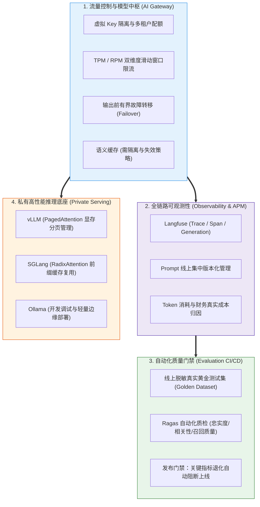

# 🎯 平台与工程化：本章通关总结与复习

> [!abstract] 一句话总结
> 平台与工程化负责把模型能力变成可运维的服务：统一接入、控制成本、追踪失败，并用评估和灰度减少上线风险。

---

## 🗺️ 全章知识拓扑大一统

---

## 📊 核心模块关键结论总览

| 模块分层 | 核心攻坚问题 | 第一性原理关键结论 | 对应笔记精读 |
| :--- | :--- | :--- | :--- |
| **00 工程心智** | 从原型验证到生产上线需要补齐哪些工程能力？ | 需围绕流量治理与多租户鉴权、Token 成本核算、跨渠道故障容灾、全链路可观测及自动化回归评测建立工程闭环。 | [[00-AI平台与工程化全景心智模型]] |
| **11 AI 网关** | 为什么企业需要专门的 AI 网关层？ | 集中保管上游 API Key 并签发租户虚拟 Key，实现异构协议统一适配、RPM/TPM 双维限流、原子预算预留及首包前有界 Failover。 | [[11-AI网关生产架构-限流-计费-审计]] [[10-LiteLLM与One-API]] |
| **06 可观测性** | 线上回答异常或延迟飙升时如何快速定位根因？ | 通过 Trace 将入口请求、RAG 检索片段、Prompt 版本、模型推理与工具执行串联，在脱敏前提下完整留存执行上下文与耗时明细。 | [[06-Langfuse接入]] |
| **07 持续评测** | 如何量化验证新模型或新 Prompt 是否引发效果退化？ | 从脱敏线上 badcase 与核心业务场景沉淀黄金测试集（Golden Dataset），结合 Ragas 检索/生成指标与人工复核构建 CI/CD 发布门禁。 | [[07-Ragas评估实践]] [[08-LLM评估指标体系]] [[09-AI应用评估数据集与回归测试]] |
| **12 私有推理** | 自建 GPU 推理服务如何兼顾高并发吞吐与显存利用率？ | 核算模型权重、并发 KV Cache 与运行时显存开销；利用 vLLM PagedAttention 降低显存碎片，利用 SGLang RadixAttention 复用跨请求公共前缀。 | [[12-私有化部署-Ollama-vLLM-SGLang]] |

---

## ⚡ 大厂面试 30 秒绝杀 10 连问

> [!important] 高频核心问题
>
> 1. **在企业架构中，为什么要引入 AI 网关（如 LiteLLM / 自研网关），而不是让业务服务直连模型厂商 API？**
>    - 答：① **凭证安全与租户隔离**：网关集中托管上游供应商真实 Key，向各业务线签发绑定配额与模型白名单的虚拟 Key（Virtual Keys）；② **协议解耦与平滑容灾**：统一暴露 OpenAI 兼容接口，当主力渠道超时或 429 限流时，可在首包输出前自动切换至备用渠道；③ **统一计量与限流**：集中实施 RPM/TPM 双维限流与 Token 级财务分摊计费。
>
> 2. **为什么大模型 SSE 流式输出在经过 Nginx 或网关时容易出现“攒完一次性蹦出”的卡顿现象？如何解决？**
>    - 答：传统反向代理默认开启响应缓冲区（Proxy Buffering），会等待上游攒够一定字节数或连接结束后才向客户端刷出数据。**解决方案**：在 Nginx 配置中显式声明 `proxy_buffering off`（或由网关响应头返回 `X-Accel-Buffering: no`），同时检查链路上的 CDN、WAF 是否关闭了流式缓冲并调大长连接读取超时（`proxy_read_timeout`）。
>
> 3. **为什么传统的 APM 监控（如 SkyWalking / Prometheus）不足以覆盖大模型应用的可观测需求，需要引入 Langfuse？**
>    - 答：传统 APM 擅长监控接口延迟、HTTP 状态码与系统资源，而大模型链路的排障核心在于**非结构化语义上下文**。Langfuse 在分布式 Trace 基础上，专门针对 LLM 链路管理 Prompt 模板版本、RAG 检索召回片段与相似度、多轮 Tool Calling 入参出参、Token 消耗明细以及线上/离线质量评分（Scores）与回归数据集（Datasets）。
>
> 4. **vLLM 的核心技术 PagedAttention 解决了什么底层痛点？**
>    - 答：在自回归生成过程中，每个请求的 KV Cache 随生成长度动态增长且无法预先得知准确长度，传统连续显存预分配会导致严重的内部碎片与外部碎片。**PagedAttention** 借鉴操作系统虚拟内存分页思想，将 KV Cache 切分为固定大小的物理块（Blocks）并通过块表按需非连续分配，大幅降低了显存浪费，从而在相同 GPU 显存下容纳更高并发的 Continuous Batching。
>
> 5. **SGLang 的 RadixAttention 与 vLLM 的 PagedAttention 各自侧重解决什么问题？**
>    - 答：两者均致力于优化 KV Cache 管理且可协同工作：**PagedAttention** 侧重于解决 KV Cache 的**物理显存分页分配与碎片消除**；而 **RadixAttention** 侧重于解决**跨请求公共前缀缓存（Prefix Caching）的高效复用**——它在显存中维护一棵基数树（Radix Tree）并采用 LRU 淘汰策略，使长 System Prompt、多轮对话历史与多分支 Agent 推理直接命中已计算的 KV 缓存，显著降低首字延迟（TTFT）。
>
> 6. **如何建立可靠的 AI 应用上线前 CI/CD 回归测试门禁？**
>    - 答：① **沉淀独立测试集**：将日常调参样本与验收集隔离，从脱敏线上日志、高频业务问答及安全边界案例中构建 100~300 条 Golden Dataset；② **锁定基准配置**：固定数据集版本、检索参数与裁判模型版本，联合计算检索召回率、上下文忠实度（Faithfulness）、答案正确性及延迟成本；③ **分级拦截策略**：对整体指标设定允许波动阈值，对安全越权、敏感信息泄露等高危用例实施一票否决。
>
> 7. **在 AI 网关落地语义缓存（Semantic Cache）时，如何防范跨租户数据污染与错误命中？**
>    - 答：语义缓存通过计算用户 Query 的向量相似度复用历史回答以降低延迟与成本，但高相似度提问在不同上下文下可能需要不同回答。工程落地时，缓存检索必须**以租户 ID、用户权限域、模型版本、Prompt 版本及知识库版本作为前置精确过滤条件**，仅在同权限、同版本域内进行高阈值向量匹配，并对涉及实时金额、库存或个人隐私的动态查询禁用语义缓存。
>
> 8. **在私有化部署中，为什么常说“本地开发选 Ollama，生产高并发选 vLLM / SGLang”？**
>    - 答：Ollama 基于 `llama.cpp` 封装，主打极简的命令行体验与单机跨平台运行，非常适合个人开发调试与轻量边缘部署；而在生产高并发场景下，vLLM 与 SGLang 提供了成熟的张量并行（Tensor Parallelism）、连续批处理（Continuous Batching）、PagedAttention 显存管理与前缀缓存机制，能够充分发挥多卡 GPU 集群的并发吞吐性能。实际选型时应结合目标模型兼容性与真实并发负载压测决定。
>
> 9. **企业接入阿里百炼、火山方舟等国内大模型云平台时，工程验收应重点关注哪些要素？**
>    - 答：① **合规与数据边界**：确认服务地域、数据传输加密及平台关于输入输出数据不用于公有模型训练的协议条款；② **兼容接口细节验证**：虽然主流平台均提供 OpenAI-compatible API，仍需逐项实测目标模型的 Function Calling、结构化 JSON 输出、多模态格式及流式尾包 `usage` 返回；③ **配额与容灾**：核对具体模型或推理接入点（Endpoint）的 RPM/TPM 限额，并在网关层配置跨供应商容灾路由。
>
> 10. **在高并发网关中，如何设计租户配额扣减机制以防止并发请求打穿预算（超支）？**
>     - 答：不能采用“请求进入时仅查一次余额、结束后再扣款”的读写分离模式，否则高并发请求会同时通过余额检查造成严重透支。应采用**“两阶段原子预留与幂等结算”**：请求进入模型前，通过 Redis Lua 脚本按单次最大可能消耗（Input Tokens + `max_tokens`）原子检查并冻结预留额度；请求完成（或失败/命中缓存）后，按唯一 `request_id` 幂等扣减实际消耗并退还多余预留，金额统一使用最小货币单位整数或 `BigDecimal` 并在后台与供应商账单定期对账。

---

## 🚨 生产落地十诫（Architectural Commandments）

1. **一戒业务直连上游真 Key**：所有模型调用统一经由 AI 网关或服务端代理，上游真实 API Key 集中加密托管，业务端仅持有受控虚拟 Key 且严禁落入明文日志。
2. **二戒限流仅依赖传统 QPS**：结合大模型算力特征，建立 RPM（请求数）、TPM（Token 吞吐）、并发数与单次预算的多维联合限流。
3. **三戒无界重试与半途拼流**：设置明确的重试上限与总超时；仅在首包输出前执行跨渠道 Failover，流式输出开始后严禁静默切换模型拼接回复。
4. **四戒忽略流式代理缓冲**：逐跳核查 Nginx（`proxy_buffering off`）、CDN 与网关的流式缓冲及空闲超时配置，保障 SSE 实时推流。
5. **五戒线上调用缺乏脱敏追踪**：接入 Langfuse / OpenTelemetry 串联完整调用链路，对个人隐私与密钥字段脱敏并设置合规保留周期。
6. **六戒测试集与调参集混用**：构建独立的黄金测试集（Golden Dataset），联合评估检索与生成指标，并对高风险安全用例设置单独门禁。
7. **七戒未经压测盲目选型推理引擎**：基于真实业务上下文长度、并发量与目标模型压测 vLLM / SGLang 吞吐与首字延迟（TTFT）。
8. **八戒语义缓存跨租户裸跑**：语义缓存必须严格绑定租户权限、模型版本、Prompt 版本与知识库版本，动态实时查询不走语义缓存。
9. **九戒显存预估遗漏 KV Cache**：私有化部署容量规划须综合计算模型权重、最大并发 KV Cache 与运行时开销，避免高并发下触发 OOM。
10. **十戒模型或 Prompt 变更无灰度直发**：底层模型切换或核心 Prompt 升级必须先通过离线回归评测集验证，再经线上小流量灰度观察后全量发布。

---

## 🔗 下一章通关衔接

下一章补充 Python 和 TypeScript，便于使用评估工具和构建 AI 前端：

👉 进入下一章：[[../07-辅助语言/_index|07 · 辅助语言：Python 与 TypeScript]]
- Java 工程师如何快速掌握 AI 生态的两大关键外围语言；
- Python 在算法评测（Ragas）、深度学习库与 Agent 原型中的高效使用；
- TypeScript 与 React/Next.js 在构建现代化流式 AI 前端应用中的实战对接！
