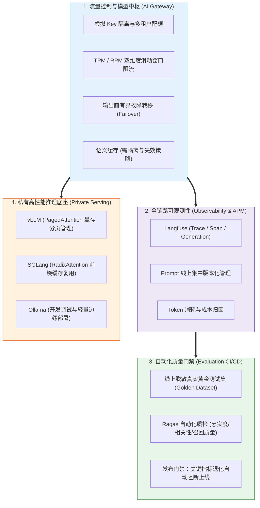

# 🎯 平台与工程化：本章通关总结与复习

> [!abstract] 一句话总结
> 平台与工程化负责把模型能力变成可运维的服务：统一接入、控制成本、追踪失败，并用评估和灰度减少上线风险。

---

## 🗺️ 本章知识结构

---

## 📊 核心知识速览

| 内容 | 学习重点 | 对应笔记 |
| :--- | :--- | :--- |
| 工程化 | 权限、成本、故障处理、观测与评测 | [[00-AI平台与工程化全景心智模型|工程全景]] |
| AI 网关 | 凭证、模型路由、限流、预算和有界降级 | [[11-AI网关生产架构-限流-计费-审计|网关架构]] · [[10-LiteLLM与One-API|网关选型]] |
| 可观测性 | 用 Trace 关联请求、检索和工具调用，并控制敏感数据 | [[06-Langfuse接入|Langfuse]] |
| 持续评测 | 准备测试集，比较检索、回答质量与人工复核结果 | [[07-Ragas评估实践|Ragas]] · [[08-LLM评估指标体系|指标]] · [[09-AI应用评估数据集与回归测试|数据集与回归]] |
| 私有推理 | 核算权重、KV Cache 和运行时开销，再用实际负载压测 | [[12-私有化部署-Ollama-vLLM-SGLang|私有化部署]] |

---

## ❓ 本章自测

> [!question]- 1. AI 网关能解决哪些问题？
> 它可以集中管理上游凭证、租户配额、模型路由和用量，并按请求数或 Token 限流。备用模型是否可切换取决于配置，流式内容输出后不能静默拼接另一模型的回答。

> [!question]- 2. 为什么流式回答会被攒在一起才显示？
> 代理缓冲可能延迟数据转发。可以检查 Nginx 的 `proxy_buffering`、上游 `X-Accel-Buffering` 响应头和 `proxy_read_timeout`，也要排查 CDN、WAF 等其他链路节点。

> [!question]- 3. 大模型应用需要记录哪些额外的观测信息？
> 除延迟和状态码外，还可关联 Prompt 版本、检索结果、工具调用、Token 用量和质量评分。Langfuse 是一种实现选择，其他支持这些信息的观测方案也可以；记录时要控制敏感数据。

> [!question]- 4. PagedAttention 解决了什么问题？
> 请求长度不同，提前分配连续 KV Cache 可能浪费显存。PagedAttention 将缓存分块并按需映射到非连续位置，有助于减少浪费；实际并发能力仍要结合模型和负载测量。

> [!question]- 5. PagedAttention 与 RadixAttention 各侧重什么？
> PagedAttention 侧重按块管理 KV Cache；RadixAttention 利用共享前缀组织和复用缓存。两者关注点不同，vLLM 也支持[前缀缓存](https://docs.vllm.ai/en/latest/design/prefix_caching/)；具体收益取决于请求和配置。

> [!question]- 6. 上线前怎样设计回归测试门禁？
> 分开调优集和验收集，覆盖高频、边界及安全问题；固定数据集和评测配置，比较召回、回答质量、延迟与成本，并为高风险用例设置单独门槛。

> [!question]- 7. 语义缓存怎样避免越权和错误命中？
> 先按租户、权限域和相关版本隔离，再评估相似问题是否适合复用及缓存有效期。实时数据和个人信息通常不适合直接复用旧回答，相似度高也不代表答案相同。

> [!question]- 8. Ollama、vLLM 和 SGLang 应该怎么选？
> Ollama 可作为本地开发的简单入口，vLLM 和 SGLang 可作为推理服务候选。模型支持、批处理、并行能力和部署成本需按版本核对，再用实际负载压测。

> [!question]- 9. 接入云模型平台时要验收哪些内容？
> 核对地域、数据保留和使用条款；实测目标模型的工具调用、结构化输出、多模态与流式用量字段；再检查具体模型的配额、计费和备用方案。

> [!question]- 10. 高并发请求如何避免同时通过余额检查而超支？
> 调用前按模型价格和预计用量原子预留额度，结束后按请求 ID 幂等结算并释放多余额度。用量缺失或断流时标记待对账；金额使用整数最小单位或 `BigDecimal`，并核对供应商账单。

---

## 🚨 上线前检查

- 将供应商密钥保存在受控的服务端，避免写入日志；需要统一管理时可通过网关签发受限凭证。
- 除请求数外，还要考虑 Token 吞吐、并发数和单次请求预算。
- 为重试设置次数和总超时；流式输出开始后，不要静默切换模型并拼接两次回答。
- 检查 Nginx、CDN 和网关的流式缓冲与空闲超时配置。
- 用 Langfuse 或 OpenTelemetry 串联调用链，对敏感信息脱敏并设置保留期限。
- 将调参集和验收集分开，对高风险安全用例设置单独的检查标准。
- 用实际模型、上下文长度和并发量测试推理引擎的吞吐与首字延迟。
- 语义缓存要考虑租户权限、模型、Prompt 和知识库版本；实时数据不宜直接复用旧答案。
- 估算显存时同时考虑模型权重、并发请求的 KV Cache 和运行时开销。
- 模型或核心 Prompt 变更后，先做离线回归，再按需灰度发布并观察效果。

---

## 🔗 下一步学习

继续学习 [[../07-辅助语言/_index|Python 与 TypeScript]]，了解如何运行 Python 评估工具，以及使用 TypeScript 构建流式 AI 前端。
