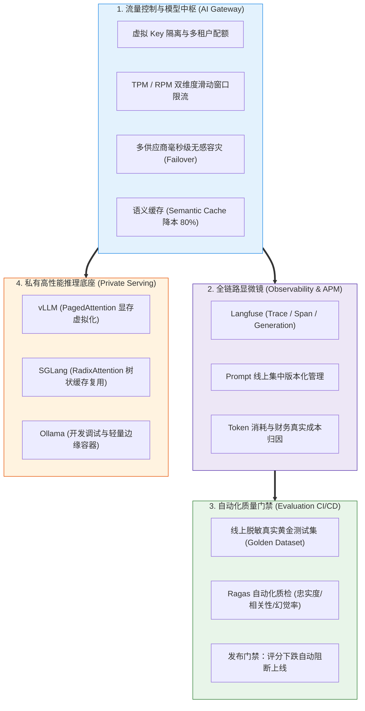

# 🎯 平台与工程化：本章通关总结与复习

> [!abstract] 一句话总结
> AI 平台与工程化的终极使命是**“为非确定性的概率大模型披上确定性的工程铠甲”**——通过 AI 网关统一流量安全与财务核算，通过 Langfuse 全链路追踪破除黑盒迷雾，通过 vLLM 榨干私有硬件吞吐，并通过黄金测试集门禁确保模型升级不降级。

---

## 🗺️ 全章知识拓扑大一统

---

## 📊 核心模块关键结论总览

| 模块分层 | 核心攻坚问题 | 第一性原理关键结论 | 对应笔记精读 |
| :--- | :--- | :--- | :--- |
| **00 工程心智** | 为什么写个 Demo 到上线有 80% 的鸿沟？ | 裸跑 API 必然遭遇盗刷、账单失控、供应商宕机断流、黑盒无审计；工程化四大基石填平确定性鸿沟。 | [[00-AI平台与工程化全景心智模型]] |
| **11 AI 网关** | 传统网关为什么管不好大模型流量？ | 大模型是超长流式连接，单次请求计算量差异达万倍；必须支持 TPM/RPM 联合限流、毫秒级 Failover 与虚拟 Key 隔离。 | [[11-AI网关生产架构-限流-计费-审计]] [[10-LiteLLM与One-API]] |
| **06 可观测性** | 大模型胡说八道时怎么线上破案复盘？ | 传统 APM 只能看网络延迟；Langfuse 专用 Trace 将 Prompt 输入、RAG 检索 Chunk、工具执行参数与 Token 成本串联留痕。 | [[06-Langfuse接入]] |
| **07 持续评测** | 怎么知道新模型或新 Prompt 变得更好还是更差？ | 告别肉眼主观试题；基于脱敏线上 badcase 沉淀 200 条黄金测试集，结合 Ragas 自动化评分构建 CI/CD 发布门禁。 | [[07-Ragas评估实践]] [[08-LLM评估指标体系]] [[09-AI应用评估数据集与回归测试]] |
| **12 私有推理** | 私有化 GPU 算力如何榨干显存与吞吐？ | 原生 HuggingFace 显存碎片严重；vLLM 的 PagedAttention 借鉴虚拟内存分页彻底消除碎片；SGLang 基数树缓存极大加速多轮对话。 | [[12-私有化部署-Ollama-vLLM-SGLang]] |

---

## ⚡ 大厂面试 30 秒绝杀 10 连问

> [!important] 高频核心问题直击要害
>
> 1. **为什么在微服务架构中，必须在业务与大模型之间设立专门的 AI 网关（如 LiteLLM / 自建网关）？**
>    - 答：① **安全隔离**：业务系统只持有虚拟 Key，官方真 Key 集中保管，彻底防止代码泄露密钥；② **流量与成本限流**：实现基于 TPM（Tokens Per Minute）与 RPM 的双维滑动窗口限流，按部门设置月度预算配额，杜绝死循环刷爆账单；③ **高可用容灾**：当主力供应商遭遇网络抖动或 429 限流时，网关在 100 毫秒内自动将请求静默重试路由至备用渠道（Failover），业务无感。
>
> 2. **AI 网关在处理流式输出（SSE）时，有哪些容易被忽视的生产陷阱？**
>    - 答：① **反向代理缓冲问题**：网关及上游 Nginx 默认开启缓冲（`proxy_buffering on;`），会导致流式 Token 被积压成块一次性吐出，破坏打字机体验，必须强制设置 `X-Accel-Buffering: no`；② **Token 漏计问题**：流式传输时很多厂商默认在末尾不附带 Usage 统计，网关必须传参开启 `include_usage` 或在本地挂载 Tokenizer 离线自算保底。
>
> 3. **传统 APM（如 SkyWalking、CAT）能代替大模型专用可观测平台（如 Langfuse）吗？为什么？**
>    - 答：完全不能。传统 APM 关注的是方法耗时、JVM 内存与 SQL 慢查询，无法解析非结构化的自然语言交互。Langfuse 等 LLM 专用平台构建了 **Trace $\to$ Span $\to$ Generation** 的树状拓扑，能够完整快照单次交互中渲染后的真实 Prompt 文本、RAG 检索的具体 Chunk 及其相似度、Agent 工具调用的入参出参，并按公有云真实费率折算出单次调用的财务成本（Cost）。
>
> 4. **什么是 PagedAttention 技术？vLLM 为什么能比传统推理框架提升数倍吞吐？**
>    - 答：在大模型自回归生成中，KV Cache（键值缓存）占用大量显存且长度动态不可预测。传统推理框架必须为每个序列预分配连续显存，导致严重的显存内部碎片与外部碎片（浪费率高达 60%~80%）。vLLM 借鉴操作系统的**虚拟内存分页机制（Virtual Memory Paging）**，将 KV Cache 划分为固定大小的内存页（Pages），物理显存无需连续，按需非连续分配。此举将显存浪费降至近乎为零，使单卡能并发运行的 Batch Size 扩大数倍，吞吐量实现飞跃。
>
> 5. **SGLang 的 RadixAttention 与 vLLM 的 PagedAttention 有何异同？**
>    - 答：两者都是为了极致优化 KV Cache。PagedAttention 重点解决了**单请求内部显存碎片化分配**的问题；而 SGLang 的 RadixAttention 重点解决了**跨请求之间前缀缓存（Prefix Caching）的极限复用**。它在显存中维护一棵基数树（Radix Tree），在长 System Prompt、少样本 Few-shot、多轮对话和复杂的树状搜索（Tree-of-Thought）中，相同的文本前缀无需重新计算直接命中显存，使首字延迟（TTFT）暴降 80%。
>
> 6. **如何建立科学的大模型上线前 CI/CD 回归测试门禁？**
>    - 答：① **脱敏沉淀测试集**：从真实线上日志中提取 100~300 条具有代表性的边界 Case 与高频业务问答，构建 Golden Dataset（包含问题、参考上下文、标准答案）；② **指标自动化计算**：在流水线中通过 Ragas 框架计算忠实度（Faithfulness，无幻觉）和相关性（Relevance）；③ **硬性质量阈值拦截**：当代码修改或 Prompt 变更后，综合得分相比上一基线版本下降超 2% 时，直接中断部署流程，防止负向劣化上线。
>
> 7. **什么是语义缓存（Semantic Cache）？它在 AI 网关中是如何落地的？**
>    - 答：传统缓存是基于字符串精确 Hash 匹配，只要用户改一个字缓存就失效。语义缓存是**基于向量相似度的模糊匹配**：用户提问到达网关后，先计算 Query 的 Embedding 向量并在 Redis/向量库中检索已有问答。若最高余弦相似度超过极高阈值（如 0.96），直接将历史生成的回答截胡返回，跳过昂贵的 LLM 推理。在企业知识库与客服场景下，能将平均耗时从 3 秒降至 50 毫秒，削减 60% 以上的 API 账单。
>
> 8. **在私有化部署中，开发调试选 Ollama，生产高并发选 vLLM，背后的技术依据是什么？**
>    - 答：Ollama 基于 `llama.cpp`，主打极简单机运行，默认只开箱支持单并发或少量并发，缺乏高级连续批处理（Continuous Batching）和显存分页，强行用于生产会在高并发下导致队列严重拥堵甚至崩溃；vLLM 和 SGLang 专为生产级高并发吞吐设计，采用 Tensor Parallel 分布式切卡、流水线并行、PagedAttention 动态连续批处理，专为支撑百级以上并发请求而生。
>
> 9. **阿里云百炼（DashScope）与火山方舟等国内模型平台，在企业选型时应关注哪些核心合规与技术要素？**
>    - 答：① **安全合规资质**：必须具备国内“深度合成服务算法备案”与“大模型上线备案”；② **网络传输与协议标准**：优先选择支持 OpenAI-compatible API 的平台，确保无需修改业务代码即可平滑接入现有 AI 网关；③ **冷热计费模式**：评估其 Token 计费模式、预付费 TPM/RPM 吞吐包月套餐与专属实例（Dedicated Instance）的财务性价比。
>
> 10. **如何为企业多团队制定一套健全的 LLM 成本分摊与配额治理体系？**
>     - 答：实施“三权分立与动态充值制”：
>       - **分配层**：网关按部门颁发虚拟 Key，设置每月的硬限额（Hard Limit）与软限额告警（Soft Limit，达到 80% 触发邮件告警）；
>       - **计量层**：每笔请求在网关处根据返回的 Prompt/Completion Tokens，结合各模型定价规则实时计算人民币消耗，扣减部门虚拟账户余额；
>       - **报表层**：每天自动生成各业务线成本消耗看板（Top 消费应用、异常高 Token 慢请求排行），实现全公司技术投入全透明可量化。

---

## 🚨 生产落地十诫（Architectural Commandments）

1. **一戒业务直连公有云真Key**：所有模型调用一律经由 AI 网关代理，真 Key 严密封存，业务只持有受控虚拟 Key。
2. **二戒限流仅依赖传统 QPS**：必须根据模型算力特征建立 TPM（Tokens）与 RPM 双维滑动窗口联合限流。
3. **三戒单渠道无容灾配置**：主力模型必须配置备用容灾提供商，网关实现 100ms 内静默自动 Failover。
4. **四戒网关开启流式代理缓冲**：必须配置 `X-Accel-Buffering: no`，杜绝 Nginx 截留打字机流式输出。
5. **五戒线上调用裸奔无可观测**：必须接入 Langfuse / OpenTelemetry，对每一次 Prompt、RAG 片段与工具调用全量留痕。
6. **六戒凭肉眼主观判断模型好坏**：必须构建至少 200 条问答的 Golden Dataset，并依托 Ragas 指标构建 CI/CD 自动化门禁。
7. **七戒高并发生产直接裸跑 Ollama**：生产集群必须部署 vLLM 或 SGLang，享受 PagedAttention 连续批处理吞吐红利。
8. **八戒全量提问无缓存直冲模型**：高频重复客服业务必须部署语义缓存（Semantic Cache），实现毫秒级短路降本。
9. **九戒忽略显存容量预估导致 OOM**：私有化部署大模型必须精确核算权重显存与 KV Cache 预留显存，严禁超卖爆卡。
10. **十戒模型版本变动无脱敏回归**：更换主力大模型前，必须先在隔离沙箱完成全量回归测试集跑分，严防劣质新版本上线引发客诉。

---

## 🔗 下一章通关衔接

你已经构建了企业级 AI 应用坚不可摧的工程基石！接下来我们将进入技术生态的横向扩充与全栈贯通：

👉 进入下一章：[[10-AI应用开发/07-辅助语言/_index|07 · 辅助语言：Python 与 TypeScript]]
- Java 工程师如何快速掌握 AI 生态的两大关键外围语言；
- Python 在算法评测（Ragas）、深度学习库与 Agent 原型中的高效使用；
- TypeScript 与 React/Next.js 在构建现代化流式 AI 前端应用中的实战对接！
