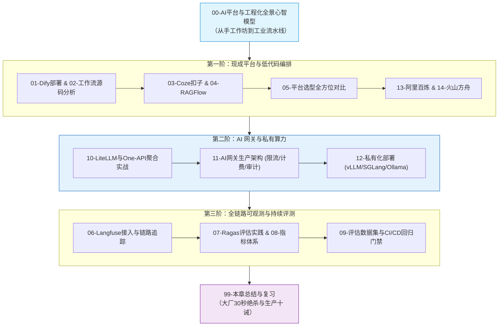

# 🛠️ 06 · 平台与工程化

> [!info] 本区说明
> 对应学习路径 **阶段六**。全面攻坚 AI 应用跨越“玩具到生产”工程鸿沟的四大基石：低代码编排平台、全链路可观测（Langfuse）、AI 生产网关（LiteLLM/自建）与私有化推理底座（vLLM/SGLang）。

---

## 🗺️ 通关全景学习路线

---

## 📚 知识笔记清单

### 00 · 全景心智
- [[00-AI平台与工程化全景心智模型]] 🌟（工程化四大基石、AI 网关守门人、全链路工业时序图谱）

### 01 · 低代码与编排平台
- [[01-Dify部署与使用]]（全栈 AI 应用平台搭建与工具链集成）
- [[02-Dify工作流引擎源码]]（DAG 调度内核、节点拓扑校验与状态流转）
- [[03-Coze扣子]]（字节跳动 Bot 与智能体生态）
- [[04-RAGFlow]]（深度文档版面分析与 RAG 专项平台）
- [[05-平台选型对比]]（Dify vs Coze vs 自建框架深度选型矩阵）

### 02 · 生产 AI 网关与私有算力
- [[10-LiteLLM与One-API]]（开箱即用的多模型聚合与渠道分发）
- [[11-AI网关生产架构-限流-计费-审计]]（TPM/RPM 双维限流、无感 Failover 与虚拟 Key）
- [[12-私有化部署-Ollama-vLLM-SGLang]]（PagedAttention、RadixAttention 榨干 GPU 算力）
- [[13-阿里百炼]]（DashScope 通义生态与企业云上托管）
- [[14-火山方舟]]（豆包大模型接入与内容安全防护）

### 03 · 可观测与持续评测门禁
- [[06-Langfuse接入]]（全链路 Trace 追踪、Prompt 版本管理与耗时归因）
- [[07-Ragas评估实践]]（忠实度、相关性自动化评测基准实战）
- [[08-LLM评估指标体系]]（业务价值、安全护栏与性能质量评估指标）
- [[09-AI应用评估数据集与回归测试]]（黄金测试集构建与 CI/CD 门禁拦截）

### 99 · 本章通关总结
- [[99-本章总结与复习]]（全章核心拓扑、大厂 30 秒必杀 10 连问、生产落地十诫）

---

## 🔗 相关链接

- 上级总览：[[../00-总览/学习仪表盘]]
- 前置章节：[[../05-Agent-MCP-Skills/_index|05 · Agent · MCP · Skills]]
- 下一章节：[[../07-辅助语言/_index|07 · 辅助语言 Python 与 TypeScript]]
