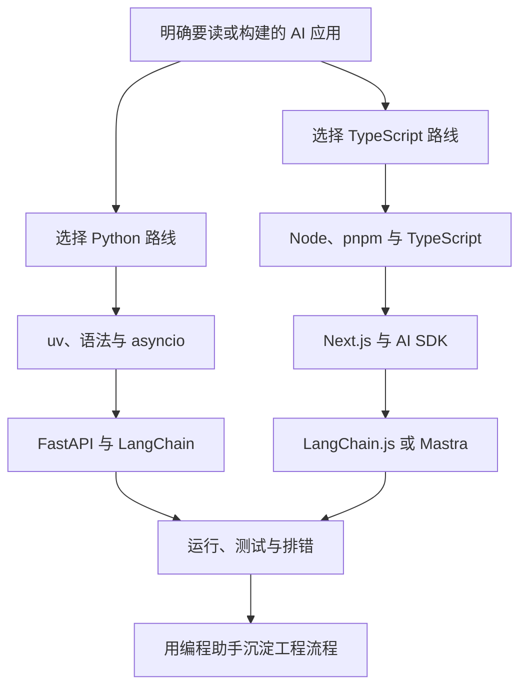

# 辅助语言：本章总结与复习

> [!abstract] 一句话总结
> 本章目标不是脱离 Java 重学一套技术栈，而是能读懂、运行和修改 Python 与 TypeScript AI 项目，并能选择合适的后端、全栈和 Agent 工具。

## 知识 / 能力概览

| 路线 | 核心知识 | 应具备的能力 |
| ---- | -------- | ------------ |
| Python 基础 | Java 语法对照、类型注解、Pydantic、`uv` | 看懂项目结构，管理虚拟环境与依赖 |
| Python AI 服务 | `asyncio`、FastAPI、LangChain Python | 封装异步模型调用，读懂 Prompt、Retriever、Tool、Chain/Graph |
| TypeScript 基础 | Java 类型对照、Node、`pnpm` | 看懂 TS 类型、异步代码和前后端同仓项目 |
| TypeScript AI 全栈 | Next.js App Router、Vercel AI SDK、`useChat` | 实现 `/api/chat`、流式输出和聊天状态管理 |
| Agent 编排 | LangChain.js、Mastra | 识别模型、工具、记忆、Agent 与 Workflow 的职责 |
| 工程协作 | Cursor、Claude Code、Codex | 用“理解需求、最小修改、测试验证、总结交付”完成闭环 |

## 学习主线

## 快速复习

- `uv` 管 Python 环境、依赖和运行命令；`pnpm` 管 Node 项目的依赖与脚本。
- `asyncio` 适合并发等待模型、检索和工具等 I/O，不适合直接承担重 CPU 计算。
- FastAPI 用路由和 Pydantic 快速暴露 AI 服务；Next.js App Router 可同时承载页面与 Route Handler。
- Vercel AI SDK 中，`generateText` 处理一次性生成，`streamText` 处理流式生成，`useChat` 管理前端聊天交互。
- LangChain Python / JS 偏通用 LLM 编排；Mastra 偏 TypeScript Agent 与 Workflow 工程化。
- Java 适合稳定企业后端，TypeScript 适合 AI 全栈与流式 UI，Python 适合快速接入 AI 生态；选型应服从项目目标。

## 自测问题

1. 如何分别用 `uv` 和 `pnpm` 从零跑起一个已有项目？
2. `async / await` 为什么能提升 I/O 密集型 AI 服务的吞吐量？
3. FastAPI 的 Pydantic 模型与 Java DTO、Validation 有什么对应关系？
4. Next.js Route Handler、`streamText` 和 `useChat` 如何组成一条流式聊天链路？
5. 什么场景选 LangChain.js，什么场景选 Mastra，什么场景保留 Java 后端？
6. 让 AI 编程助手修改仓库时，怎样证明结果已经完成而不是只生成了代码？

## 相关编号双链

Python：[[01-Python速查-Java视角]] · [[02-uv包管理与环境]] · [[03-asyncio异步基础]] · [[04-FastAPI起服务]] · [[05-LangChain-Python读代码笔记]]

TypeScript：[[06-TS速查-Java视角]] · [[07-Node-pnpm-环境配置]] · [[08-Next.js-AppRouter基础]] · [[09-Vercel-AI-SDK核心]] · [[10-Vercel-AI-SDK-useChat流式UI]] · [[11-LangChain.js简介]] · [[12-Mastra简介]] · [[13-TS与Java-AI生态对照]]

工程协作：[[14-AI编程助手-Cursor-Claude-Code-Codex实战]]

## 🔗 下一章衔接

学完辅助语言后，进入 **[[10-AI应用开发/09-标杆产品拆解/_index|09 · 标杆产品拆解]]**——用本章积累的 Python / TS 代码阅读能力，去拆解 Codex 与 Claude Code 这两个编程 Agent 产品的上下文工程、工具系统与治理架构。
