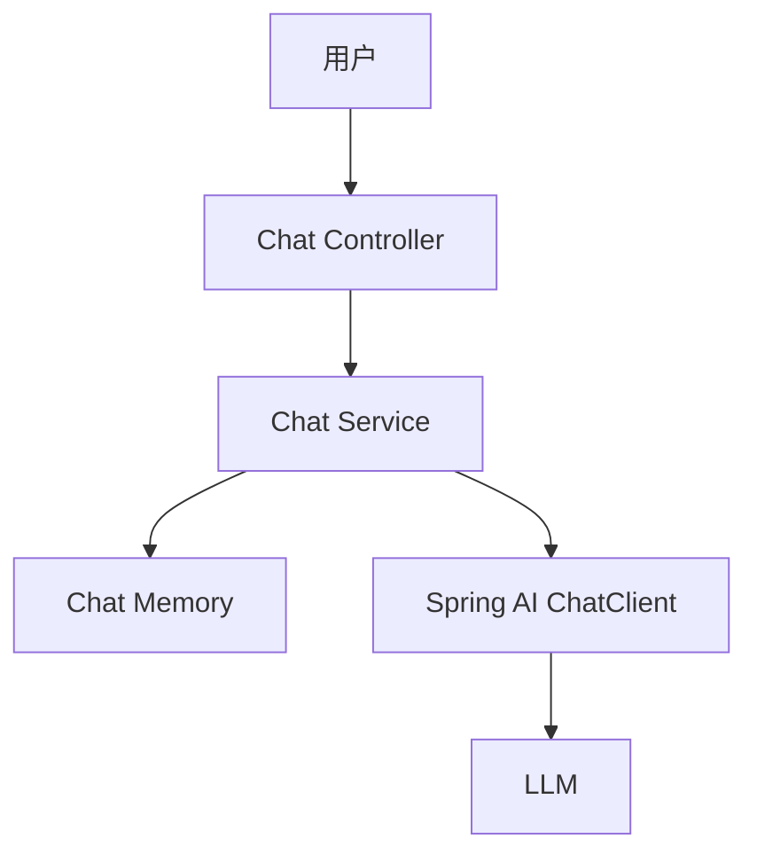

# 智能问答机器人

> [!info] 项目简介
> 用 Spring Boot 3 + Spring AI 实现基础聊天机器人，掌握 ChatClient、Prompt 参数、流式输出和简单会话记录。

## 📌 项目背景

这是 AI 应用开发的最小闭环项目，用来打通模型配置、接口封装、流式输出、会话记录和基础日志。后续的 RAG、Agent 和客服项目都可以复用这个项目的接口和工程骨架。

## 🎯 项目目标

- [ ] 提供普通问答接口和流式问答接口
- [ ] 支持系统提示词、温度、模型等参数配置
- [ ] 保存最近多轮会话，按用户隔离上下文
- [ ] 输出一组可演示的接口调用样例

## 🛠️ 技术栈

| 类别 | 选型 |
| ---- | ---- |
| 语言/框架 | Spring Boot 3 + Spring AI |
| 模型 | DeepSeek / 通义 / OpenAI 兼容接口 |
| 存储 | 内存会话 / Redis |
| 可观测 | 日志 + Langfuse（可选） |

## 🏗️ 架构设计

## 📋 实现步骤

- [ ] 初始化 Spring Boot 项目与模型配置
- [ ] 实现 `/chat` 普通问答接口
- [ ] 实现 `/chat/stream` 流式输出接口
- [ ] 增加系统提示词和参数配置
- [ ] 增加多用户会话隔离
- [ ] 编写接口调用示例和演示脚本

## 🧠 难点与关键技术点

- [[02-ChatClient与ChatModel]]
- [[07-Prompt工程基础]]
- [[13-上下文工程概述]]
- [[04-项目-智能客服多轮对话系统]]
- 流式输出要处理断连、异常和结束状态。
- 会话记录要按用户隔离，避免为了演示简单而忽略串话风险。
- 参数配置需要可复现，演示时能说明模型、温度和系统提示词。

## ✅ 验收标准

- `/chat` 和 `/chat/stream` 都能用 curl 或 HTTP Client 跑通。
- 同一用户连续 3 轮追问能复用上下文，不同用户之间不会串话。
- README 写清模型配置、环境变量、启动命令和 5 条演示问题。
- 日志能看到请求 ID、用户 ID、模型名、耗时和流式结束状态。

## 🎯 面试讲法

可以讲成“从 0 到 1 搭了一个 LLM 应用底座”：接口层负责普通/流式调用，服务层封装 ChatClient，会话层做用户隔离，日志层记录请求链路。强调这个项目为后续 RAG 和 Agent 提供了可复用基础。

## 🔗 关联笔记

- [[../02-框架-SpringAI与LangChain4j/_index]]
- [[../04-多轮对话与上下文工程/_index]]

## 📚 参考资料

- [Spring AI Chat Client API](https://docs.spring.io/spring-ai/reference/api/chatclient.html)
- [Server-Sent Events - MDN](https://developer.mozilla.org/en-US/docs/Web/API/Server-sent_events)
- [OpenAI Text Generation Guide](https://platform.openai.com/docs/guides/text-generation)
